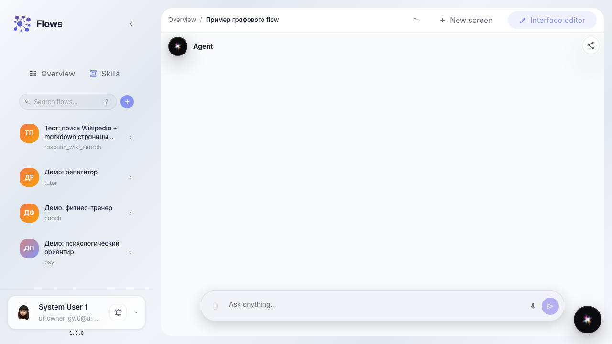
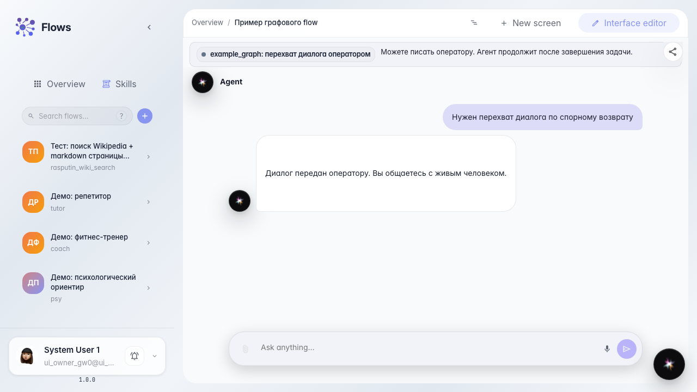
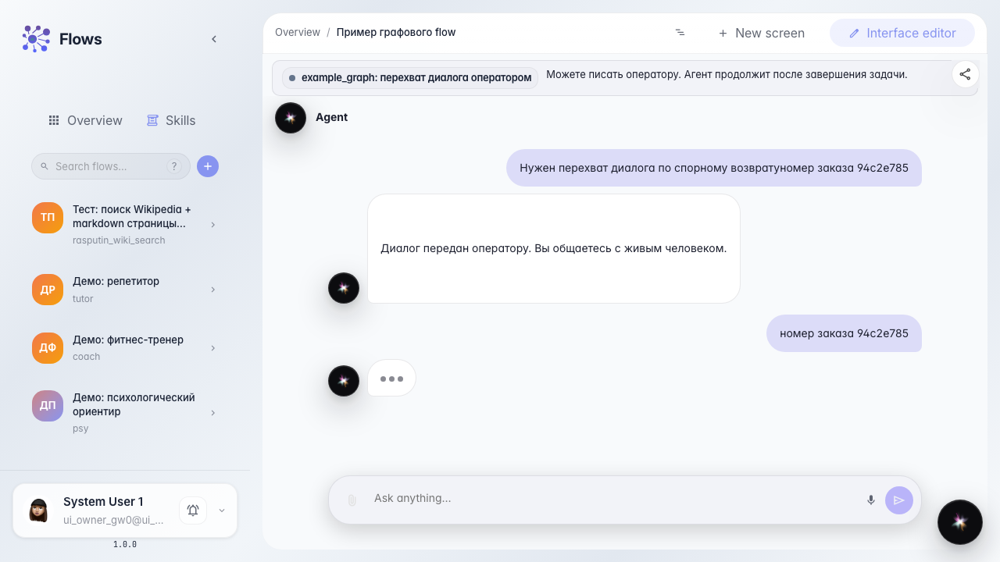

# Покупатель пишет, пока оператор ведёт диалог

**Для чего:** эта инструкция покажет, что в режиме перехвата диалога покупатель может продолжать писать в чат агента, не дожидаясь закрытия задачи.

**Какие проблемы решает:** спорный возврат требует уточнений с обеих сторон — если поле ввода у покупателя блокируется, оператор не получает номер заказа и фото вовремя.

**Результат:** после передачи оператору покупатель отправляет сообщение, оно появляется в ленте, задача остаётся открытой.

## Шаг 1. Откройте чат агента

В Flows откройте чат демо-агента. Это тот же экран, с которого покупатель пишет в магазин.

## Шаг 2. Доведите диалог до перехвата

Напишите про спорный возврат с перехватом. Появится плашка ожидания оператора, но поле ввода останется доступным — это режим перехвата, а не одного ответа.

## Шаг 3. Напишите уточнение, пока задача открыта

Введите номер заказа и отправьте. Сообщение сразу видно в ленте чата.

## Шаг 4. Проверьте, что задача не закрылась

**Демонстрация результата.** Плашка ожидания на месте, задача оператора ещё открыта: покупатель дополнил диалог, не завершив передачу.

**Итог.** В режиме перехвата вы умеете писать из чата покупателя, пока оператор разбирает обращение.

