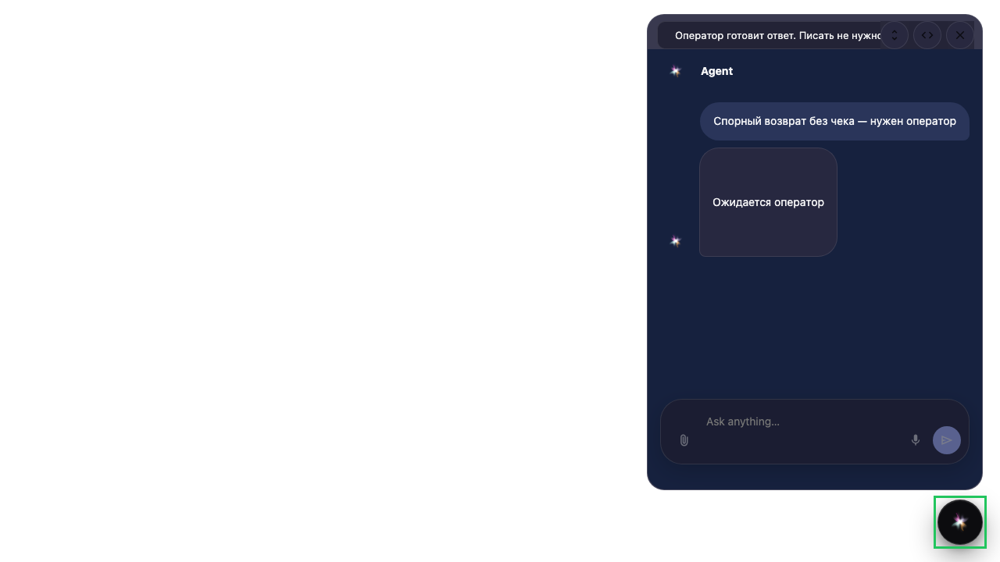

# Operator wait in the on-site widget

**What for:** this guide shows how a customer on the store site sees operator wait in the same widget as regular agent chat.

**Problems it solves:** a disputed return from an external site must not look like a broken chat — they need a clear banner and a locked input in single-reply mode.

**Result:** the embed widget shows the waiting banner and a read-only composer.

## Step 1. Open the chat widget on the site

On the store page click the widget button. The same agent chat as in Flows opens, embedded on the site.

## Step 2. Describe the disputed return

Write that you need an operator for a return without a receipt. The agent routes the case to the support queue.

## Step 3. Wait for the waiting banner

The widget shows a banner that an operator has the request. This is the same signal as in the Flows chat.

## Step 4. Confirm the input is read-only

**Result demonstration.** In single-reply the customer cannot send another message from the widget — the dialog waits for the operator.

**Summary.** On the store site HITL looks the same as in the product: a waiting banner and a locked composer.

