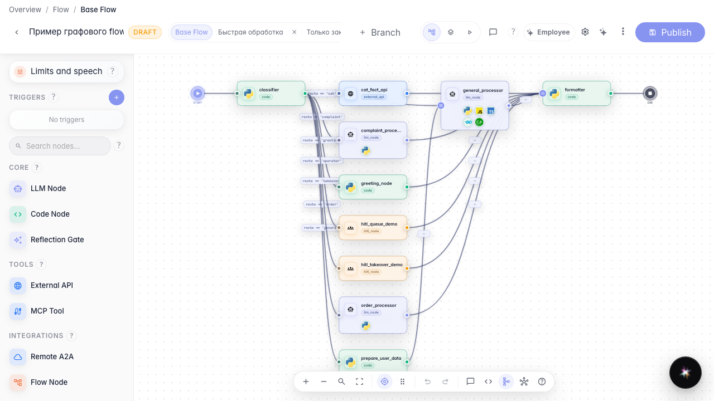
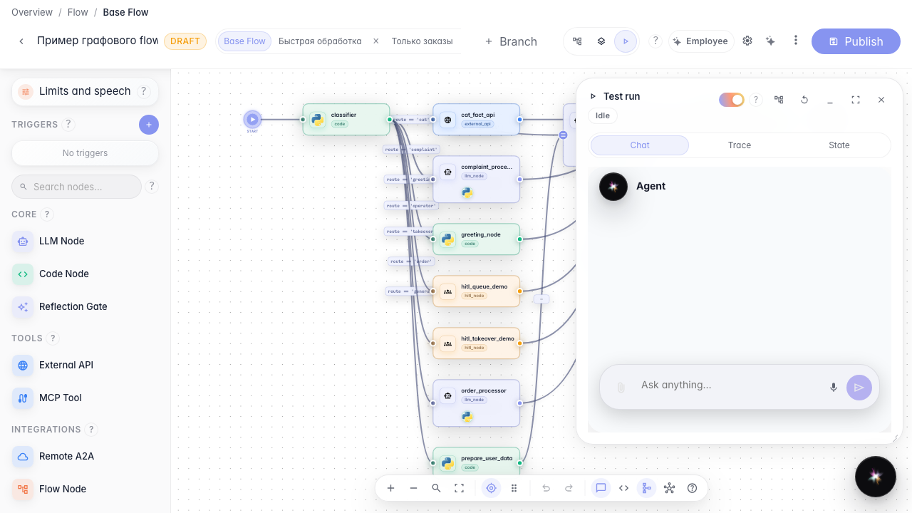
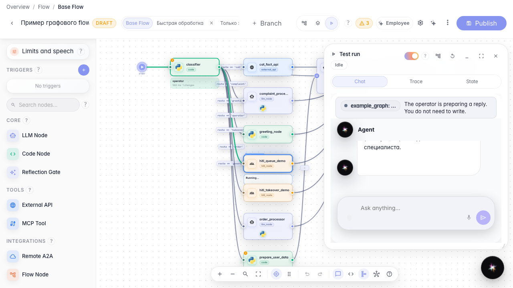
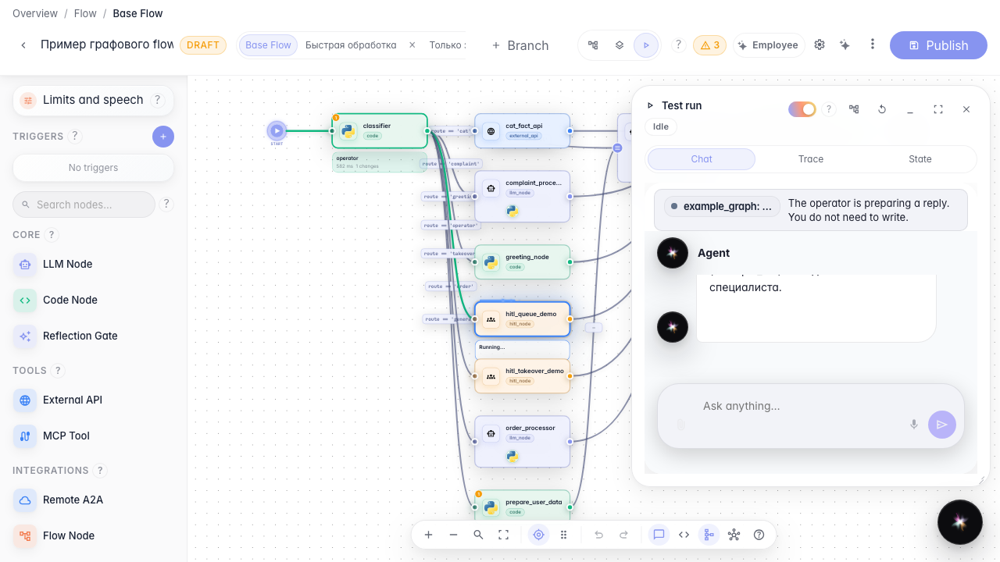

# Operator wait in Test Run

**What for:** this guide shows how to verify operator handoff inside the agent editor without opening the public chat.

**Problems it solves:** it is easy to debug HITL on the canvas and miss that the customer is already waiting — Test Run must show the same banner and locked input.

**Result:** the run panel shows the waiting banner and a read-only composer.

## Step 1. Open the agent editor

From the agent list open the Green Garden demo agent. The canvas shows the graph with operator handoff.

## Step 2. Switch to Test Run

In the editor header choose Run. The right-hand panel opens with the same chat the customer sees.

## Step 3. Send the disputed return from the panel

In the run panel write about a return without a receipt. The agent pauses the dialog until an operator replies.

## Step 4. Check the banner and locked input

**Result demonstration.** Inside the run panel you see the same waiting banner and read-only field as the customer chat.

**Summary.** You can verify HITL in Test Run without opening a separate chat tab.

