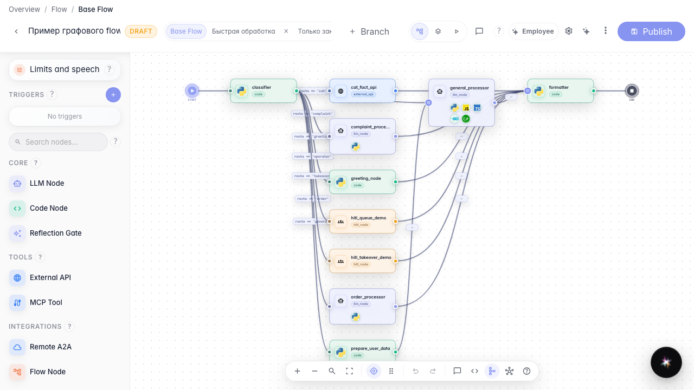
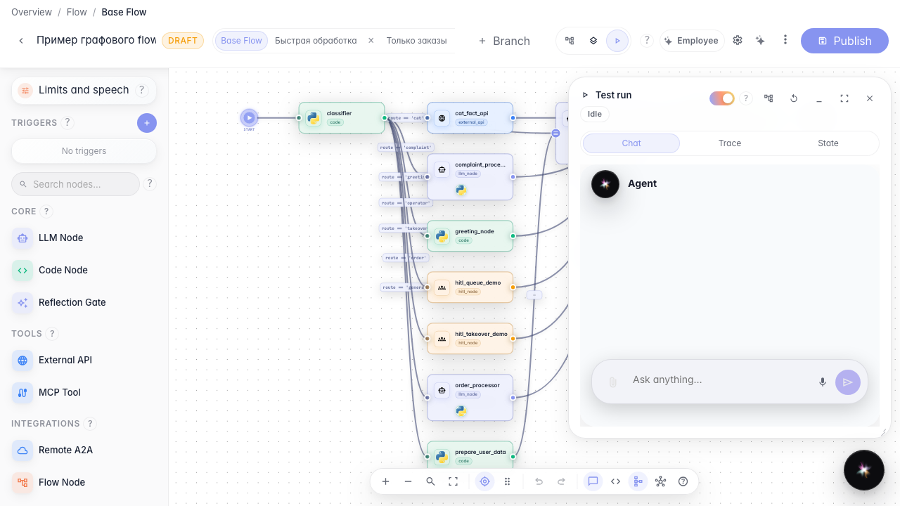
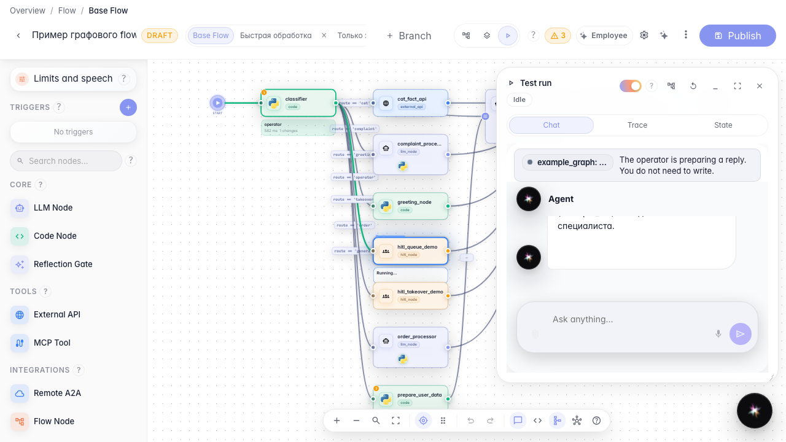
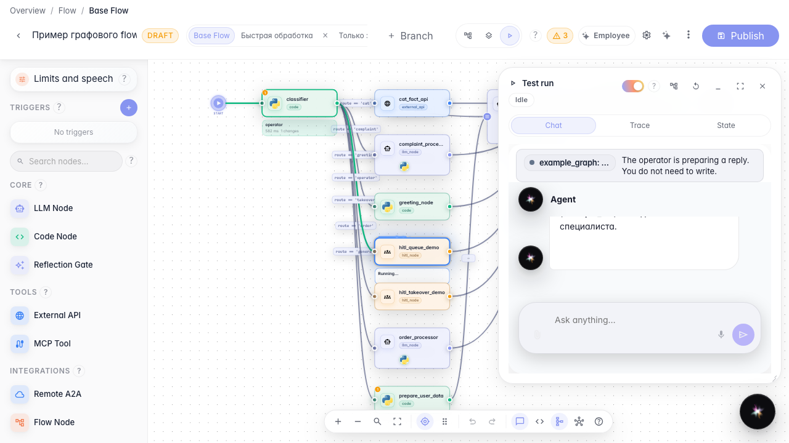

# Ожидание оператора в тестовом запуске

**Для чего:** эта инструкция покажет, как проверить передачу оператору прямо в редакторе агента, не выходя на публичный чат.

**Какие проблемы решает:** легко отладить HITL на канве и не понять, что покупатель уже ждёт — Test Run должен показать ту же плашку и тот же заблокированный ввод.

**Результат:** в панели запуска видна плашка ожидания, поле ввода только для чтения.

## Шаг 1. Откройте редактор агента

В списке агентов откройте демо-агента «Зелёный сад». На канве виден граф с передачей оператору.

## Шаг 2. Переключитесь в тестовый запуск

В шапке редактора выберите режим запуска. Справа открывается панель с тем же чатом, что у покупателя.

## Шаг 3. Отправьте спорный возврат из панели

В панели запуска напишите про возврат без чека. Агент ставит диалог на паузу до ответа оператора.

## Шаг 4. Проверьте плашку и заблокированный ввод

**Демонстрация результата.** Внутри панели запуска — та же плашка ожидания и поле только для чтения, что у покупателя в чате.

**Итог.** HITL можно проверить в Test Run, не открывая отдельную вкладку чата.

