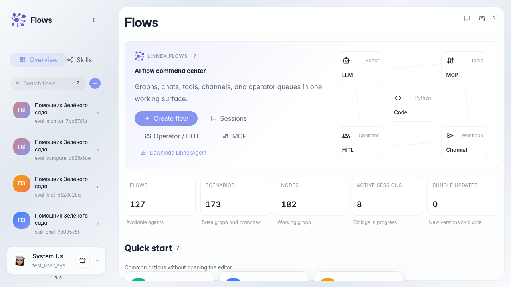
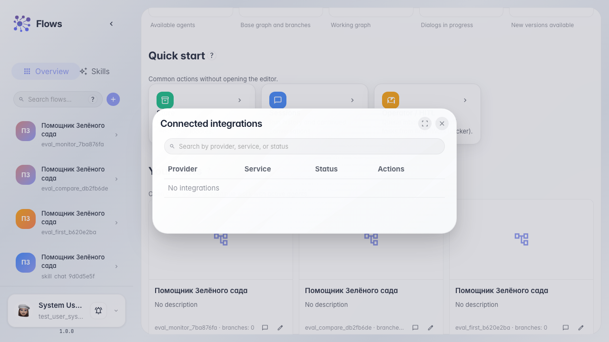

# Connect external accounts

**What for:** this guide shows where to review company OAuth integrations.

**Problems it solves:** it is unclear whether an external service is connected and where to manage credentials.

**Result:** the integrations list with search and connection table is open.

## Step 1. Find the integrations block on home

On the Flows home page, the connections section has an Integrations card. It leads to company OAuth credentials.

## Step 2. Open the integrations list

A modal opens with search and a table: provider, service, status, and actions. You can see which accounts are already connected.

## Step 3. Review the connections table columns

Confirm the table has provider, service, and status columns. They show which external account is connected and its state.

## Step 4. Review the connected accounts list

**Result demonstration.** Search, table columns, and rows or a clear empty state are visible — the UI is ready for connecting external accounts.

**Summary.** You now know where to open company integrations and how to check connected service status.

