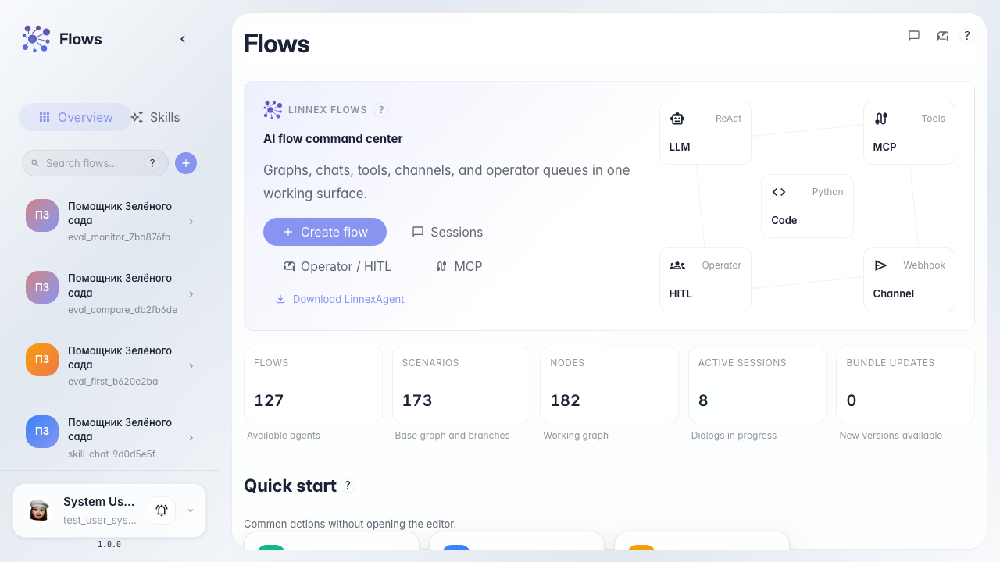
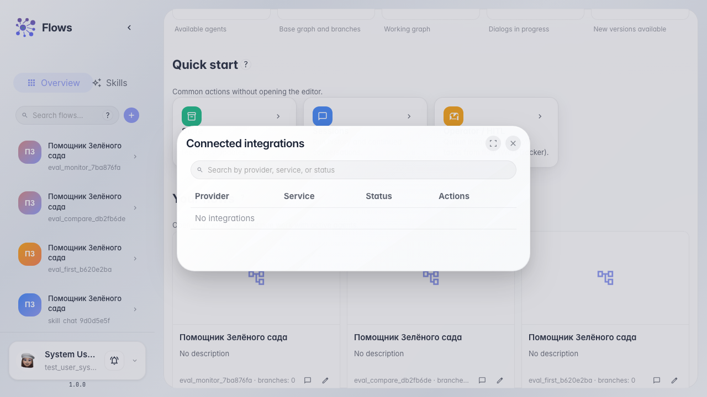

# Подключаем внешние аккаунты

**Для чего:** эта инструкция покажет, где смотреть OAuth-интеграции компании.

**Какие проблемы решает:** непонятно, подключён ли внешний сервис и где управлять списком учётных данных.

**Результат:** открыт список интеграций с поиском и таблицей подключений.

## Шаг 1. Найдите блок интеграций на главной

На главной Flows в разделе подключений есть карточка «Интеграции». Она ведёт к OAuth-учётным данным компании.

## Шаг 2. Откройте список интеграций

Откроется модальное окно со строкой поиска и таблицей: провайдер, сервис, статус и действия. Здесь видно, какие аккаунты уже подключены.

## Шаг 3. Проверьте колонки таблицы подключений

Убедитесь, что в таблице есть колонки провайдера, сервиса и статуса. По ним видно, какой внешний аккаунт подключён и в каком он состоянии.

## Шаг 4. Проверьте список подключённых аккаунтов

**Демонстрация результата.** Видны поиск, колонки таблицы и список записей или понятное пустое состояние — интерфейс готов для подключения внешних аккаунтов.

**Итог.** Теперь вы знаете, где открыть интеграции компании и как проверить статус подключённых сервисов.

