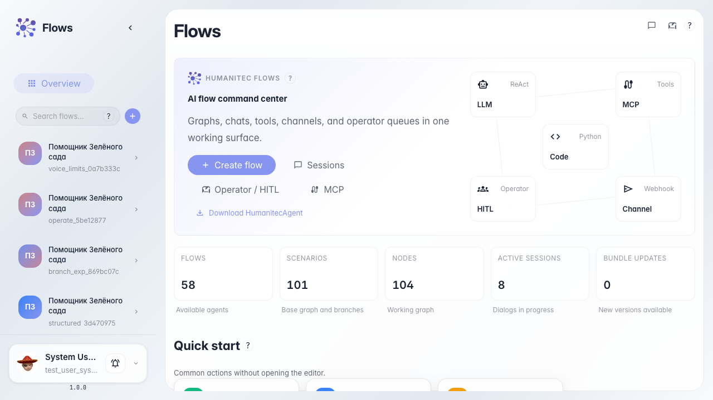
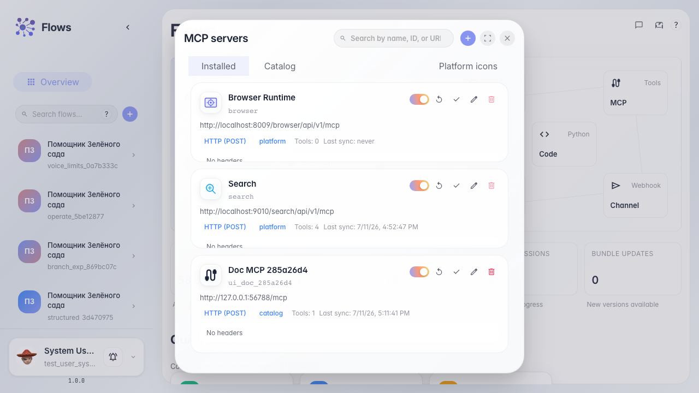
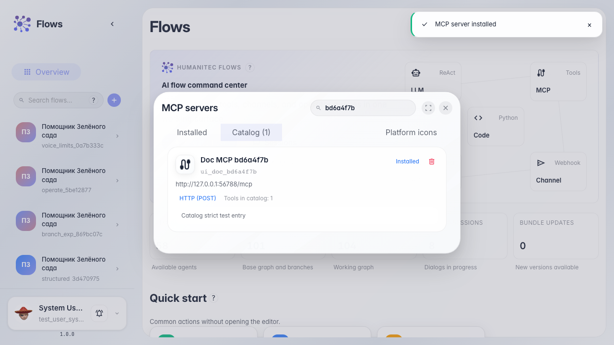
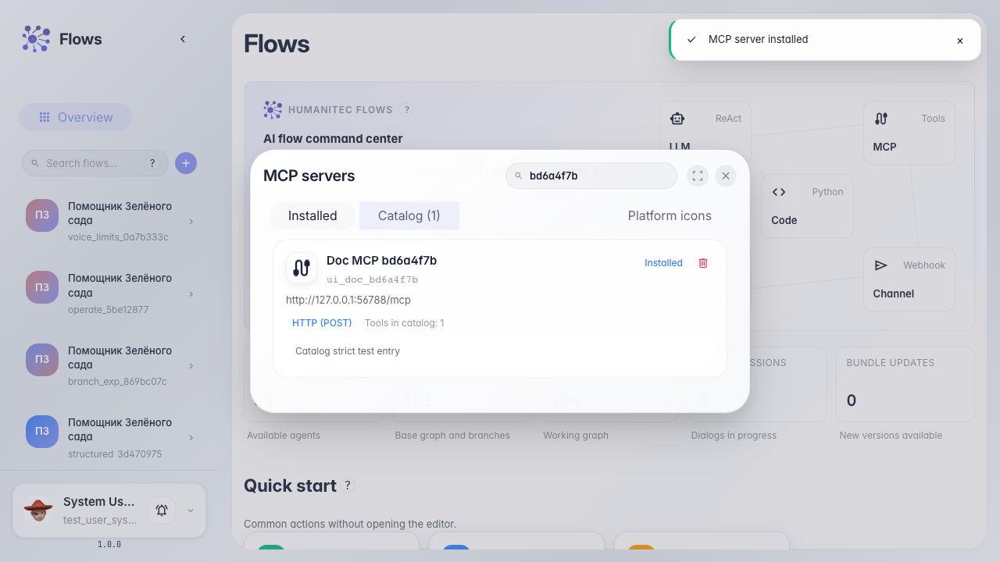

# Manage company MCP servers

**What for:** this guide helps you add an MCP server to the company and verify its tools.

**Problems it solves:** it is unclear where shared MCP servers live and how to install one from the catalog.

**Result:** the MCP server is installed, synced, and ready for agents.

## Step 1. Open the Flows home page

On the Flows home page, the company connections block includes MCP to manage servers and the tools catalog.

## Step 2. Open MCP server management

The modal shows connected company servers and a catalog tab. Here you add HTTP/SSE servers and install ready-made entries.

## Step 3. Install a server from the catalog

Find the server in the catalog and click Install. After sync, tools appear in the connected servers list.

## Step 4. Verify the connected server

**Result demonstration.** The server appears among connected entries — MCP tools are available to company agents.

**Summary.** You can now open MCP management, install a server from the catalog, and prepare it for use.

