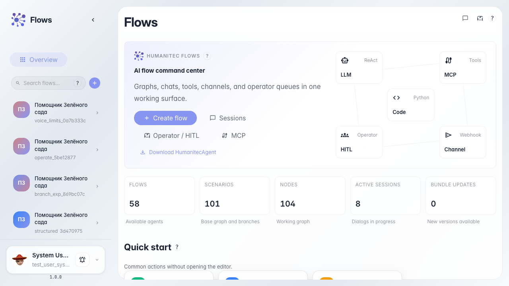
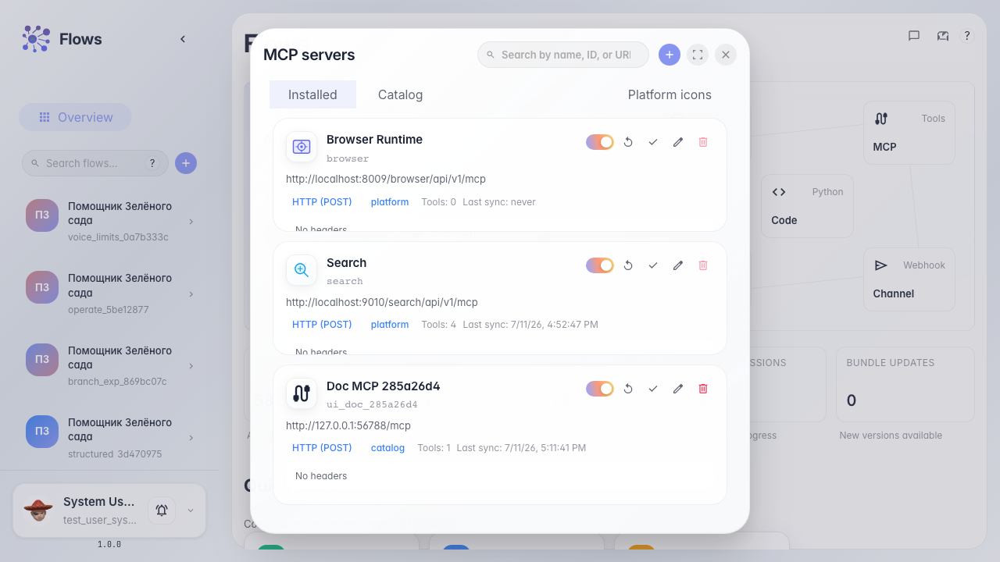
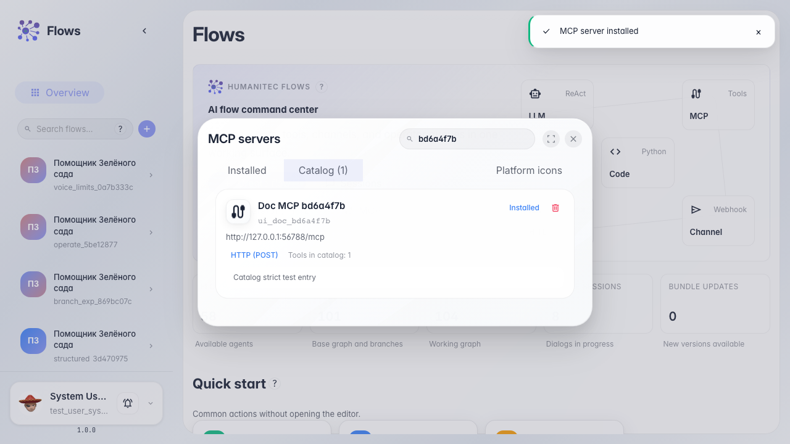
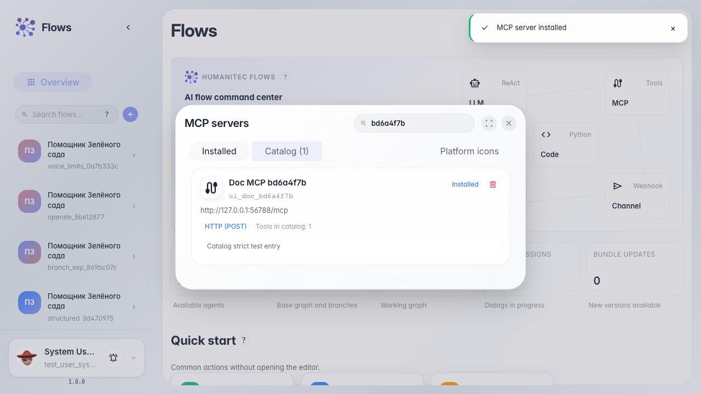

# Управляем MCP-серверами компании

**Для чего:** эта инструкция поможет добавить MCP-сервер в компанию и проверить его инструменты.

**Какие проблемы решает:** непонятно, где хранятся общие MCP-серверы и как установить сервер из каталога.

**Результат:** MCP-сервер установлен, синхронизирован и готов к использованию агентами.

## Шаг 1. Откройте главную Flows

На главной Flows есть блок подключений компании. Кнопка MCP открывает управление серверами и каталогом инструментов.

## Шаг 2. Откройте управление MCP-серверами

В модалке видны подключённые серверы компании и вкладка каталога. Здесь добавляют HTTP/SSE серверы и устанавливают готовые записи.

## Шаг 3. Установите сервер из каталога

Найдите сервер в каталоге и нажмите «Установить». После синхронизации инструменты появятся в списке подключённых серверов.

## Шаг 4. Проверьте подключённый сервер

**Демонстрация результата.** Сервер виден среди подключённых — значит, инструменты MCP доступны агентам компании.

**Итог.** Теперь вы умеете открыть управление MCP, установить сервер из каталога и подготовить его к работе.

