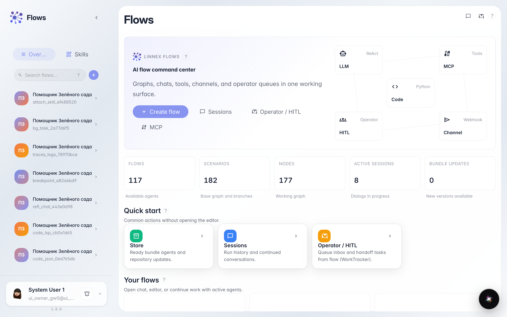
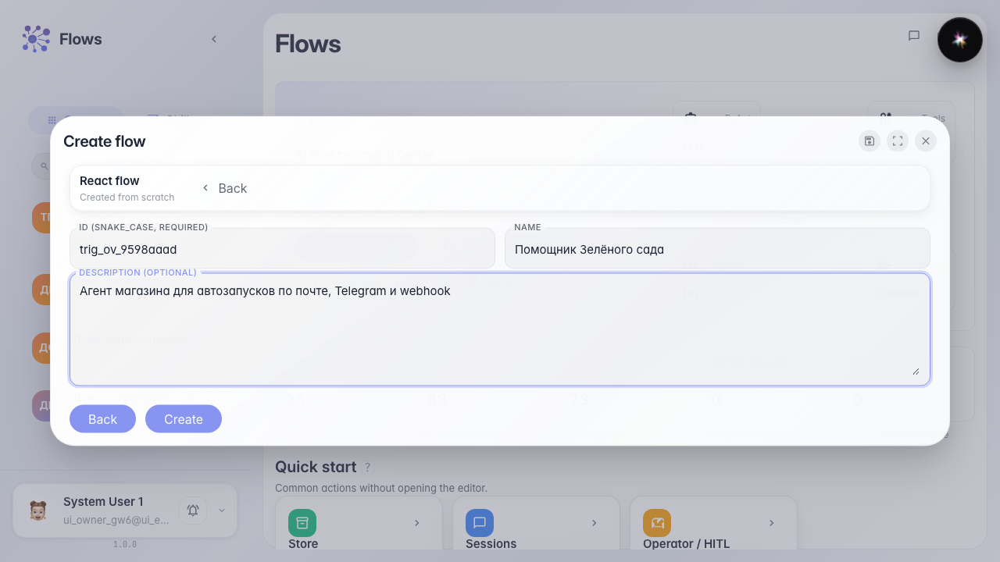
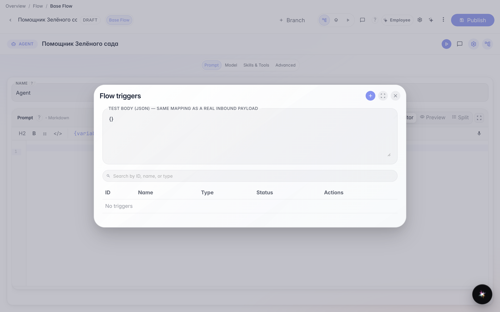
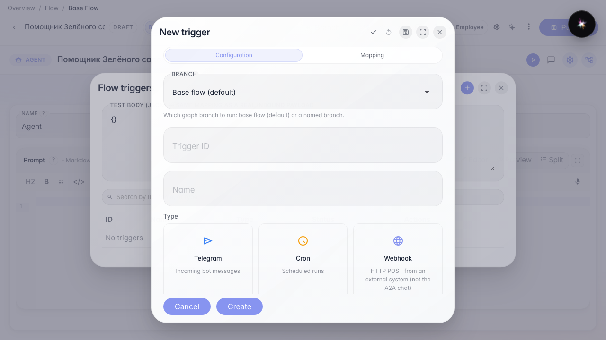
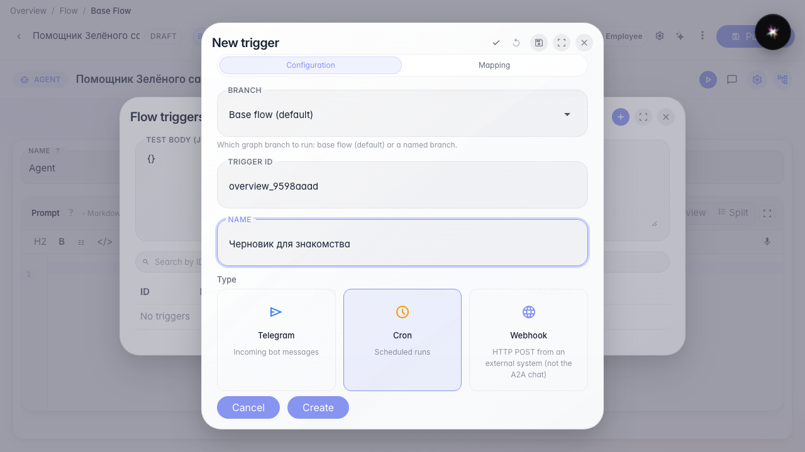

# What triggers are and how to start configuring them

**What for:** this guide shows where an agent keeps automatic runs and which five trigger types exist.

**Problems it solves:** beginners do not know how a webhook differs from a schedule or where to start — first you need the agent and the triggers list.

**Result:** the Green Garden Assistant is created, the triggers list is open, and the create form shows the shared fields.

## Step 1. Open the agent catalog

On the Flows home the catalog is on the left. Triggers belong to a specific agent, so create or open the store assistant first.

## Step 2. Create an agent from a template

Pick the plain agent template, set an identifier and the name Green Garden Assistant. The editor opens with a ready answer node.

## Step 3. Open the triggers list

In the editor menu choose Triggers. A platform event connects the agent to actions in other services without a separate webhook.

## Step 4. Look at the five trigger types

Click +. Type cards: Cron — on a schedule; Telegram — bot messages; Webhook — HTTP from an external system; Email — inbound mailbox mail; Platform event — actions in CRM, tasks, and other services.

## Step 5. Learn the shared fields on any trigger form

**Result demonstration.** Every trigger has an identifier (Latin for the system), a name (for people in the list), an Enabled switch, and a scenario branch picker. Next open the guide for the type you need and fill its fields.

**Summary.** You can create an agent, open triggers, and pick an automatic-run type.

