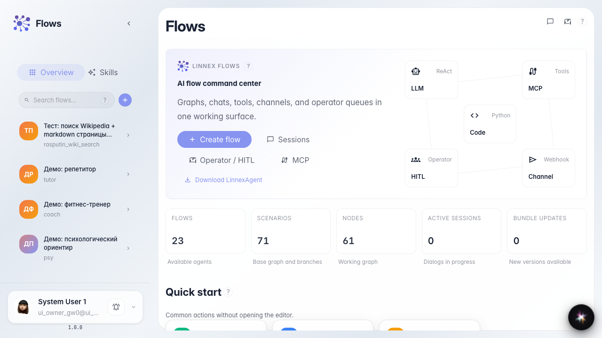
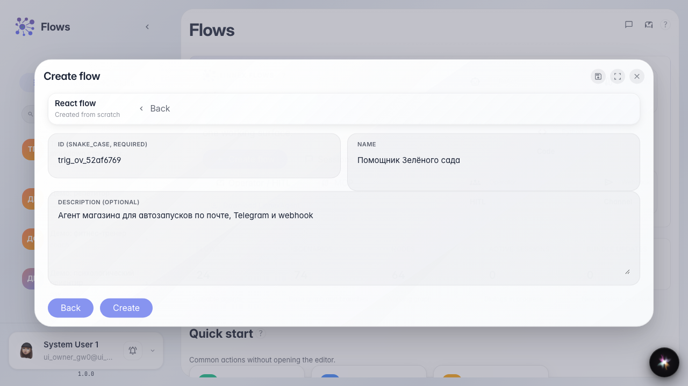
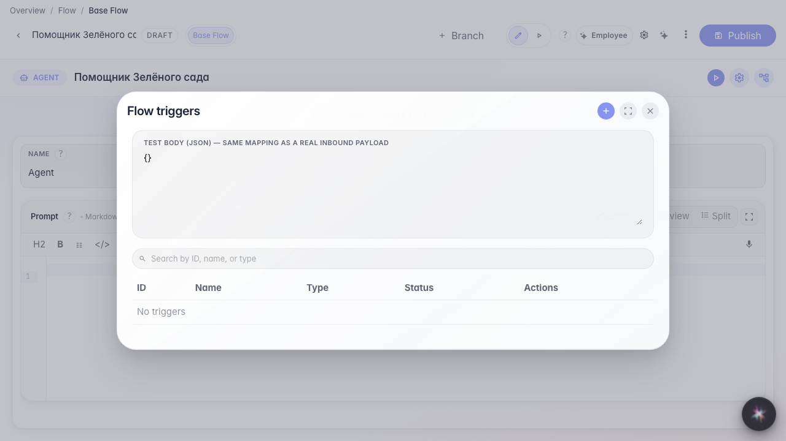
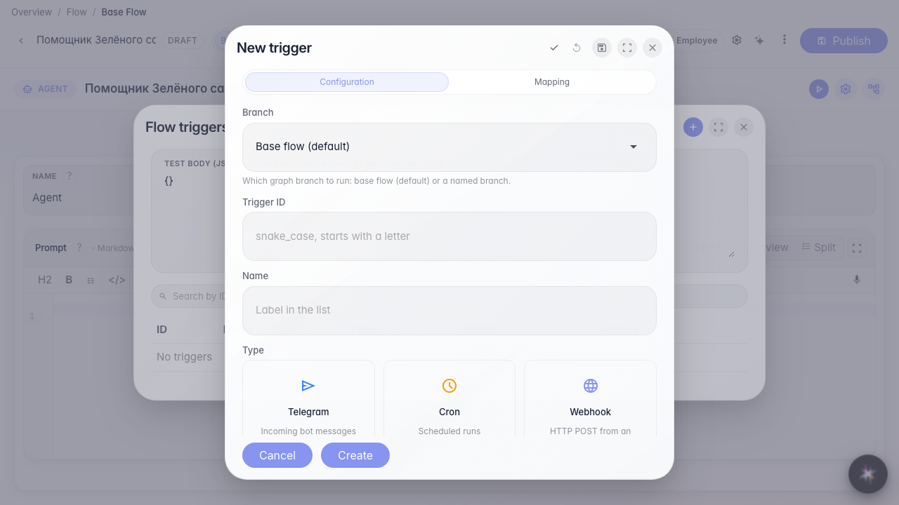
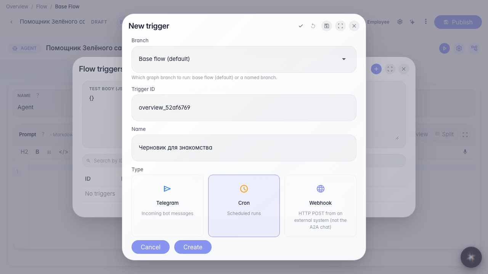

# Что такое триггеры и как начать их настраивать

**Для чего:** эта инструкция покажет, где у агента живут автозапуски и какие пять типов триггеров доступны.

**Какие проблемы решает:** новичок не знает, чем webhook отличается от расписания и с чего начать — сначала нужен сам агент и список триггеров.

**Результат:** «Помощник Зелёного сада» создан, открыт список триггеров и форма создания с общими полями.

## Шаг 1. Откройте каталог агентов

На главной Flows слева — каталог. Триггеры настраивают у конкретного агента, поэтому сначала создайте или откройте помощника магазина.

## Шаг 2. Создайте агента из шаблона

Выберите шаблон обычного агента, укажите идентификатор и название «Помощник Зелёного сада». После создания откроется редактор с готовой нодой ответа.

## Шаг 3. Откройте список триггеров

В меню редактора выберите «Триггеры». Здесь появятся все автозапуски: расписание, Telegram, webhook, почта и события платформы. Пока список пустой — это нормально для нового агента.

## Шаг 4. Посмотрите пять типов триггера

Нажмите «+». Карточки типов: Cron — по времени; Telegram — сообщения бота; Webhook — HTTP от внешней системы; Почта — входящие письма ящика; Событие платформы — действия в CRM, задачах и других сервисах.

## Шаг 5. Изучите общие поля любой формы триггера

**Демонстрация результата.** У каждого триггера есть идентификатор (латиница для системы), название (для людей в списке), переключатель «Включён» и выбор ветки сценария. Дальше откройте отдельную инструкцию по нужному типу и заполните его поля.

**Итог.** Вы умеете создать агента, открыть триггеры и выбрать тип автозапуска.

