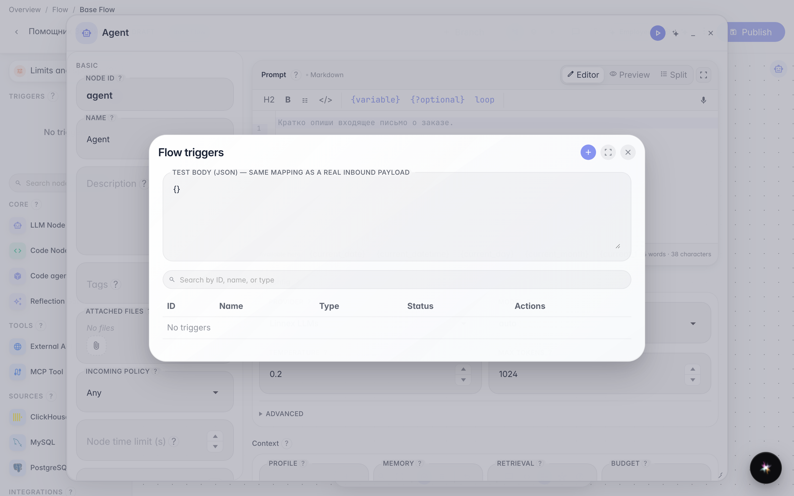
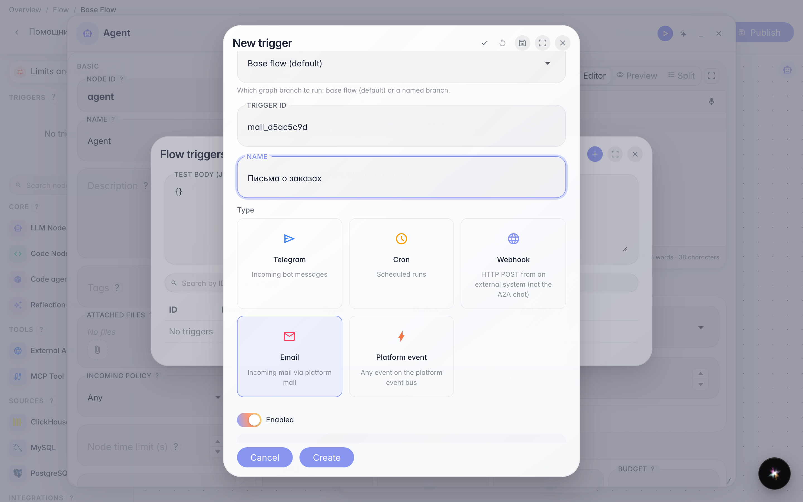
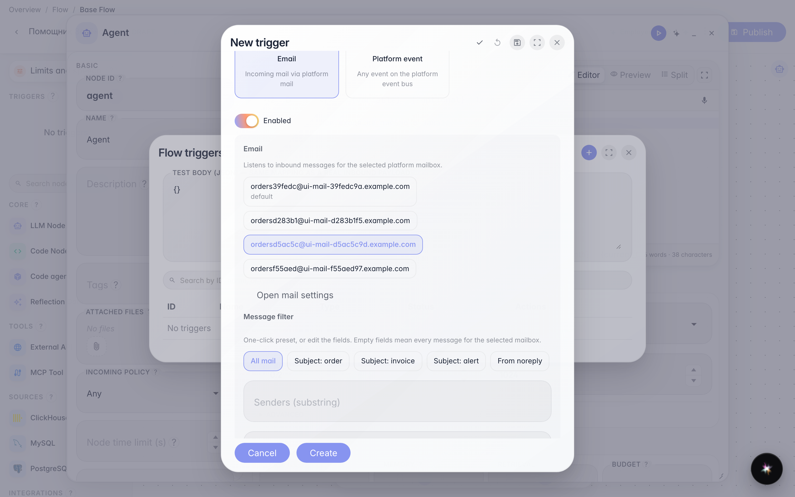
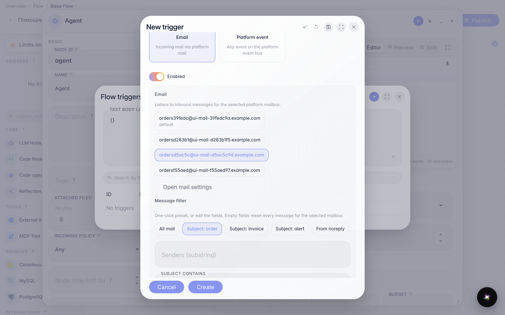
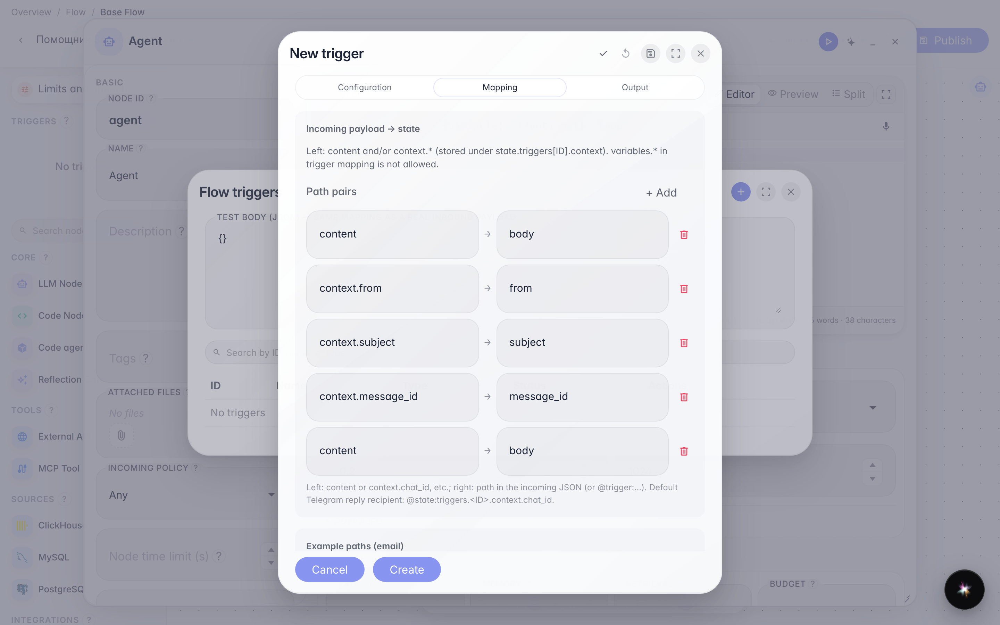
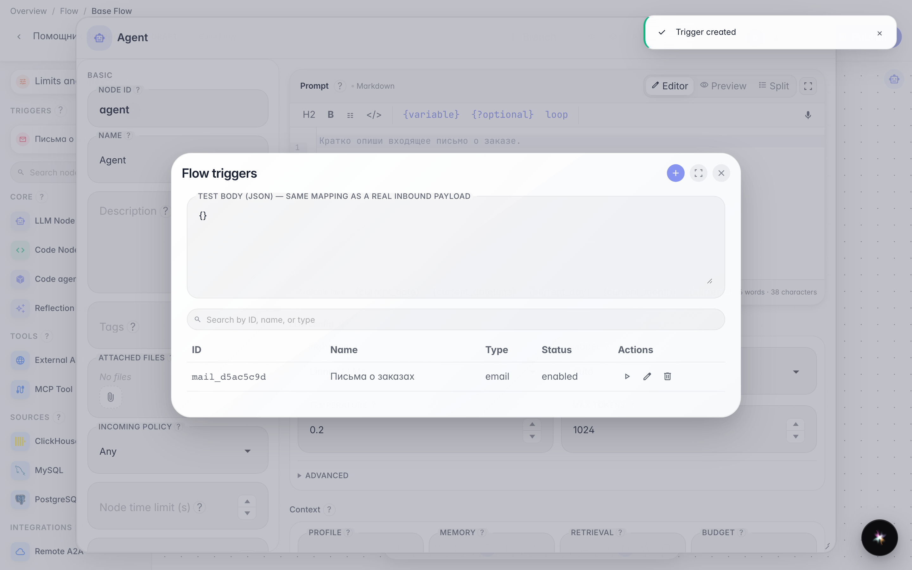

# Run the agent from inbound email

**What for:** messages to a platform mailbox can start the agent by subject or sender.

**Problems it solves:** orders and invoices arrive by mail — you do not want to read the inbox by hand and start the assistant separately.

**Result:** an email trigger on a chosen mailbox with a subject filter preset is saved.

## Step 1. Open the agent triggers

In the editor menu choose Triggers. An email automatic run listens to a mailbox already connected in platform mail.

## Step 2. Choose Email and set the name

The Email card subscribes the agent to inbound mail. Set an id and the name Order emails. If no mailboxes exist yet, the form offers mail settings — here a mailbox is already prepared.

## Step 3. Pick the mailbox with one click

Click the chip with the mailbox address you need. An active chip means the trigger listens to that mailbox. The default badge marks the primary mailbox.

## Step 4. Choose a subject filter preset

Presets fill the filter in one click: All mail, subject with order/invoice/alert, or noreply only. Senders and Subject contains can still be edited — empty fields mean every message for the selected mailbox.

## Step 5. Configure Mapping from the mail sample

On Mapping you see from, subject, and body. Click an example — subject or body becomes the agent input. After saving you can verify mapping with sample → Test.

## Step 6. Save the email trigger and check the list

**Result demonstration.** Order emails is in the list — the agent will fire on matching mail for the selected mailbox and subject.

**Summary.** You can pick a mailbox, a filter preset, and mapping for an email trigger.

