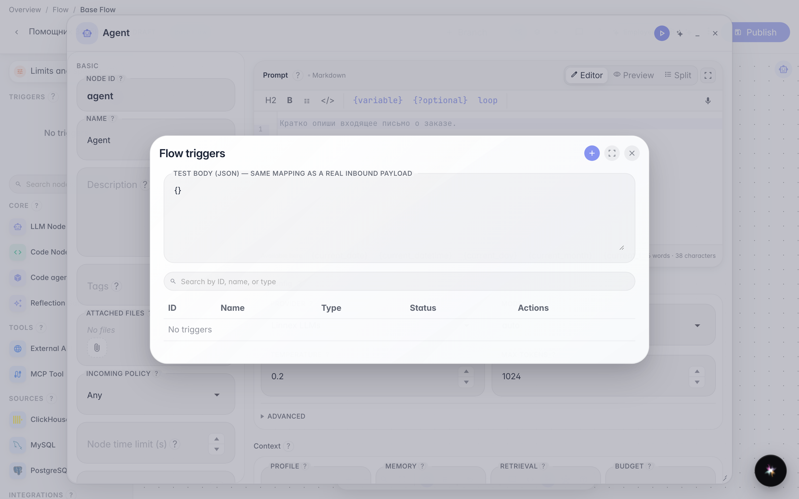
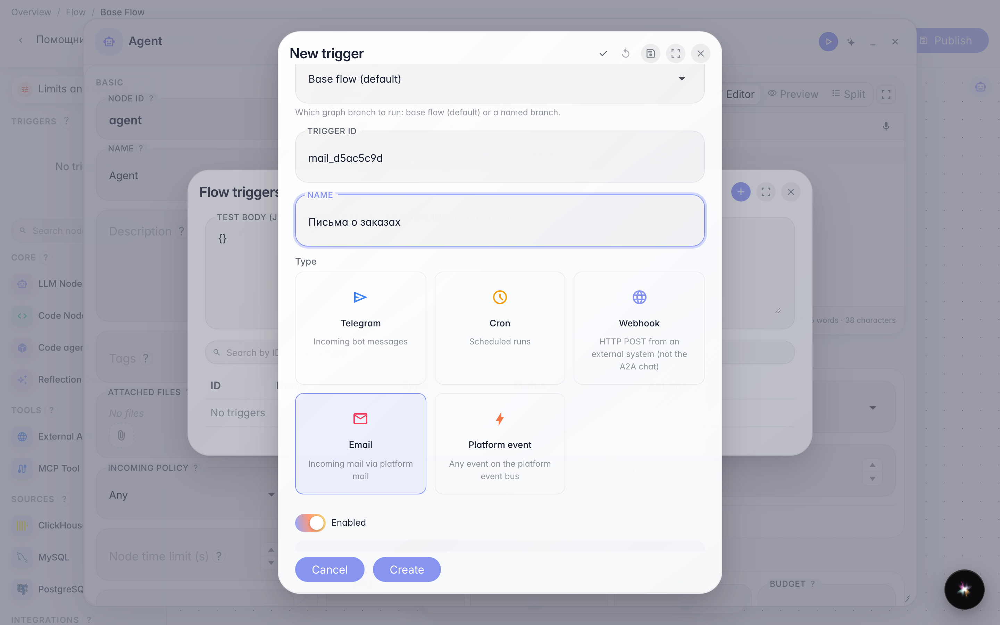
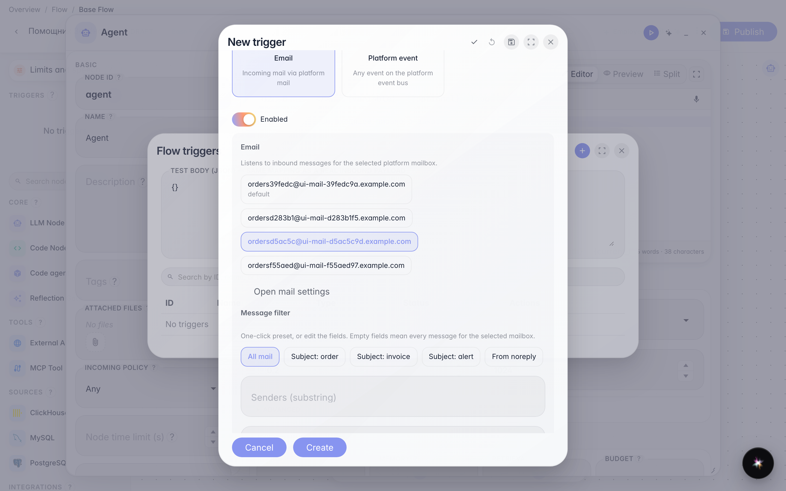
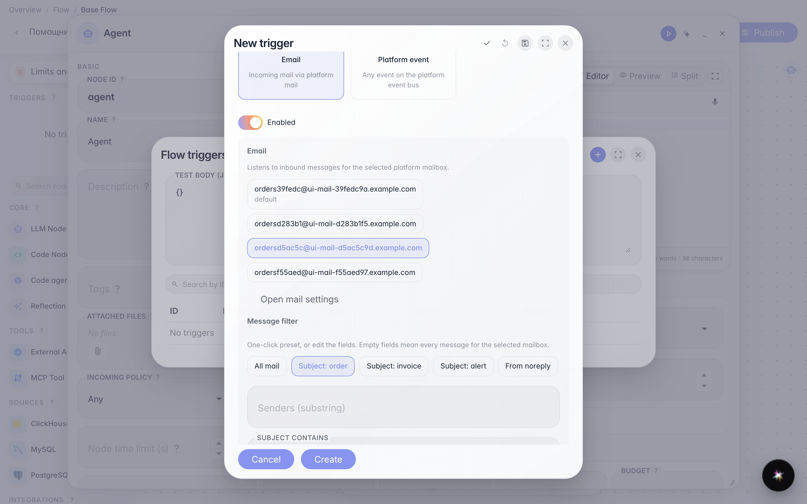
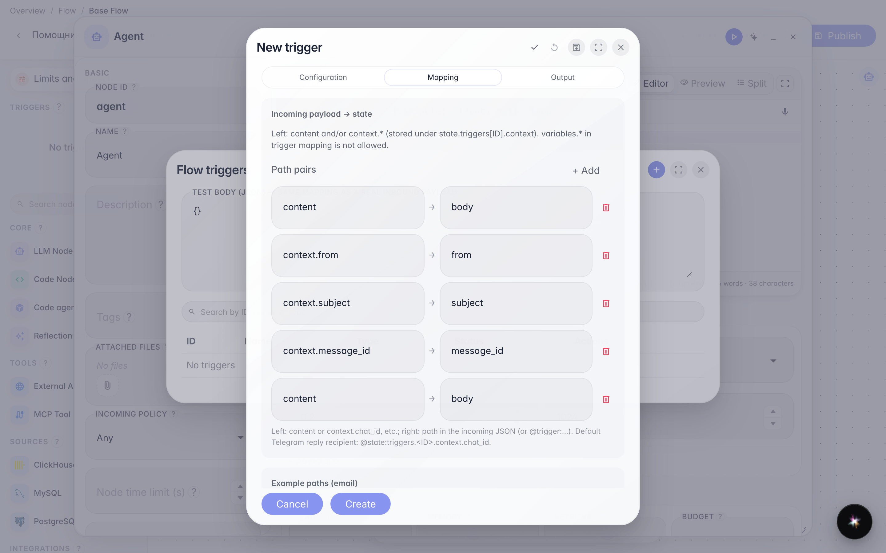
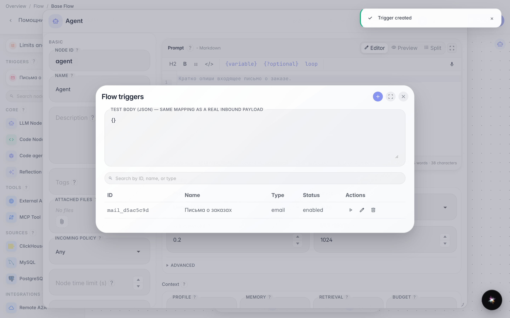

# Запускаем агента по входящим письмам

**Для чего:** письма на ящик платформы смогут запускать агента по теме или отправителю.

**Какие проблемы решает:** заказы и счета приходят почтой — не хочется перечитывать ящик вручную и запускать помощника отдельно.

**Результат:** почтовый триггер на выбранном ящике с пресетом фильтра по теме сохранён.

## Шаг 1. Откройте триггеры агента

В меню редактора выберите «Триггеры». Почтовый автозапуск слушает ящик, уже подключённый в почте платформы.

## Шаг 2. Выберите тип «Почта» и задайте название

Карточка «Почта» подписывает агента на входящие письма. Укажите id и название «Письма о заказах». Если ящиков ещё нет, форма предложит открыть настройки почты — здесь ящик уже подготовлен.

## Шаг 3. Выберите ящик одним кликом

Нажмите чип с адресом нужного ящика. Активный чип означает, что триггер слушает именно его. Бейдж «основной» помечает ящик по умолчанию.

## Шаг 4. Выберите пресет фильтра по теме

Пресеты одним кликом заполняют фильтр: «Все письма», тема с «заказ»/«счёт»/alert или только noreply. Поля «Отправители» и «Тема содержит» можно править вручную — пустые поля означают все письма выбранного ящика.

## Шаг 5. Настройте Mapping по sample письма

На вкладке Mapping видны from, subject, body. Нажмите пример — тема или текст письма станет входом агента. После сохранения можно проверить mapping кнопкой sample → Test.

## Шаг 6. Сохраните почтовый триггер и проверьте список

**Демонстрация результата.** «Письма о заказах» есть в списке — агент сработает на письма выбранного ящика с нужной темой.

**Итог.** Вы умеете выбрать ящик, пресет фильтра и mapping для почтового триггера.

