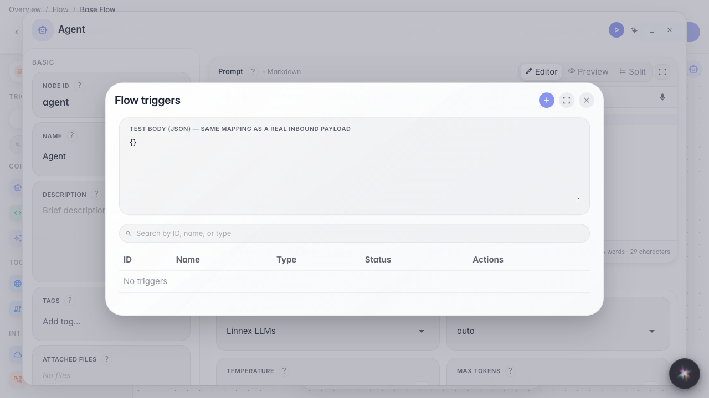
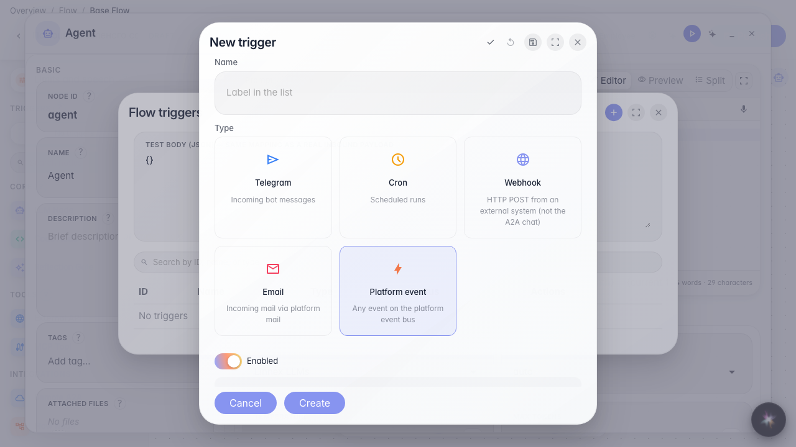
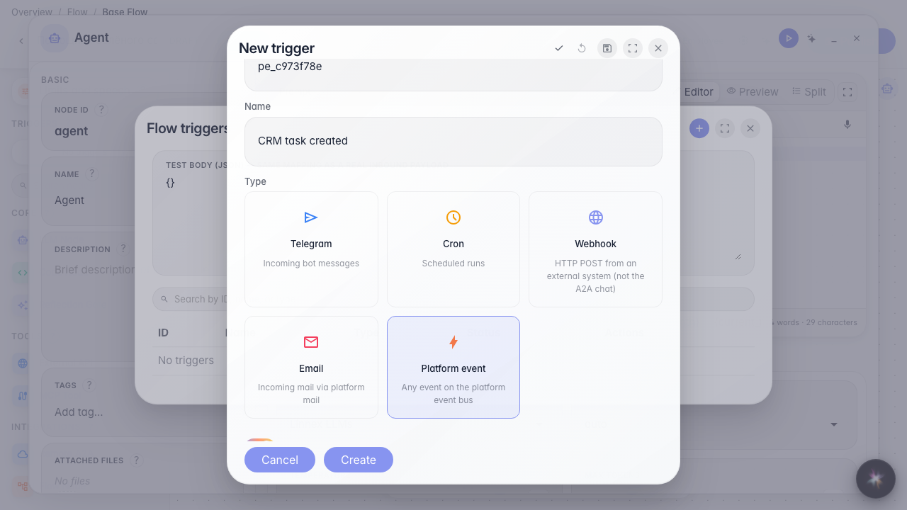
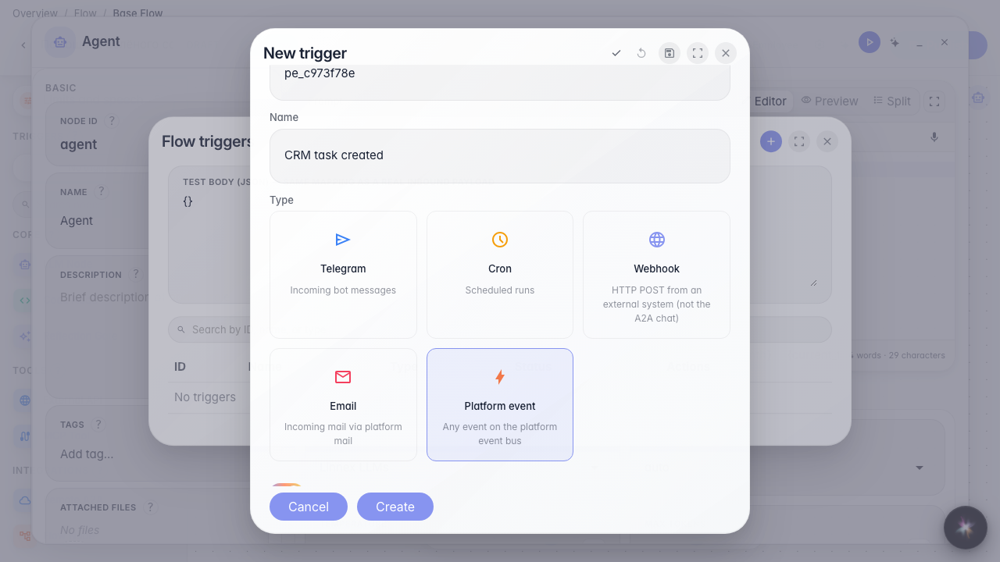

# Run the agent on a platform event with a filter

**What for:** the agent reacts only to matching bus events (for example CRM task created).

**Problems it solves:** without a filter the flow would fire on every event of that type — a payload filter narrows the subscription.

**Result:** a platform_event trigger with entity_type=task is saved.

## Step 1. Open the triggers list

In the editor menu choose Triggers and create a new trigger.

## Step 2. Choose Platform event type

This type subscribes the flow to the platform:events bus.

## Step 3. Pick event and entity_type = task filter

Event type comes from the catalog. Path/op/value are only from catalog filter_fields (autocomplete).

## Step 4. Change event type clears filters; set comment.role = operator

The role enum value comes from catalog filter_fields.

## Step 5. Save and verify the trigger in the list

**Result demonstration.** The trigger with comment.role=operator is saved — the agent reacts only to operator comments.

**Summary.** You can subscribe a flow to a platform event with a filter.

