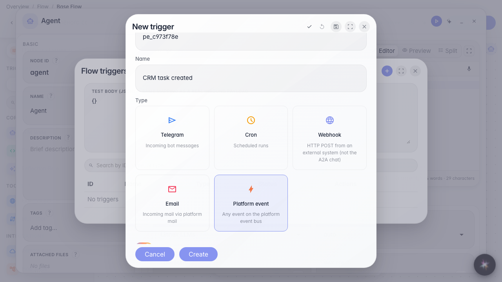

# Запускаем агента по событию платформы с фильтром

**Для чего:** агент реагирует только на нужные события шины (например создание CRM task).

**Какие проблемы решает:** без фильтра flow сработает на каждое событие типа — фильтр по payload сужает подписку.

**Результат:** триггер platform_event с условием entity_type=task сохранён.

## Шаг 1. Откройте список триггеров

В меню редактора выберите «Триггеры» и создайте новый триггер.

## Шаг 2. Выберите тип «Событие платформы»

Тип подписывает flow на шину platform:events.

## Шаг 3. Выберите событие и условие entity_type = task

Тип события берётся из каталога. Условие path/op/value — только из filter_fields каталога (autocomplete).

## Шаг 4. Смените тип события — фильтры сбросятся; задайте comment.role = operator

Enum-значение роли берётся из catalog filter_fields.

## Шаг 5. Сохраните и проверьте триггер в списке

**Демонстрация результата.** Триггер с фильтром comment.role=operator сохранён — агент среагирует только на комментарии оператора.

**Итог.** Вы умеете подписывать flow на событие платформы с фильтром.

