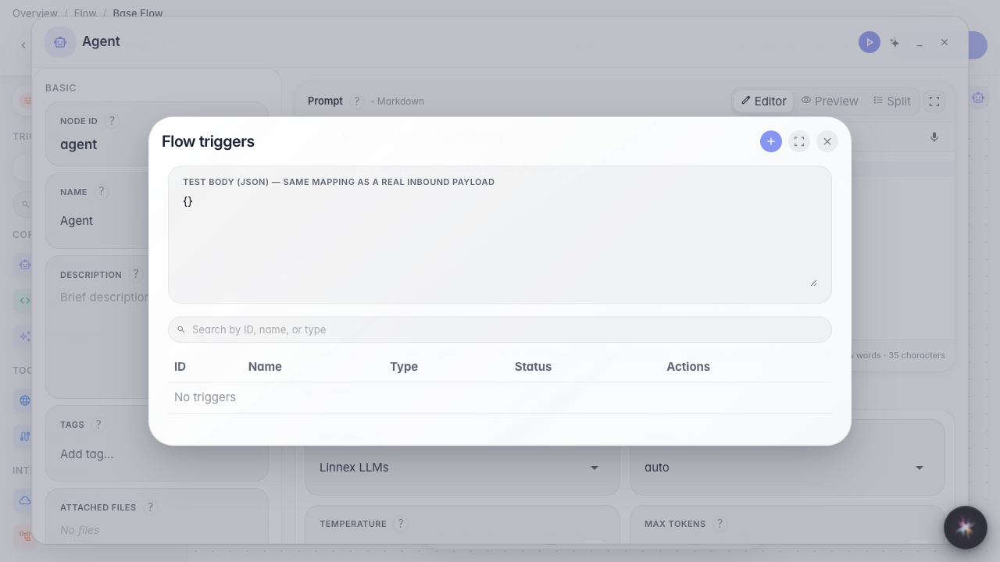
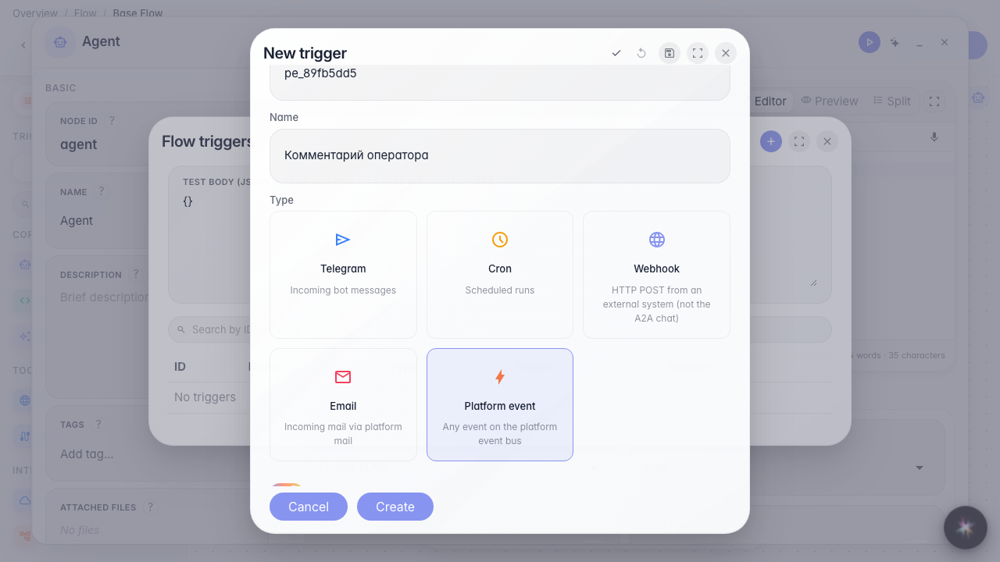
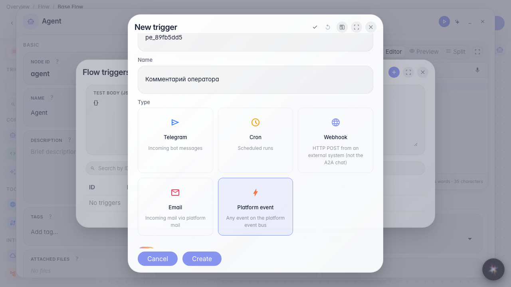
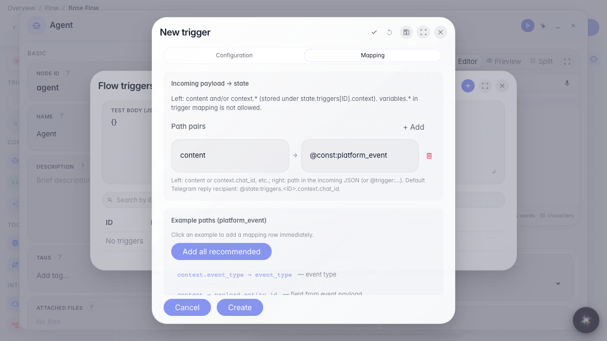

# Запускаем агента по событию платформы с фильтром

**Для чего:** агент реагирует только на нужные события из других сервисов (CRM, задачи, комментарии).

**Какие проблемы решает:** без фильтра flow сработает на каждое событие типа — условие по полям сужает подписку до полезных случаев.

**Результат:** триггер события платформы с условием на роль комментария сохранён.

## Шаг 1. Откройте список триггеров

В меню редактора выберите «Триггеры». Событие платформы подключает агента к действиям в других сервисах без отдельного webhook.

## Шаг 2. Выберите «Событие платформы» и задайте имя

Этот тип слушает каталог событий (CRM, задачи, почта и др.). Укажите id и название вроде «Комментарий оператора». Дальше выберите точный тип события.

## Шаг 3. Выберите тип события и условие фильтра

Тип события — из каталога (список с автодополнением). Фильтр — строка «поле / операция / значение»: поле берётся из каталога события, операция «равно» / «не равно» / «содержит», значение — например роль operator. Без условий агент сработает на каждое событие этого типа.

## Шаг 4. Проверьте sample payload на вкладке Mapping

Sample показывает оболочку события: тип, компания, полезные поля payload. Примеры путей помогают передать нужные данные в content агента.

## Шаг 5. Сохраните триггер и найдите его в списке

**Демонстрация результата.** «Комментарий оператора» в списке — агент ответит только когда в задаче появится комментарий с ролью operator.

**Итог.** Вы умеете подписаться на событие платформы и сузить его фильтром.

