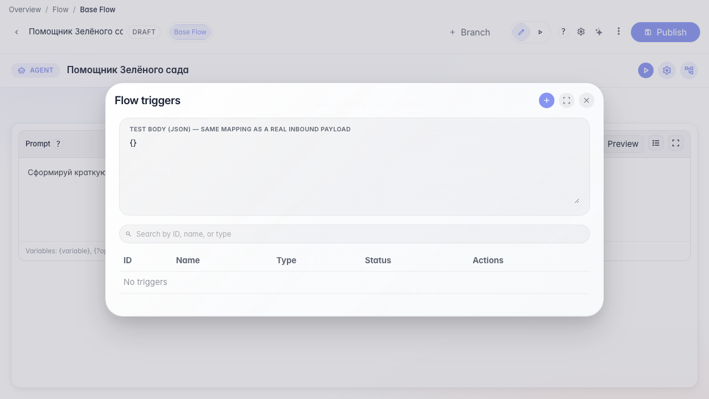
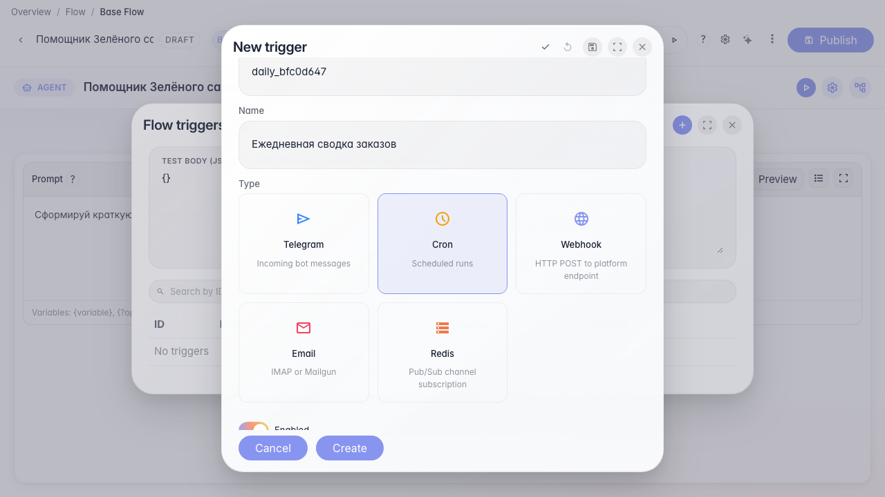
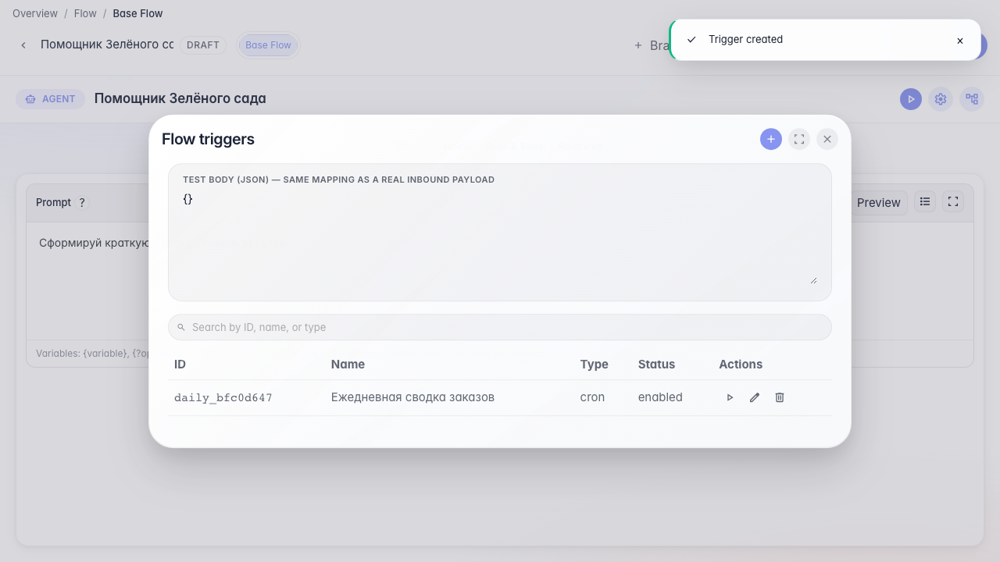

# Run the agent on a schedule

**What for:** this guide configures a daily agent run without manual starts.

**Problems it solves:** an order summary is needed every morning — a cron trigger automates it.

**Result:** a schedule trigger with a cron expression is saved on the agent.

## Step 1. Open the triggers list

In the editor menu choose Triggers. Here you see all automatic agent runs — on a schedule, from Telegram, or via webhook.

## Step 2. Create a cron trigger

Click +, pick Cron, and set the schedule to 0 9 * * * — the agent runs every day at 9:00.

## Step 3. Save the trigger in the list

Click Save in the trigger editor. The new Daily order summary row appears in the agent automatic runs list.

## Step 4. Confirm the schedule is saved

**Result demonstration.** The cron trigger appears in the list and is saved on the agent — the daily summary will run automatically.

**Summary.** You can open triggers, set a cron schedule, and save it for the Green Garden Assistant.

