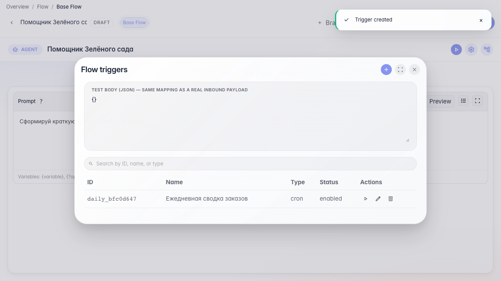

# Запускаем агента по расписанию

**Для чего:** эта инструкция настроит ежедневный запуск агента без ручного старта.

**Какие проблемы решает:** сводку заказов нужно готовить каждое утро — cron-триггер делает это автоматически.

**Результат:** триггер расписания с выражением cron сохранён в агенте.

## Шаг 1. Откройте список триггеров

В меню редактора выберите «Триггеры». Здесь видны все автозапуски агента — по расписанию, из Telegram или по webhook.

## Шаг 2. Создайте cron-триггер

Нажмите «+», выберите тип Cron и задайте расписание «0 9 * * *» — агент будет запускаться каждый день в 9:00.

## Шаг 3. Сохраните триггер в списке

Нажмите «Сохранить» в редакторе триггера. Новая строка «Ежедневная сводка заказов» появится в списке автозапусков агента.

## Шаг 4. Убедитесь, что расписание сохранено

**Демонстрация результата.** Триггер cron появился в списке и сохранён в агенте — ежедневная сводка будет запускаться автоматически.

**Итог.** Теперь вы умеете открывать триггеры, задавать cron и сохранять расписание для «Помощника Зелёного сада».

