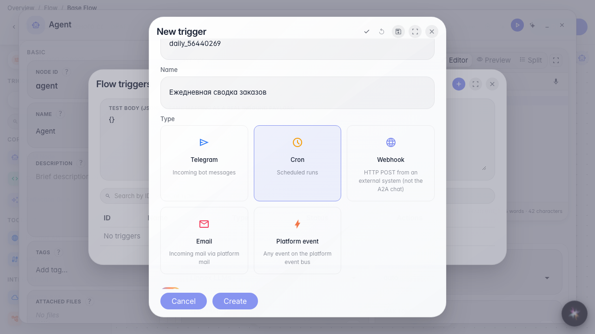
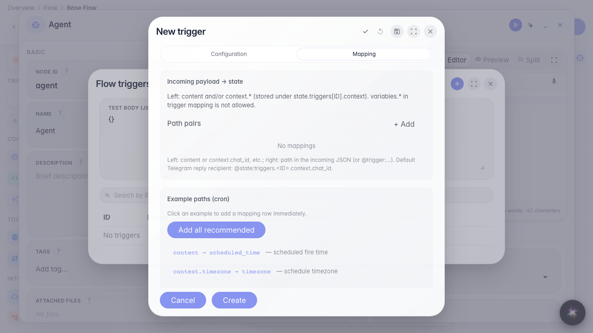
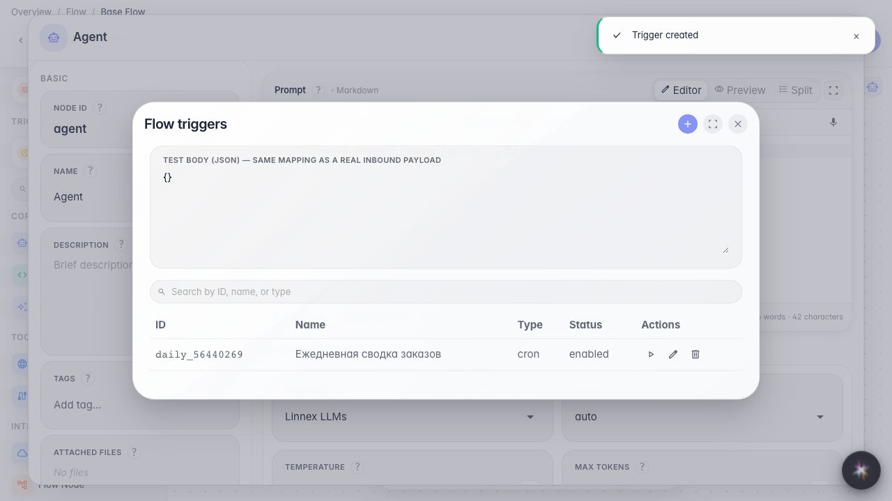

# Запускаем агента по расписанию (cron)

**Для чего:** настроить ежедневный автозапуск агента без ручного старта.

**Какие проблемы решает:** сводку заказов нужно готовить каждое утро — расписание само запускает помощника в нужный час и часовой пояс.

**Результат:** cron-триггер с выражением, поясом и стартовым текстом сохранён.

## Шаг 1. Откройте список триггеров агента

В редакторе «Помощника Зелёного сада» откройте меню и выберите «Триггеры». Здесь хранятся все автозапуски, в том числе по расписанию.

## Шаг 2. Выберите Cron и задайте имя

Нажмите «+», выберите карточку Cron. Идентификатор — латиницей для системы; название «Ежедневная сводка заказов» увидите в списке. Переключатель «Включён» оставьте активным, иначе расписание не будет срабатывать.

## Шаг 3. Заполните расписание, пояс и стартовый текст

Выражение cron «0 9 * * *» — каждый день в 9:00 (минута, час, день, месяц, день недели). Часовой пояс Europe/Moscow — чтобы 9:00 было московским, а не UTC. «Начальный текст» — фраза, с которой агент начнёт работу, будто ей написали в чат.

## Шаг 4. Откройте Mapping и посмотрите пример данных

Вкладка Mapping показывает, какие поля придут при срабатывании (время и пояс). Примеры путей можно добавить одним кликом — они связывают входящие данные с тем, что увидит агент.

## Шаг 5. Сохраните и найдите расписание в списке

**Демонстрация результата.** Строка «Ежедневная сводка заказов» видна в списке триггеров — агент будет запускаться каждое утро по заданному расписанию.

**Итог.** Вы умеете настроить cron: имя, выражение, часовой пояс и стартовый текст.

