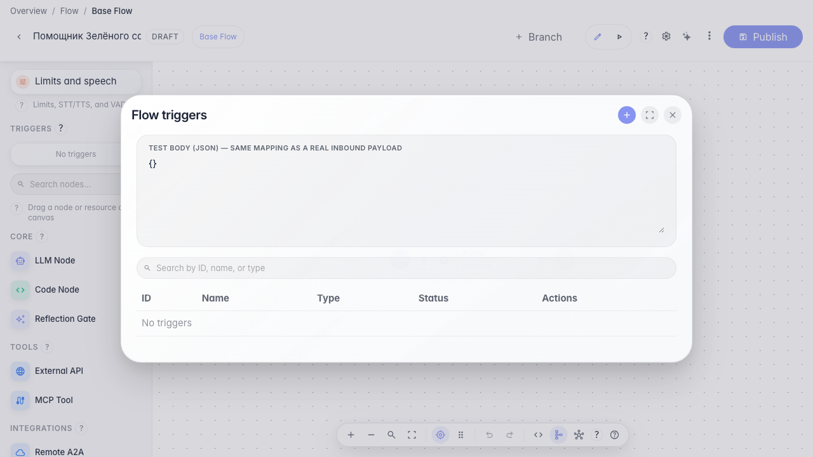
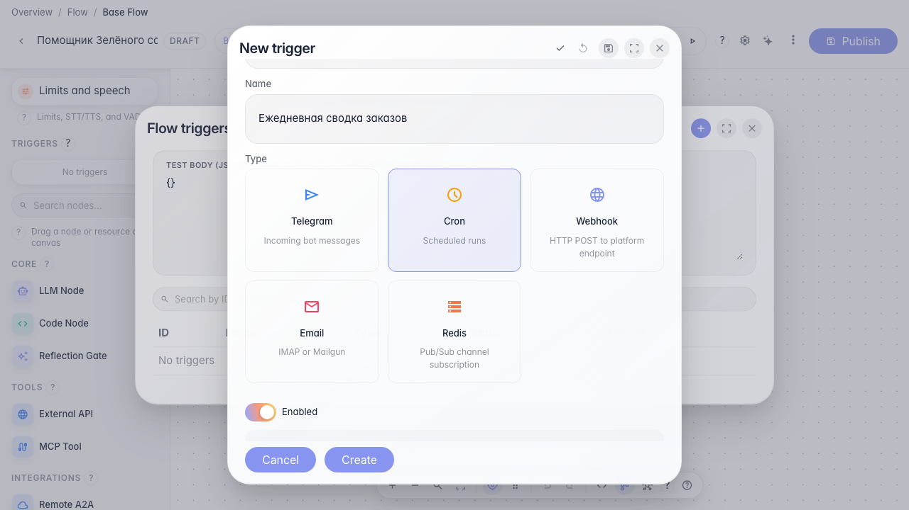

# Запускаем агента по расписанию

**Для чего:** эта инструкция настроит ежедневный запуск агента без ручного старта.

**Какие проблемы решает:** сводку заказов нужно готовить каждое утро — cron-триггер делает это автоматически.

**Результат:** триггер расписания с выражением cron сохранён в агенте.

## Шаг 1. Откройте список триггеров

В меню редактора выберите «Триггеры». Здесь видны все автозапуски агента — по расписанию, из Telegram или по webhook.

## Шаг 2. Создайте cron-триггер

Нажмите «+», выберите тип Cron и задайте расписание «0 9 * * *» — агент будет запускаться каждый день в 9:00.

