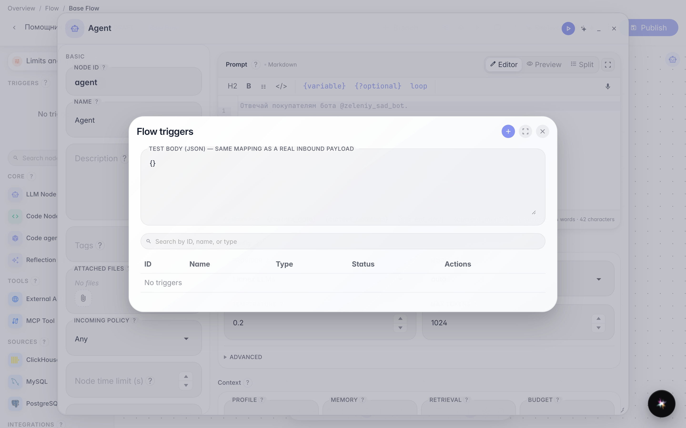
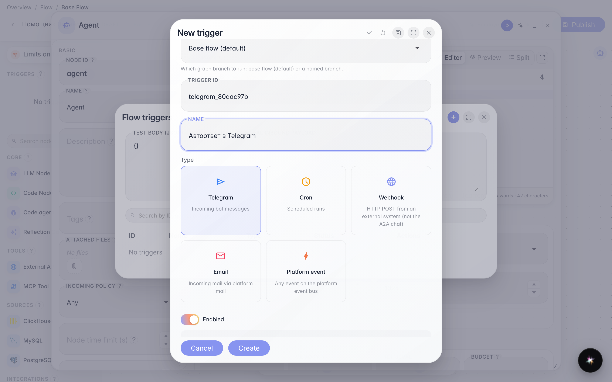
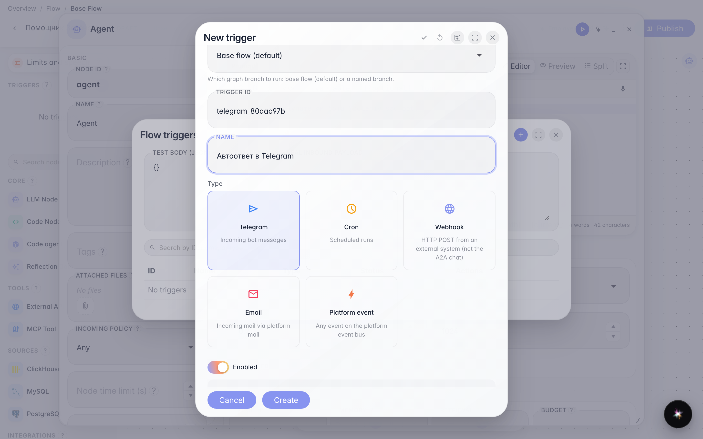
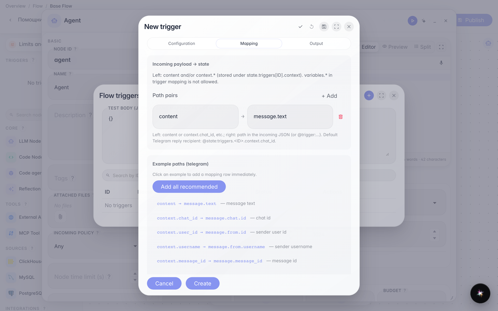
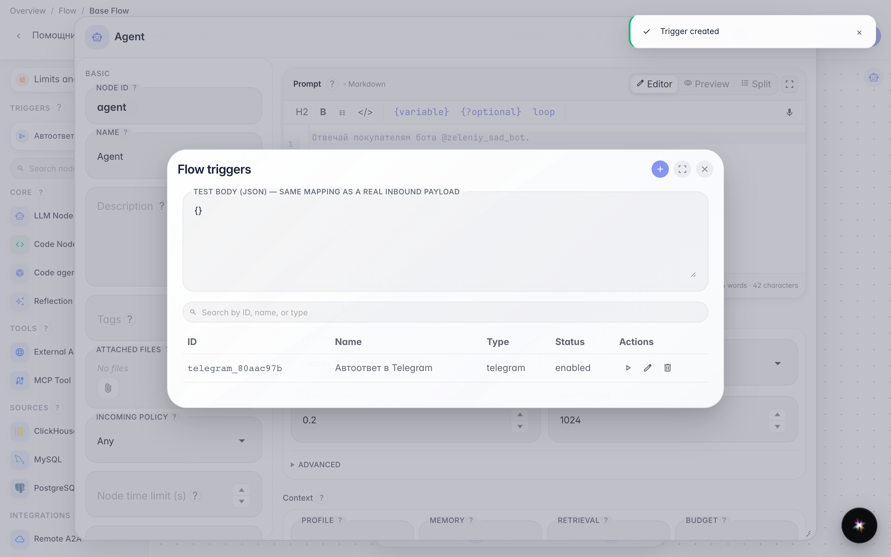

# Connect a Telegram bot to the agent

**What for:** inbound Telegram bot messages will start the agent and get a reply.

**Problems it solves:** customers message the store bot, and the assistant must answer — without copying chats by hand.

**Result:** a Telegram trigger with a secret token and a user_id filter is saved.

## Step 1. Open triggers in the editor

Open Triggers on the Green Garden Assistant. Here you connect the bot @zeleniy_sad_bot so customer messages reach the agent.

## Step 2. Choose Telegram and name the trigger

The Telegram card is for inbound Bot API Updates. Set a short id and a clear name such as Telegram auto-reply. Leave the trigger enabled.

## Step 3. Set the bot token and allowed users

In Bot token set a reference like @var:telegram_bot_token — the value comes from company secrets; do not paste the raw token into the UI. Allowed user ids are numeric Telegram ids, comma-separated; empty means everyone. Nearby are verify and webhook re-register actions.

## Step 4. Map message text to the agent reply

On the Mapping tab click a path example — usually message text goes to content, and chat_id is needed so the reply returns to the same chat. Sample JSON shows the Telegram data shape.

## Step 5. Save the auto-reply and check the list

**Result demonstration.** The Telegram auto-reply trigger is in the list — the agent is ready to reply in @zeleniy_sad_bot.

**Summary.** You can connect a bot: token via secret, user_id filter, and mapping.

