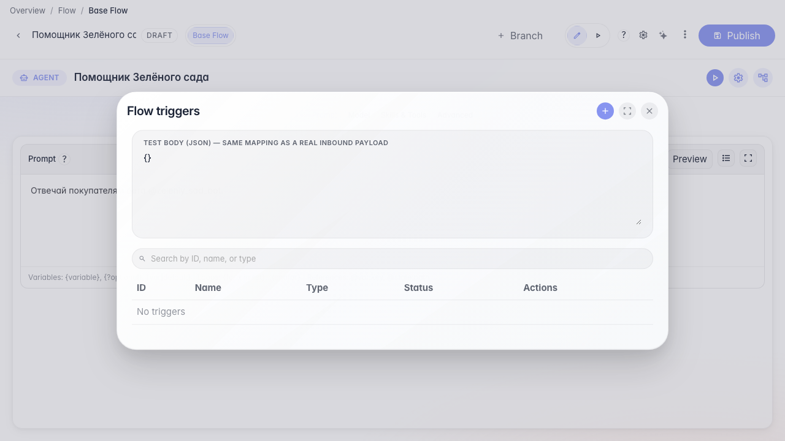
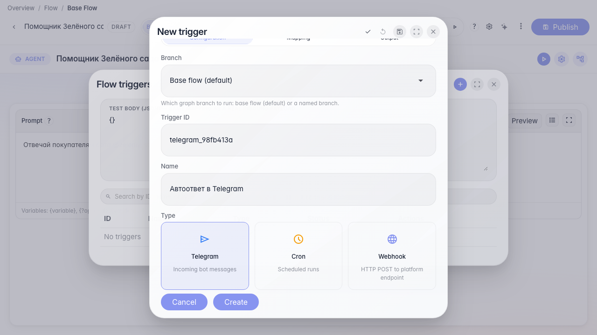
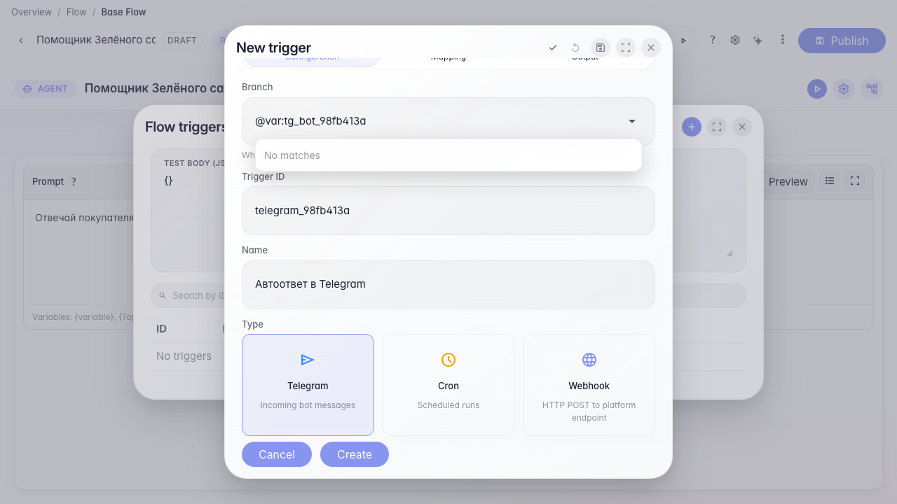
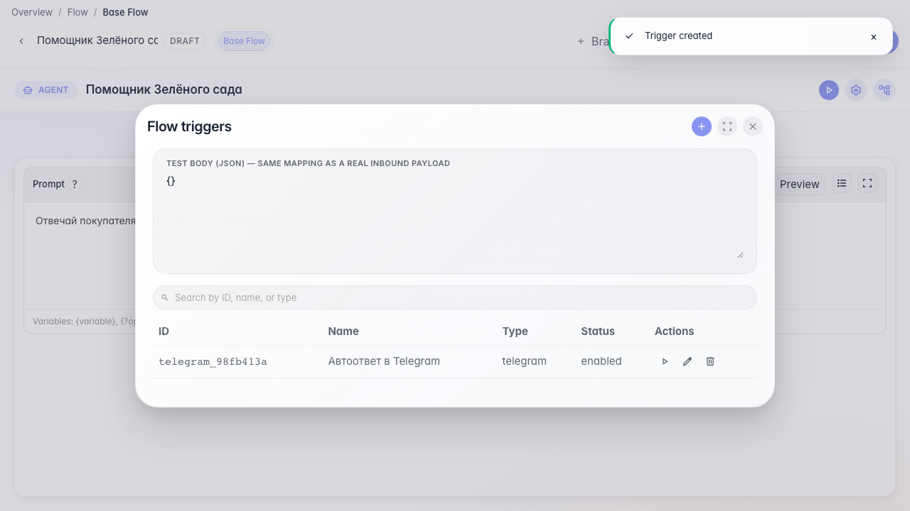

# Автоответы в Telegram

**Для чего:** эта инструкция подключит входящие сообщения Telegram-бота к агенту.

**Какие проблемы решает:** покупатели пишут в «@zeleniy_sad_bot», а ответ должен формировать агент автоматически.

**Результат:** триггер Telegram с токеном через переменную-секрет настроен.

## Шаг 1. Откройте список триггеров

В меню редактора выберите «Триггеры». Здесь настраиваются автозапуски агента — в том числе входящие сообщения Telegram-бота.

## Шаг 2. Создайте триггер Telegram

В списке триггеров нажмите «+» и выберите Telegram. Укажите id и название — так бот магазина будет принимать сообщения покупателей.

## Шаг 3. Укажите токен бота через секрет

В поле токена укажите @var:tg_bot_98fb413a — значение возьмётся из защищённых переменных компании. Рядом доступны кнопки проверки и перерегистрации webhook.

## Шаг 4. Сохраните автоответ Telegram

**Демонстрация результата.** Триггер Telegram сохранён с ссылкой на секрет — агент готов отвечать в @zeleniy_sad_bot.

**Итог.** Теперь вы умеете настраивать Telegram-триггер и хранить токен в секрете.

