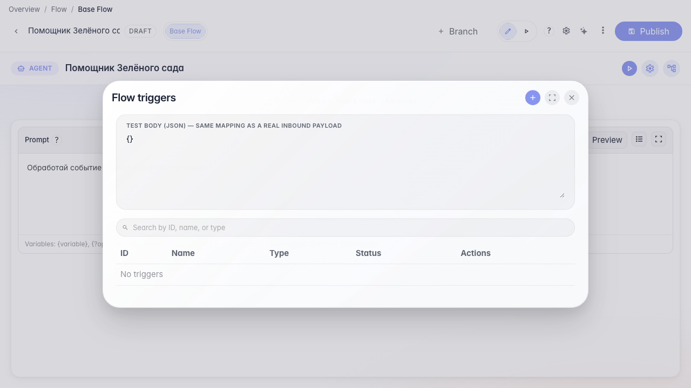
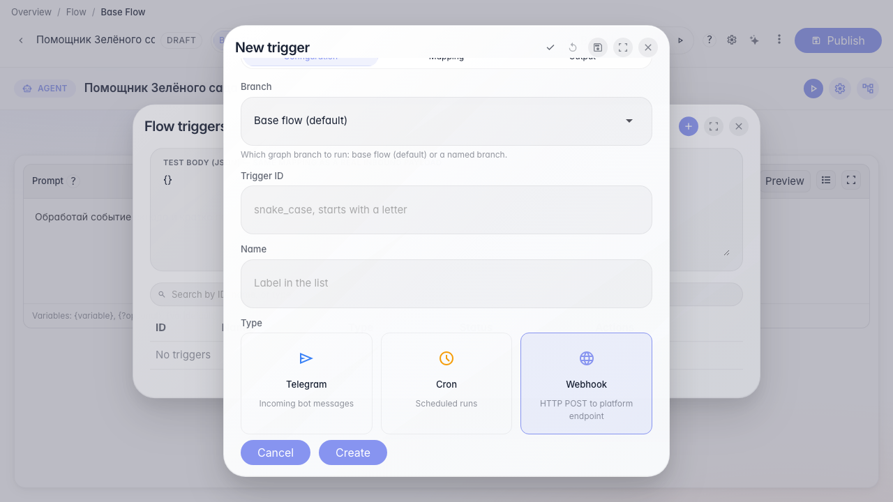
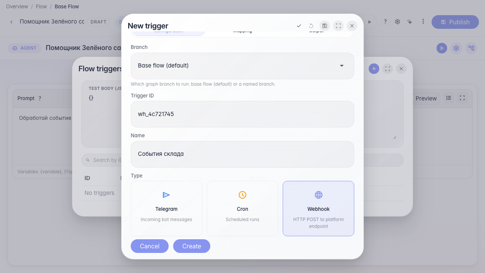
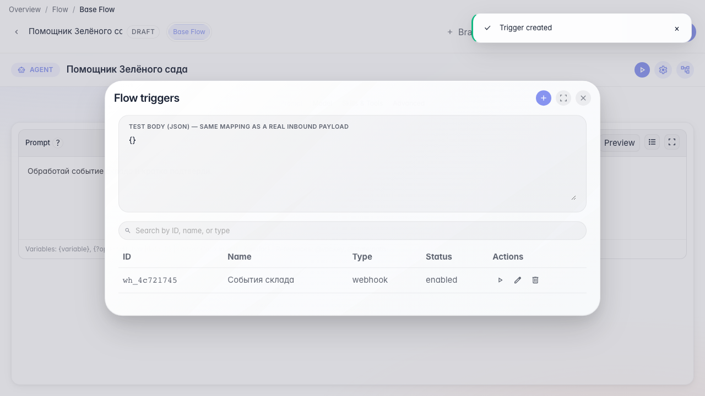

# Run the agent from a webhook

**What for:** this guide configures an agent run from an HTTP webhook from an external store system.

**Problems it solves:** warehouse or CRM events must arrive without Telegram and without a manual start.

**Result:** a webhook trigger is saved on the Green Garden Assistant.

## Step 1. Open the triggers list

In the editor menu choose Triggers. Create a webhook here alongside schedule and Telegram.

## Step 2. Choose the Webhook type

Click create and choose Webhook. The platform will accept an HTTP POST on the agent endpoint.

## Step 3. Set id and name

Set a short id and a clear name such as Warehouse events so you can find the trigger among other autos.

## Step 4. Save and find the webhook in the list

**Result demonstration.** The Warehouse events webhook appears in the triggers list — an external system can call the agent over HTTP.

**Summary.** You can create a webhook trigger for external store events.

