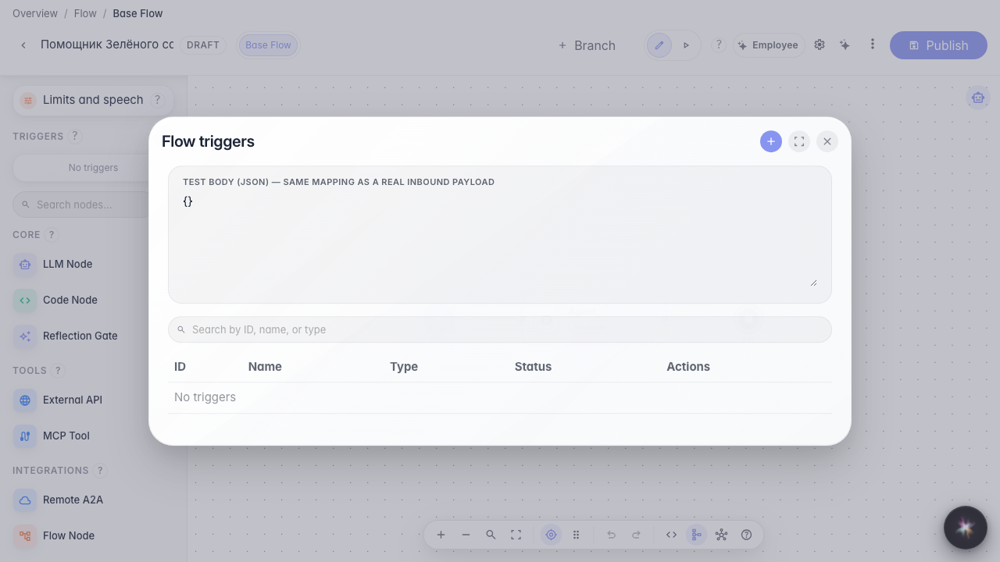
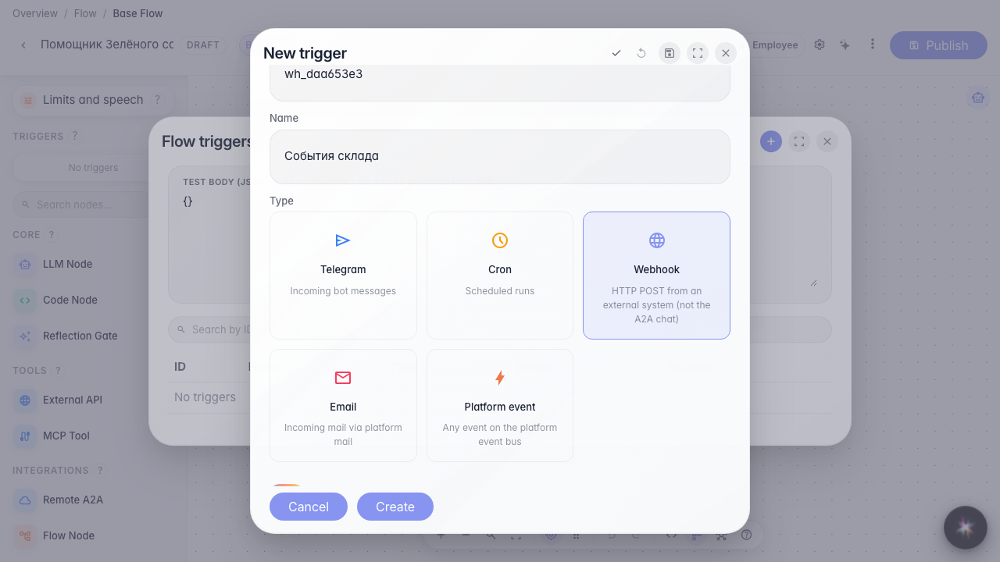
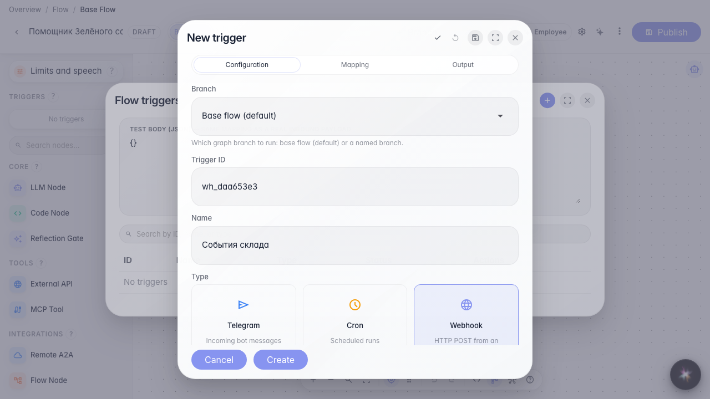
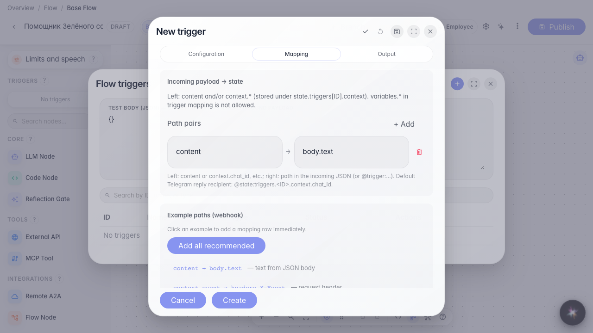
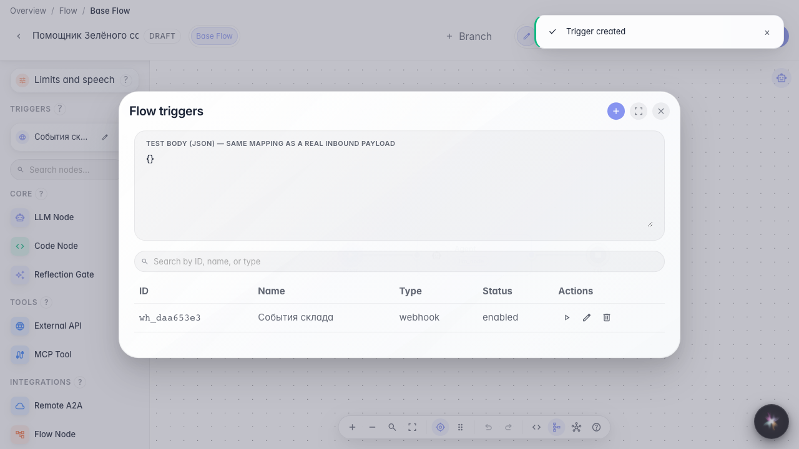

# Запускаем агента по HTTP webhook

**Для чего:** внешняя система магазина сможет запускать агента обычным HTTP POST.

**Какие проблемы решает:** события склада или CRM приходят не из Telegram и не по расписанию — нужен защищённый URL с секретом.

**Результат:** webhook с секретом, заголовком, IP-фильтром и mapping сохранён.

## Шаг 1. Откройте список триггеров

В меню редактора выберите «Триггеры». Webhook создают здесь же — рядом с расписанием и Telegram.

## Шаг 2. Выберите Webhook и задайте имя

Тип Webhook принимает JSON по HTTP POST (это не чат A2A). Укажите id и название «События склада». Ниже появится URL endpoint — его копируют во внешнюю систему.

## Шаг 3. Настройте секрет, заголовок и разрешённые IP

Секрет — пароль запроса: без него платформа отклонит вызов. Заголовок секрета (здесь Authorization) — имя HTTP-заголовка, куда внешняя система кладёт этот пароль. Разрешённые IP — теги адресов; пусто = без фильтра. Готовый curl можно скопировать для проверки.

## Шаг 4. Добавьте mapping из примера

На вкладке Mapping нажмите пример — например content ← body.text. Так текст из JSON склада станет входом агента. Sample payload показывает ожидаемую форму.

## Шаг 5. Сохраните webhook и найдите его в списке

**Демонстрация результата.** «События склада» видны в списке — внешняя система может вызывать агента по защищённому URL.

**Итог.** Вы умеете настроить webhook: URL, секрет, заголовок, IP и mapping.

