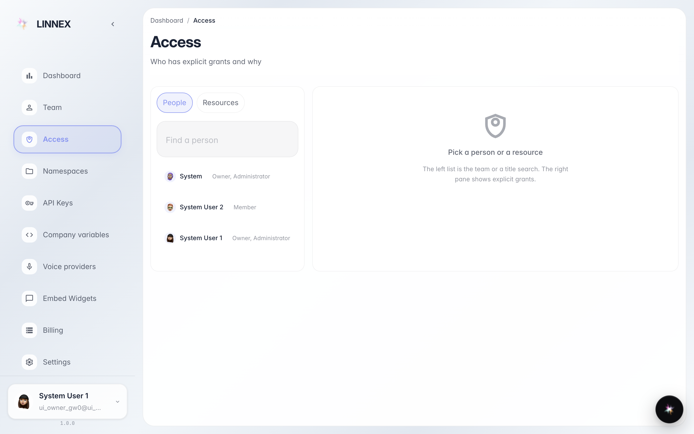
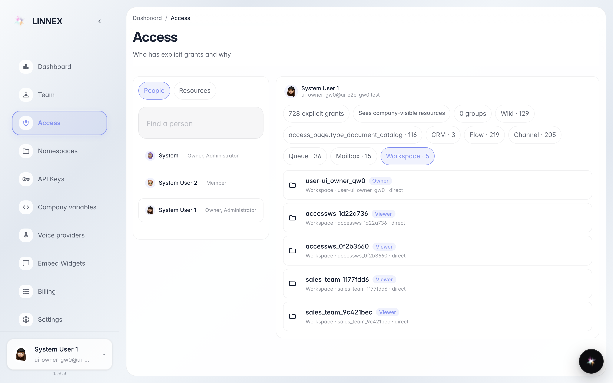
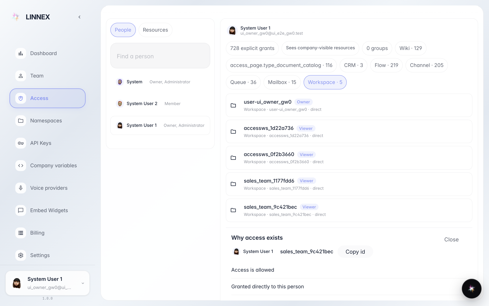

# Check who has access and why

**Purpose:** the «Access» page answers «who can do what in the company» in plain language, employee by employee.

**Problems solved:** a colleague cannot see a project — or sees too much; here you see all their grants and the reason for each one.

**Result:** an employee selected, their grant list shown with a clear explanation of where each grant comes from.

## Step 1. Open «Access» and pick an employee

The employee list is on the left. Click the person whose permissions you want to check: all their grants appear on the right — projects, documents and other platform areas.

## Step 2. Review the employee grants

Each row is one grant: what it applies to and which role it gives (view, edit, etc.). Names are written in plain words, without technical codes.

## Step 3. See where the grant comes from

**Result demonstration.** Clicking a row opens the «Why» panel: it explains how the person got this grant — e.g. «Granted directly» — and by whom.

**Summary.** If a grant is excessive or missing, it is managed in «Team» and inside the projects themselves; this page is for checking.

