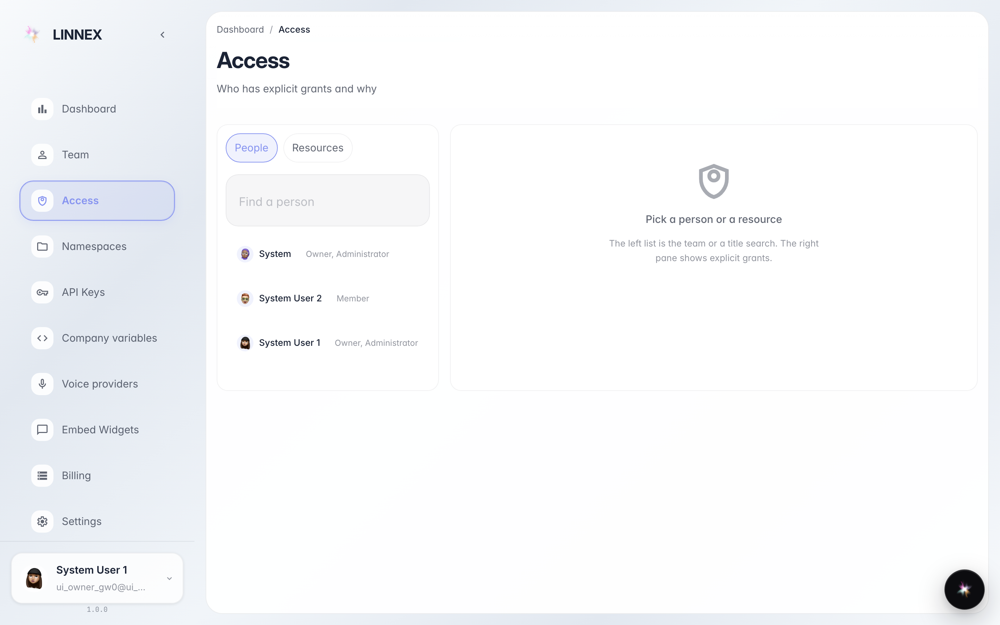
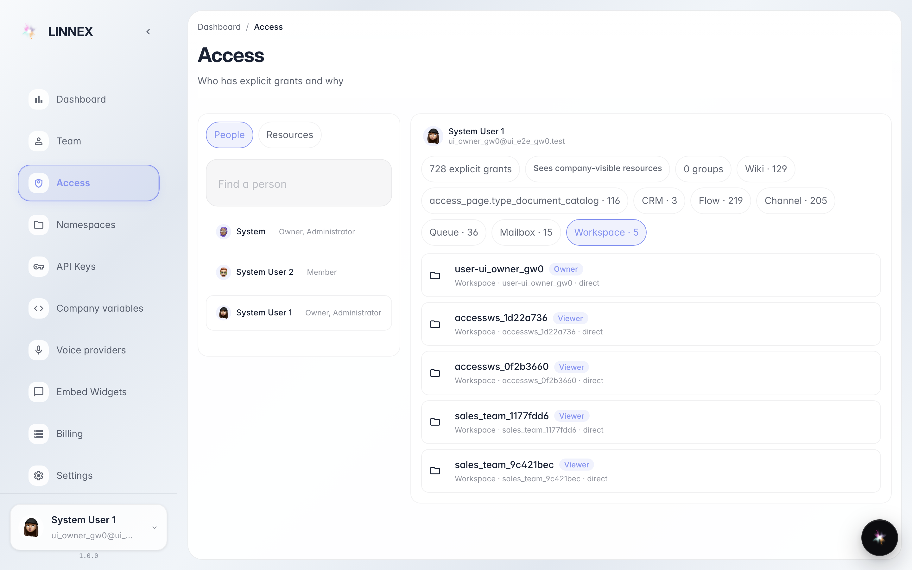
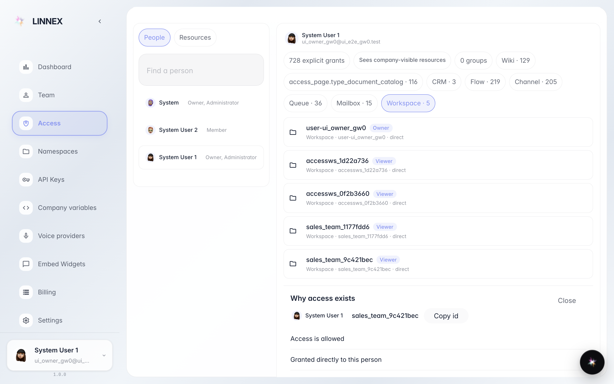

# Проверить, кто и почему имеет доступ

**Для чего:** страница «Доступы» отвечает на вопрос «у кого какие права в компании» — без технических деталей: человеческим языком, по каждому сотруднику.

**Какие проблемы решает:** коллега не видит проект или, наоборот, видит лишнее — здесь видно все его права и причину каждого.

**Результат:** выбран сотрудник, показан список его прав и понятное объяснение, откуда каждое право взялось.

## Шаг 1. Откройте «Доступы» и выберите сотрудника

Слева — список сотрудников компании. Нажмите на человека, чьи права хотите проверить: справа появятся все его доступы — к проектам, документам и другим частям платформы.

## Шаг 2. Посмотрите список прав сотрудника

Каждая строка — одно право: к чему оно относится и какую роль даёт (просмотр, редактирование и т.д.). Названия написаны обычными словами, без технических кодов.

## Шаг 3. Узнайте, откуда взялось право

**Демонстрация результата.** Нажатие на строку открывает панель «Почему»: она объясняет, как человек получил это право — например «Выдан напрямую» — и кем.

**Итог.** Если права лишние или их не хватает — это настраивается в разделах «Команда» и в самих проектах; здесь вы только проверяете.

