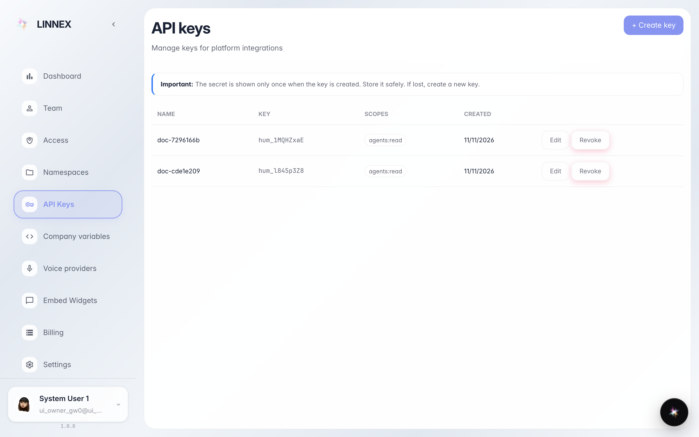
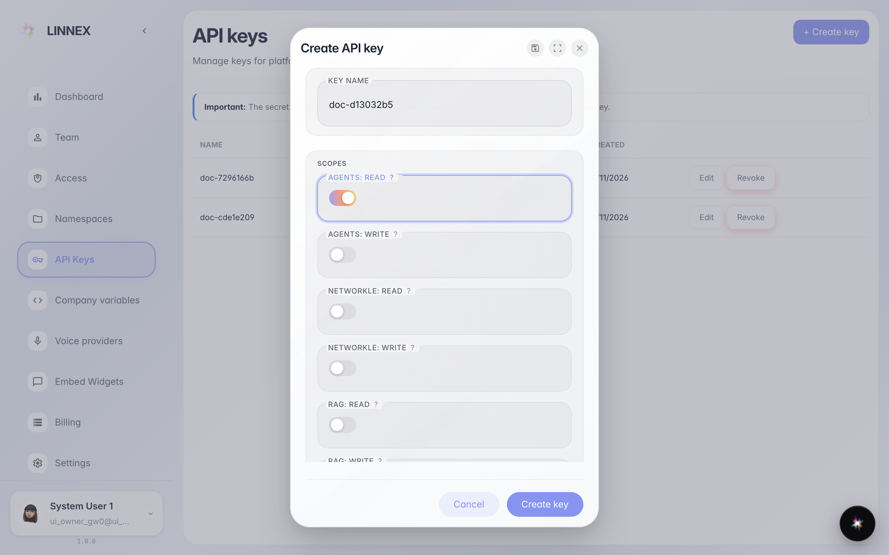
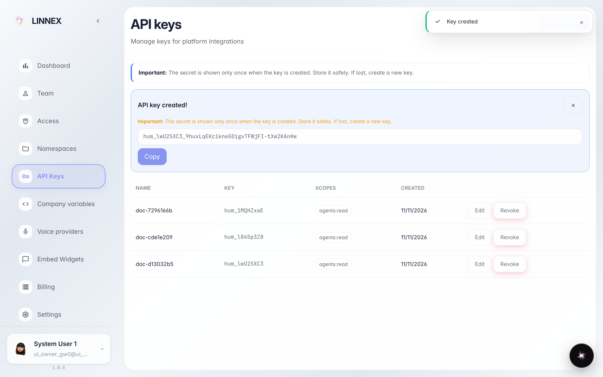

# Create an API key

**Purpose:** an API key lets an external program (ERP, website, script) talk to the platform on the company's behalf.

**Problems solved:** the tech office or the supplier asks for «the key» to connect their software: here you generate and hand it over once.

**Result:** a new key with the chosen permissions and the secret copied (shown only once).

## Step 1. Open «API keys»

The page lists active keys with name, prefix, scopes and date. The banner on top reminds you the secret is shown only at creation.

## Step 2. Key name and permissions

In the window write a name that recalls who will use it (e.g. «erp») and tick only the permissions needed: the less a key can do, the safer it is.

## Step 3. Copy the secret: shown only once

**Result demonstration.** The green banner shows the just-created secret: copy it and hand it to whoever will use it right away. After closing it can't be recovered — if lost, revoke the key and create another.

**Summary.** The external program is connected; the list keeps track of the key and it can be revoked in one click.

