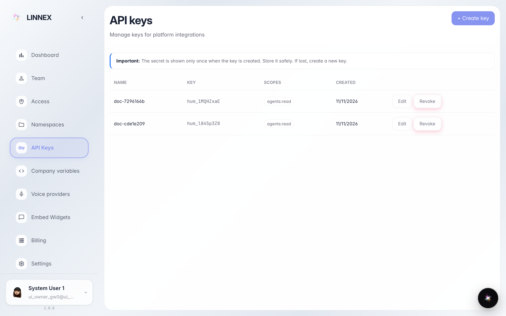
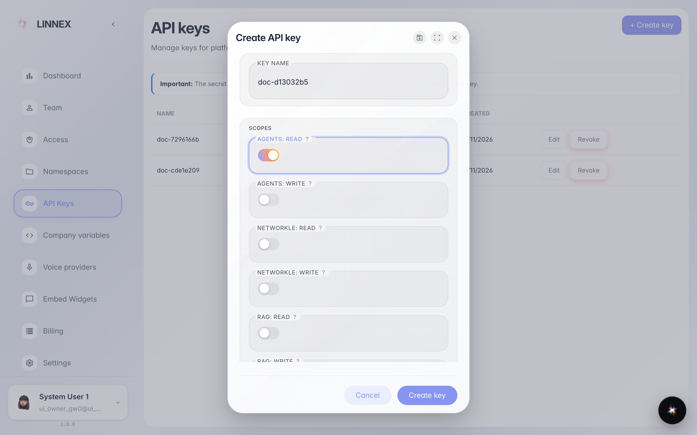
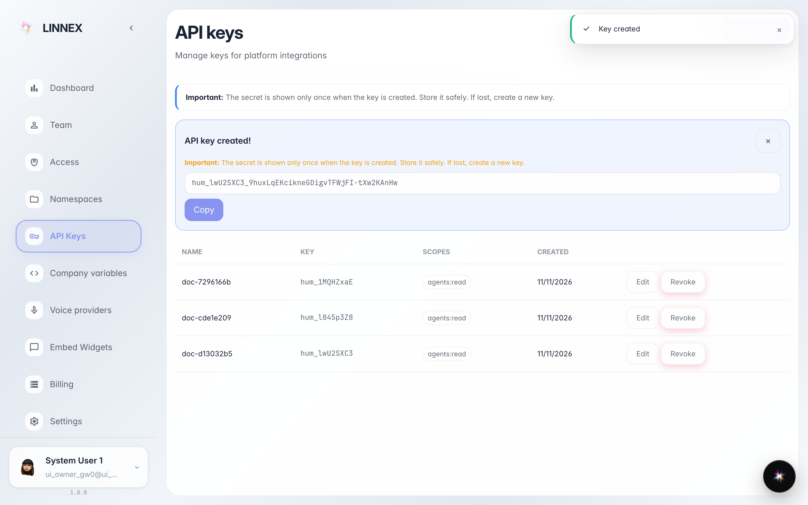

# Создать ключ API

**Для чего:** ключ API позволяет внешней программе (учётной системе, сайту, скрипту) обращаться к платформе от имени компании.

**Какие проблемы решает:** технари или поставщик просят «ключ» для подключения своего ПО: здесь он создаётся и передаётся один раз.

**Результат:** новый ключ с выбранными правами, секрет скопирован (показывается один раз).

## Шаг 1. Откройте «Ключи API»

Страница перечисляет активные ключи: имя, префикс, права и дата. Рамка вверху напоминает: секрет виден только при создании.

## Шаг 2. Имя и права ключа

В окне напишите имя, по которому понятно, кто будет пользоваться (например «учётная система»), и отметьте только нужные права: чем меньше ключ умеет, тем он безопаснее.

## Шаг 3. Скопируйте секрет: он показывается один раз

**Демонстрация результата.** Зелёная рамка показывает только что созданный секрет: скопируйте и сразу передайте тому, кто будет им пользоваться. После закрытия его не восстановить — если потерян, ключ отзывается и создаётся новый.

**Итог.** Внешняя программа подключена; список помнит ключ, и его можно отозвать в один клик.

