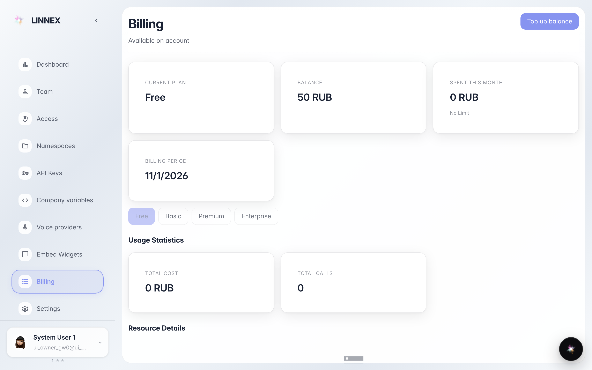

# Subscription, usage and invoices

**Purpose:** check the company plan, this month's usage, and invoice history from the «Billing» page.

**Problems solved:** understand how much is being spent and download invoices without writing to support.

**Result:** plan, usage meters and history visible at a glance.

## Step 1. Open «Billing»: plan and balance

At the top, cards show the active plan, balance and period limits. If a usage nears its limit you see it here before it slows the work.

## Step 2. This month's usage, item by item

Scrolling down, the usage section details how much of each paid service was used (agents, document recognition, calls). The figures update by themselves.

## Step 3. Invoice history

**Result demonstration.** At the bottom the history table lists past transactions and invoices with date and amount: one glance answers «when did we pay».

**Summary.** Full control: plan, usage and invoices on one page, no support requests needed.

