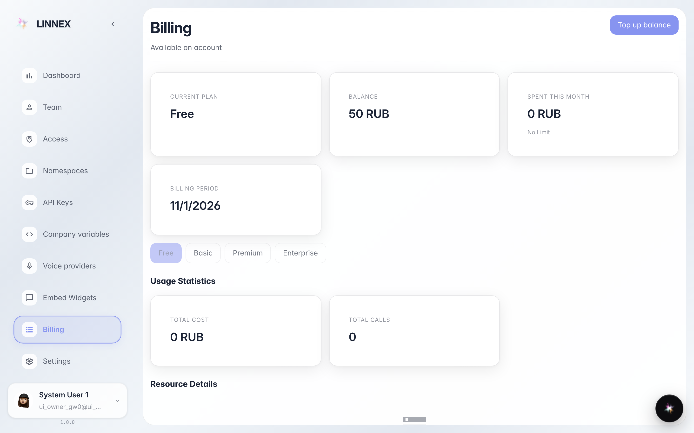

# Подписка, расход и счета

**Для чего:** проверить тариф, расход за месяц и историю счетов компании на странице «Оплата».

**Какие проблемы решает:** понять, сколько тратится и где скачать счета, не обращаясь в поддержку.

**Результат:** тариф, счётчики расхода и история видны сразу.

## Шаг 1. Откройте «Оплату»: тариф и баланс

Вверху карточки с активным тарифом, балансом и лимитами периода. Если расход приближается к лимиту, вы увидите это здесь до того, как работа замедлится.

## Шаг 2. Расход за месяц по статьям

Ниже раздел расхода детализирует, сколько использовано каждого платного сервиса (агенты, распознавание документов, звонки). Цифры обновляются сами.

## Шаг 3. История счетов

**Демонстрация результата.** Внизу таблица истории перечисляет движения и прошлые счета с датой и суммой: один взгляд отвечает на «когда мы платили».

**Итог.** Полный контроль: тариф, расход и счета на одной странице, без запросов в поддержку.

