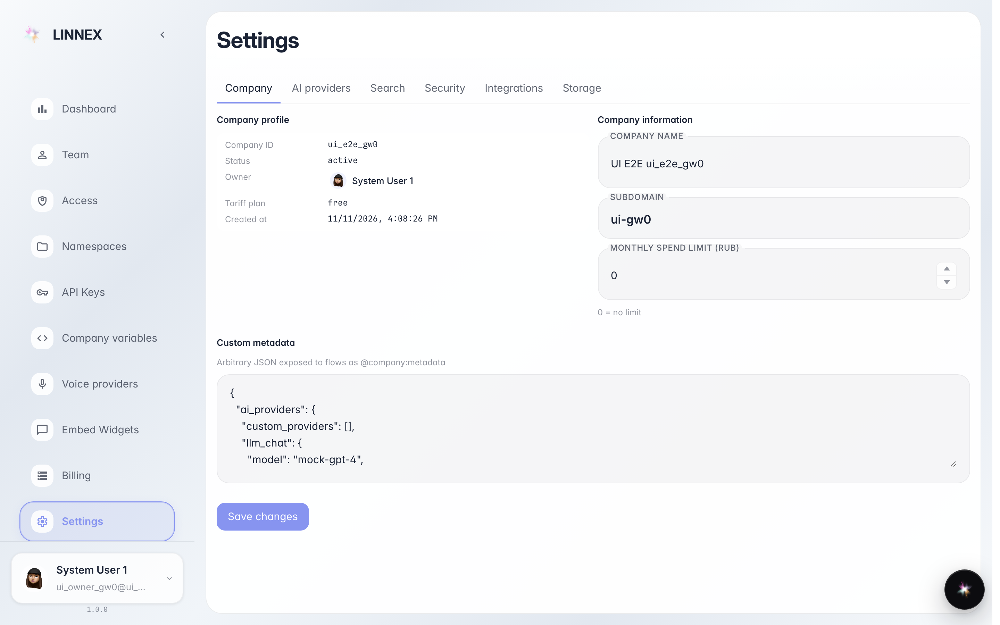
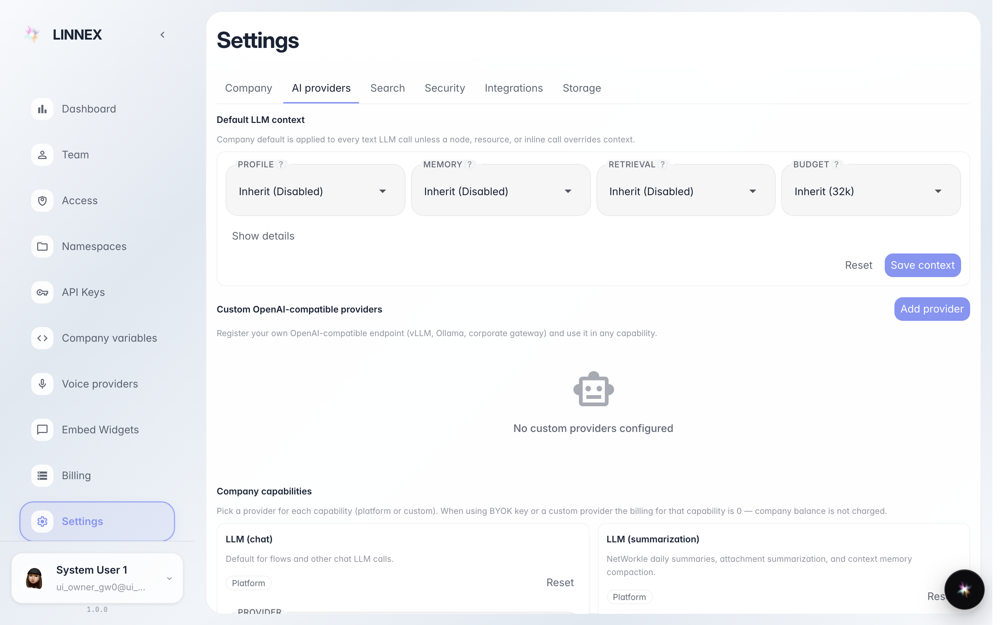
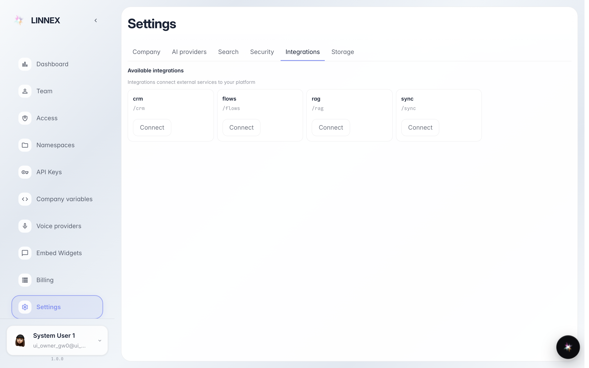

# Company settings: name, budget and connections

**What for:** the Settings page gathers everything about the company: its name, how much it may spend and which services are connected.

**Problems solved:** the owner and admins don't need to hunt options across sections — company profile, AI providers and integrations live on one page.

**Result:** you see the company data, know where to change the name and monthly budget, and where to connect services.

## Step 1. Open Settings

The Settings section of the company console. The first screen is the profile: name, plan, owner and the monthly budget field — the spending cap for paid features. The tabs above lead to the remaining sections.

## Step 2. Review AI providers

The AI providers tab shows which smart features are on: chat, search, speech recognition. Platform defaults work out of the box — change them only for your own keys and models.

## Step 3. Open the Integrations tab

**Result demonstration.** Integrations is the company's connections catalogue: mail, calendar, external services. The Connect button leads to the right section.

**Summary.** Now you know where company settings live: profile and budget on the first tab, smart features in AI providers, connections in integrations.

