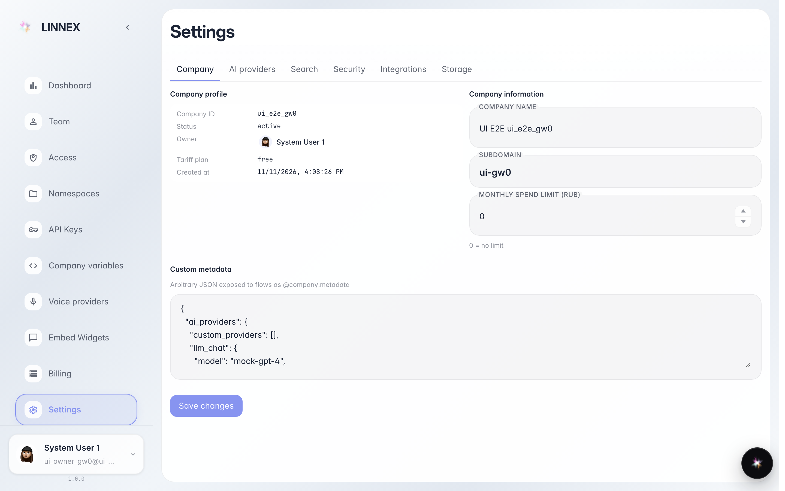
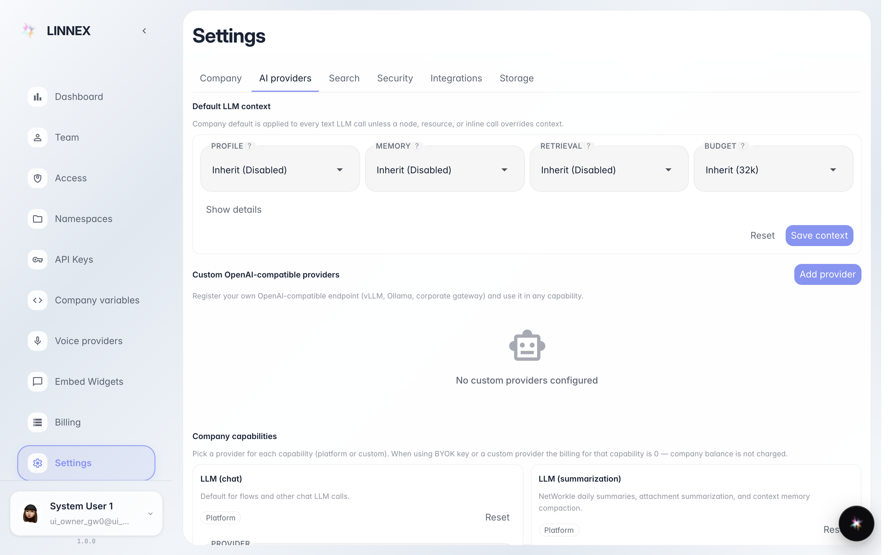
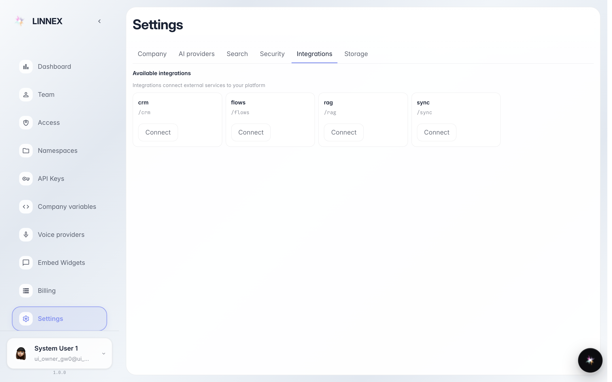

# Настройки компании: имя, бюджет и подключения

**Для чего:** страница «Настройки» собирает всё про компанию: как она называется, сколько может тратить и какие сервисы подключены.

**Какие проблемы решает:** владельцу и администратору не нужно искать параметры по разным разделам — профиль компании, AI-провайдеры и интеграции на одной странице.

**Результат:** вы видите данные компании, понимаете, где менять название и месячный бюджет, и где подключать сервисы.

## Шаг 1. Откройте «Настройки»

Раздел «Настройки» в консоли компании. Первый экран — профиль: название, тариф, владелец и поле месячного бюджета — предел трат на платные функции. Вкладки сверху ведут к остальным разделам.

## Шаг 2. Посмотрите AI-провайдеров

Вкладка «AI-провайдеры» показывает, какие умные функции включены: чат, поиск, распознавание речи. По умолчанию работают настройки платформы — менять их нужно только для своих ключей и моделей.

## Шаг 3. Откройте вкладку «Интеграции»

**Демонстрация результата.** «Интеграции» — каталог подключений компании: почта, календарь, внешние сервисы. Кнопка «Подключить» ведёт в нужный раздел.

**Итог.** Теперь вы знаете, где лежат настройки компании: профиль и бюджет — на первой вкладке, умные функции — в AI-провайдерах, подключения — в интеграциях.

