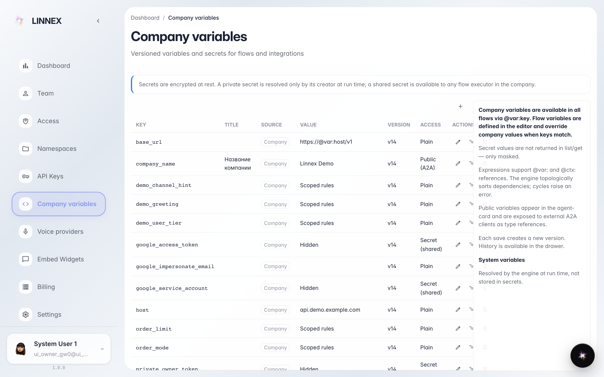
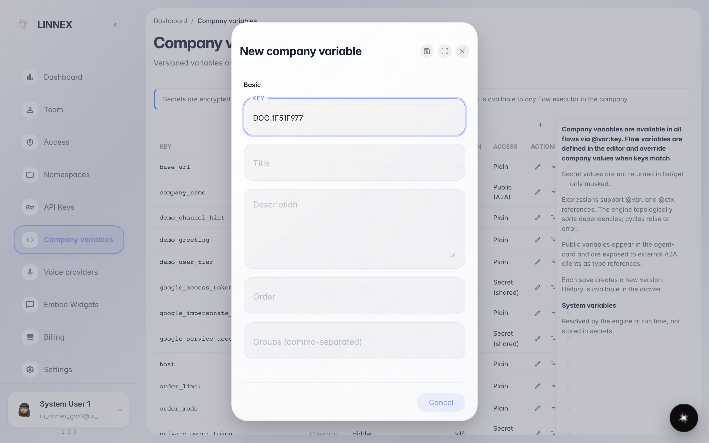
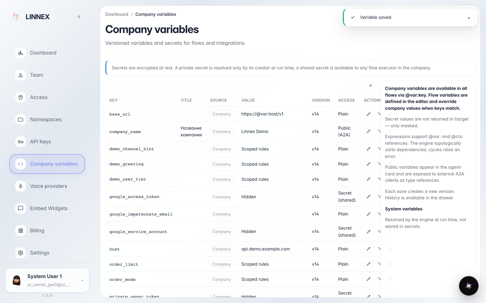

# Company variables

**Purpose:** company variables are shared settings used by agents and automations (service names, hours, standard replies).

**Problems solved:** a value used in many places changes: fix it once and every agent uses the new one.

**Result:** a variable created and visible in the list.

## Step 1. Open «Company variables»

The page lists the variables already defined: key, title and who can see them. On the right a guide explains what they are for.

## Step 2. Press «Create» and fill key and value

In the window set the key (the technical name, e.g. WORK_HOURS) and the value. «Secret» variables stay hidden even here, kept safe.

## Step 3. The variable in the list

**Result demonstration.** After saving, the variable appears in the table: all company agents see it, and editing the value here takes effect everywhere at once.

**Summary.** One edit — and every automation uses the new value.

