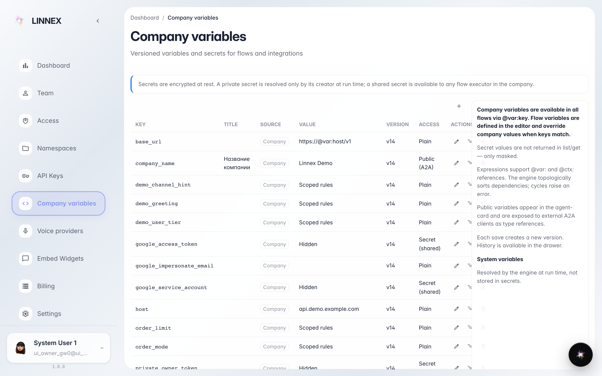
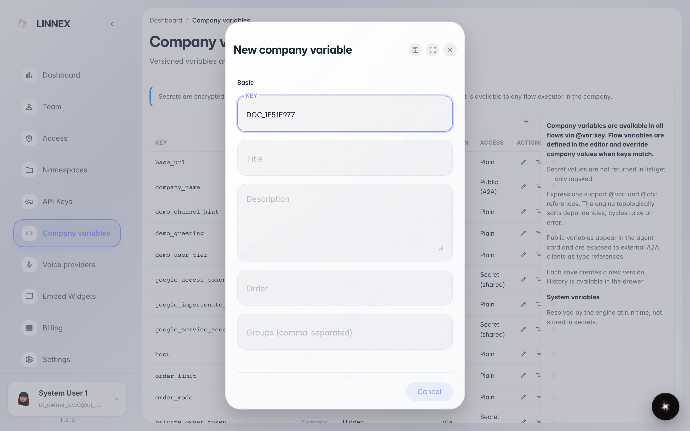
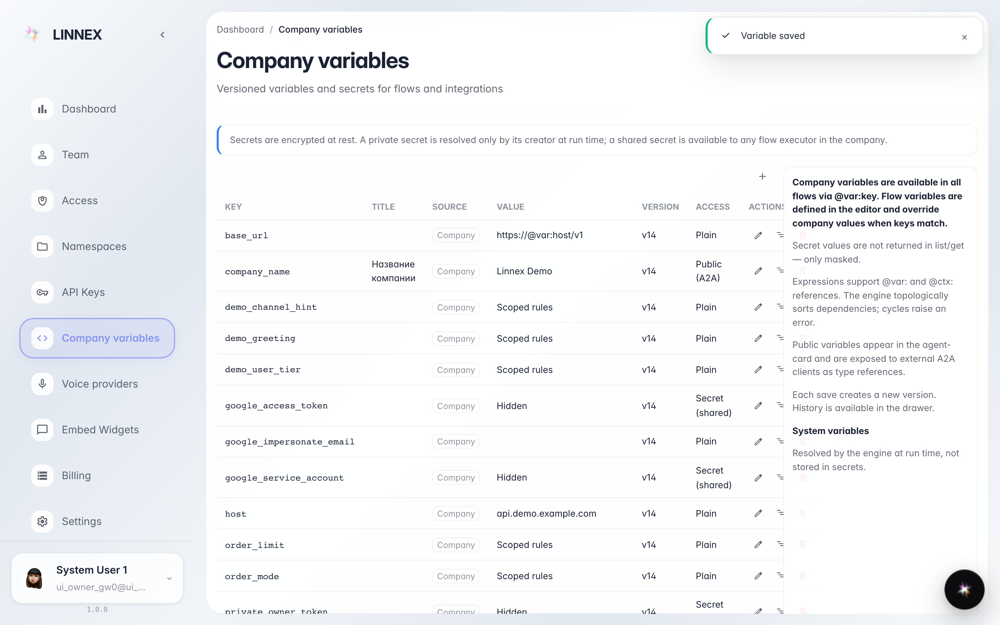

# Переменные компании

**Для чего:** переменные компании — общие настройки, которые используют агенты и автоматизации (названия служб, часы работы, стандартные ответы).

**Какие проблемы решает:** значение, используемое во многих местах, изменилось: исправляете один раз — все агенты берут новое.

**Результат:** переменная создана и видна в списке.

## Шаг 1. Откройте «Переменные компании»

Страница перечисляет уже заданные переменные: ключ, название и кто их видит. Справа — справка, которая объясняет, для чего они нужны.

## Шаг 2. Нажмите «Создать» и заполните ключ и значение

В окне укажите ключ (техническое имя, например CHASY_RABOTY) и значение. «Секретные» переменные остаются скрытыми даже здесь — в безопасности.

## Шаг 3. Переменная в списке

**Демонстрация результата.** После сохранения переменная появляется в таблице: её видно всем агентам компании, и изменение значения здесь сразу действует везде.

**Итог.** Одна правка — и все автоматизации используют новое значение.

