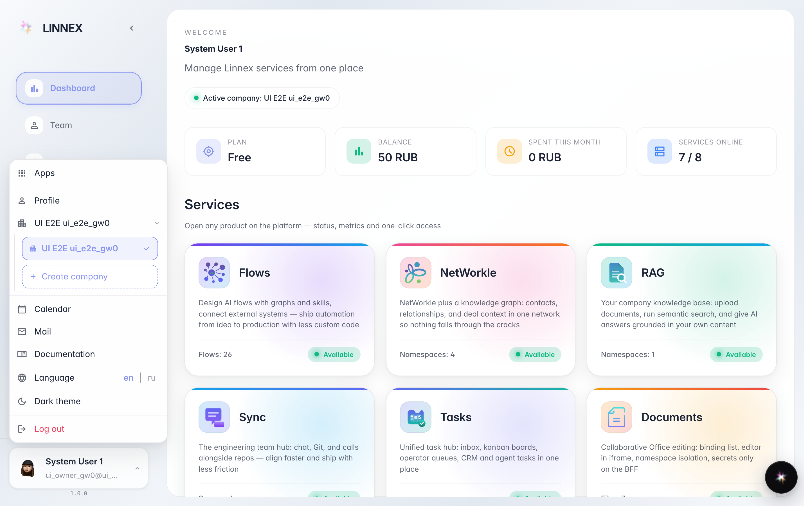
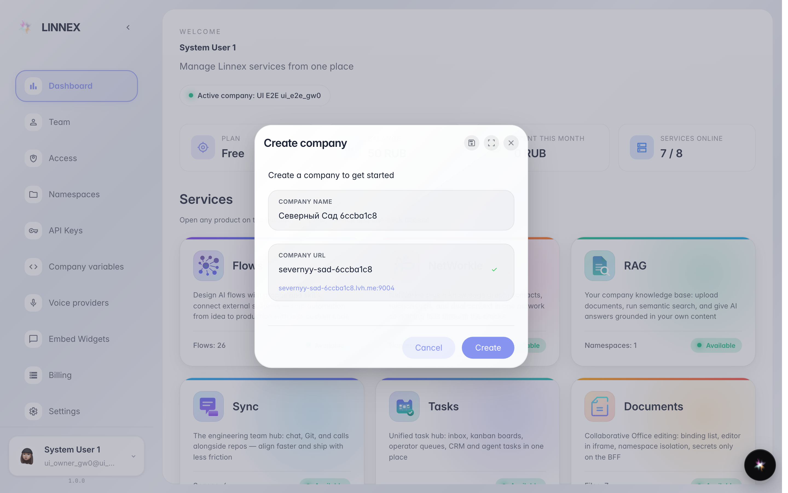
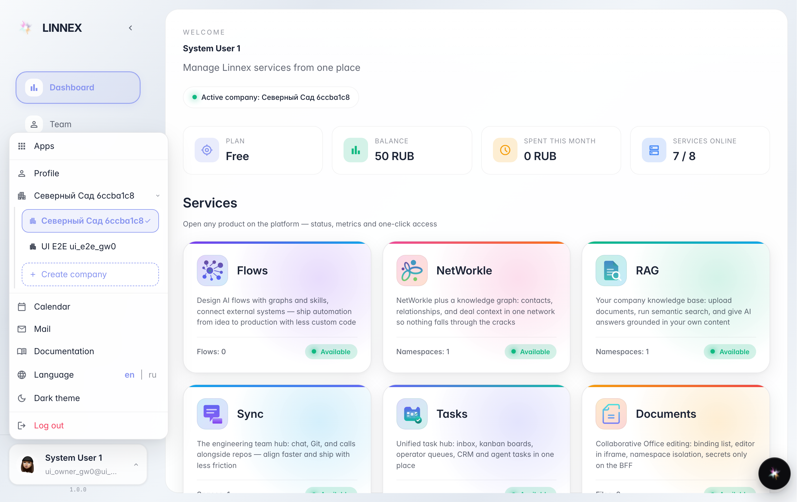

# Create another company

**What for:** one account can run several companies — a separate legal entity or a sandbox.

**Problems solved:** no second account needed: a new company is created from the account menu and appears in the switcher right away.

**Result:** a new company exists and the platform switched to it — invite people and start configuring.

## Step 1. Open the account menu and the company list

Click your name at the bottom left, then the row with the current company — the list of your companies and the Create company button opens.

## Step 2. Type the new company name

Type the name — the address (subdomain) is suggested automatically and can be edited. The Create button provisions the company.

## Step 3. The company appears in the switcher

**Result demonstration.** The new company is created and already in the list — you can switch between companies at any time.

**Summary.** One account covers several companies; each has its own people, data and settings.

