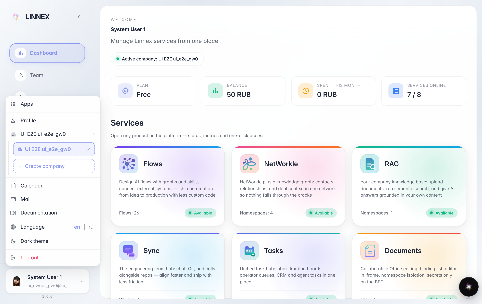
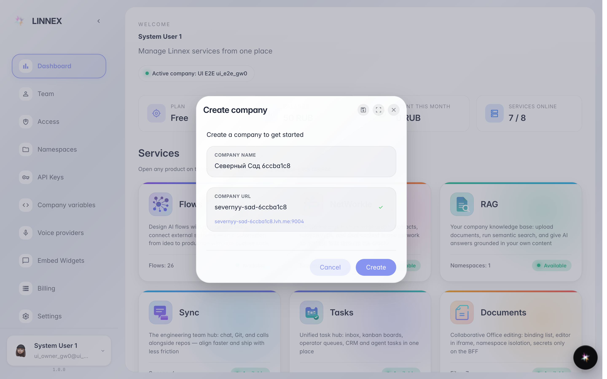
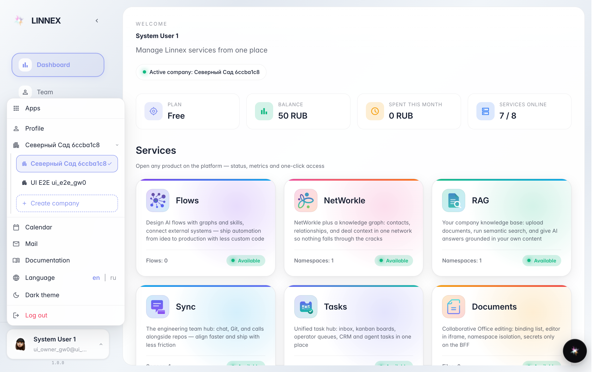

# Создать ещё одну компанию

**Для чего:** один аккаунт может вести несколько компаний — например, отдельное юрлицо или тестовую площадку.

**Какие проблемы решает:** не нужна вторая учётная запись: новая компания создаётся из меню аккаунта и сразу доступна в переключателе.

**Результат:** у вас появилась новая компания, платформа сама переключилась на неё — можно приглашать людей и настраивать.

## Шаг 1. Откройте меню аккаунта и список компаний

Нажмите на своё имя внизу слева, затем на строку с текущей компанией — откроется список ваших компаний и кнопка «Создать компанию».

## Шаг 2. Введите название новой компании

Напишите название — адрес (поддомен) предложится автоматически и может быть поправлен. Кнопка «Создать» запустит компанию.

## Шаг 3. Компания появилась в переключателе

**Демонстрация результата.** Новая компания создана и уже есть в списке — между компаниями можно переключаться в любой момент.

**Итог.** Одной учётной записи хватает на несколько компаний; для каждой — свои люди, данные и настройки.

