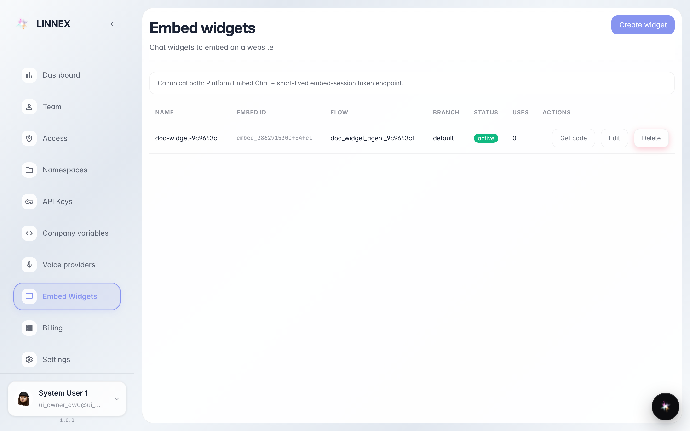
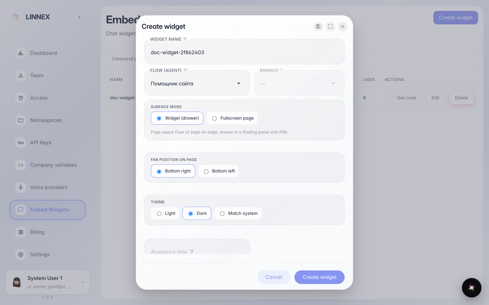
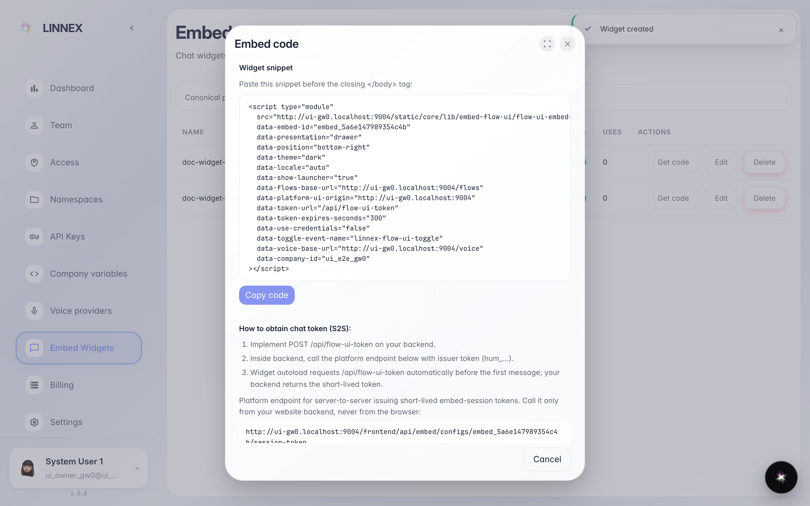

# Agent chat on your site

**Purpose:** the «Embed widgets» page creates a chat window with a company agent that goes onto any site with one line of code.

**Problems solved:** site visitors ask the agent right away — no signup, nothing to install.

**Result:** a ready-to-paste code snippet and the widget in the shared list.

## Step 1. Open «Embed widgets»

The page lists company widgets: name, identifier, the bound agent and status. The «Create widget» button opens the new chat window settings.

## Step 2. Widget name, agent and toggles

In the window write a clear name (e.g. «site chat») and pick the agent that will answer visitors. The toggles below enable voice and conversation restore for the visitor — turn on only what you need.

## Step 3. Paste the code into your site

**Result demonstration.** The widget is created and listed, and «Get code» shows a ready snippet: copy it and hand it to whoever maintains the site — the agent chat appears in the page corner.

**Summary.** Site visitors talk to your agent; the widget can be edited or deleted right in this list.

