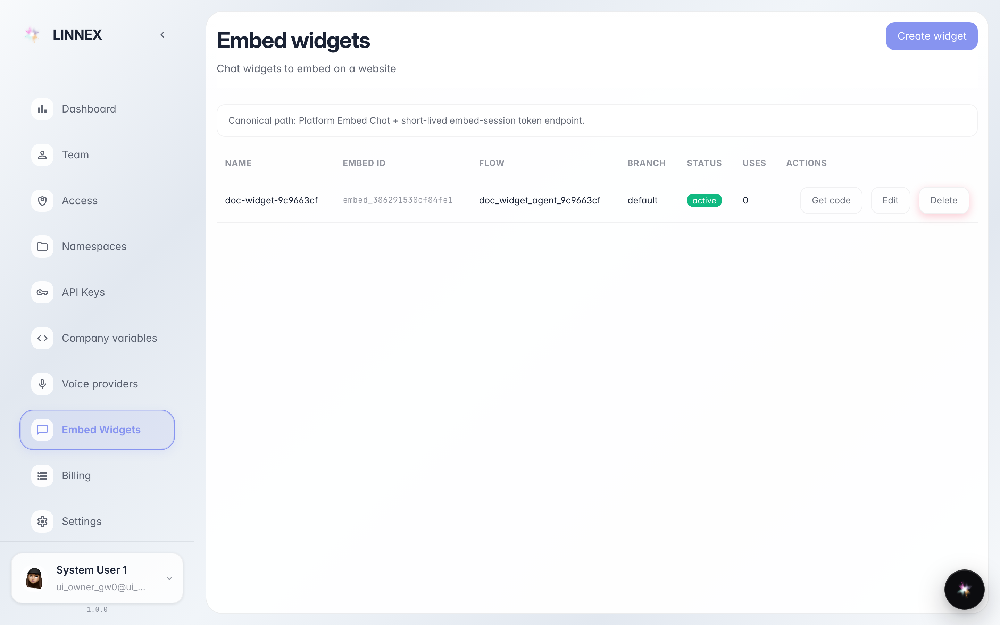
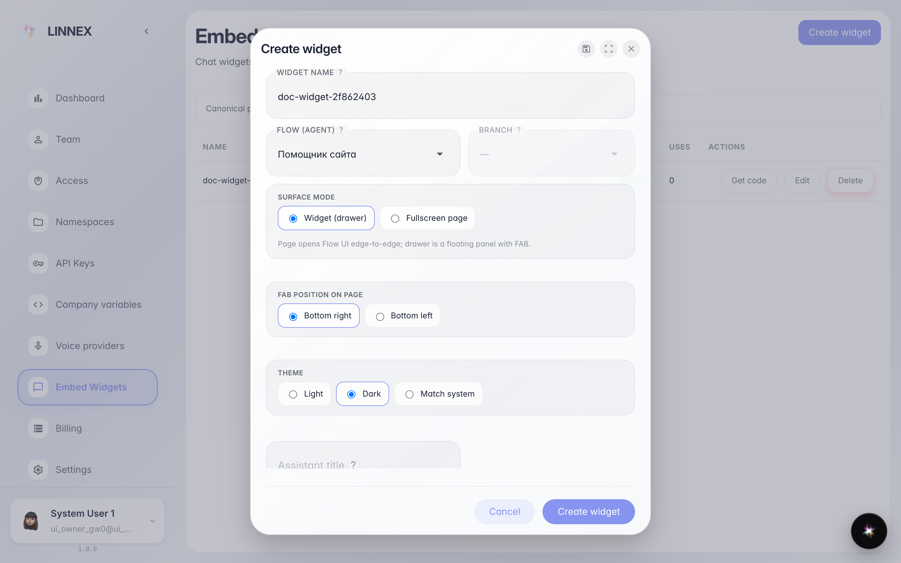
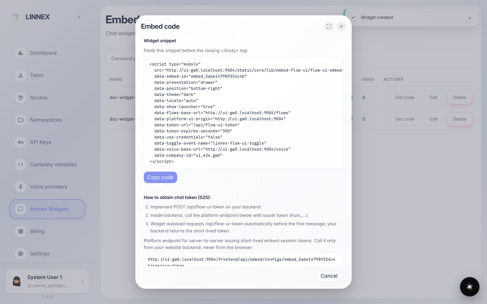

# Чат с агентом на вашем сайте

**Для чего:** страница «Встраиваемые виджеты» создаёт окно чата с агентом компании, которое ставится на любой сайт одной строкой кода.

**Какие проблемы решает:** посетители сайта сразу спрашивают агента — без регистрации и установки чего-либо.

**Результат:** готовый фрагмент кода для вставки и виджет в общем списке.

## Шаг 1. Откройте «Встраиваемые виджеты»

Страница перечисляет виджеты компании: название, идентификатор, привязанный агент и статус. Кнопка «Создать виджет» открывает настройки нового окна чата.

## Шаг 2. Имя, агент и тумблеры виджета

В окне напишите понятное название (например «чат на сайте») и выберите агента, который будет отвечать посетителям. Тумблеры ниже включают голос и сохранение диалога для посетителя — включайте только нужное.

## Шаг 3. Вставьте код на сайт

**Демонстрация результата.** Виджет создан и появился в списке, а кнопка «Получить код» показывает готовый фрагмент: скопируйте его и отдайте тому, кто занимается сайтом — чат с агентом появится в углу страницы.

**Итог.** Посетители сайта говорят с вашим агентом; виджет можно изменить или удалить в этом же списке.

