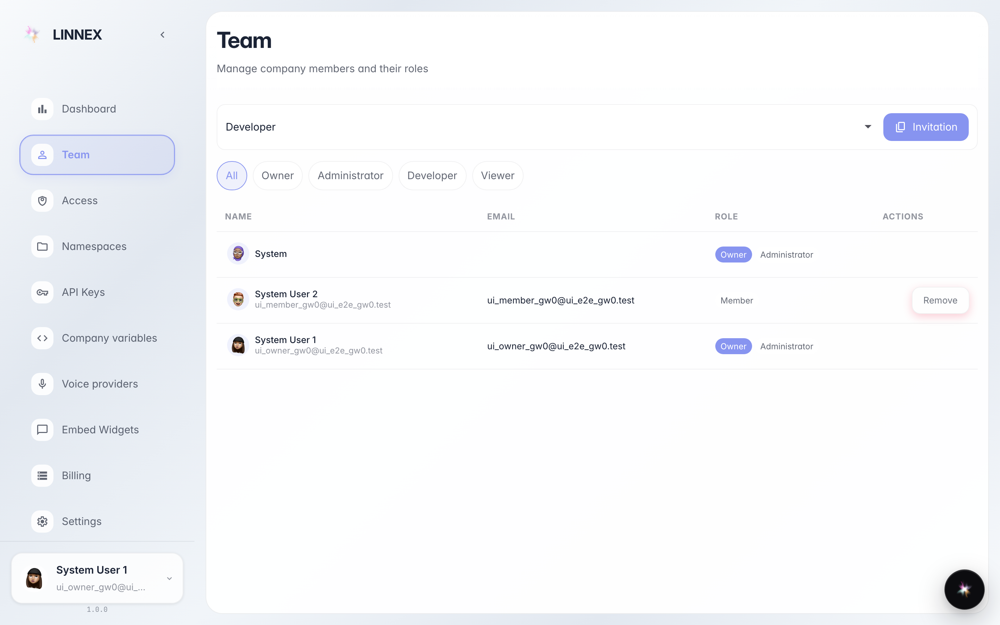
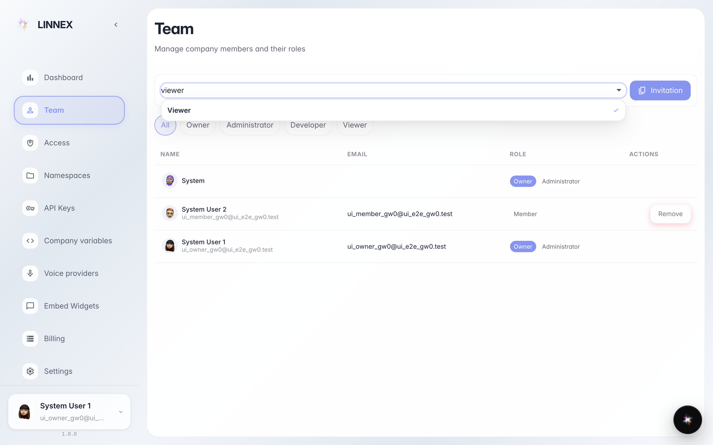
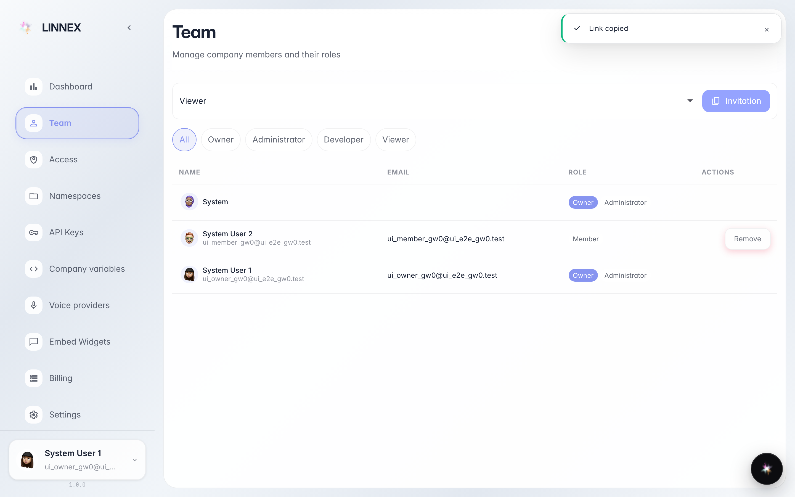

# Invite a colleague with a link

**Purpose:** add a colleague to the company with no technical setup: generate an invite link and send it any way you like (mail, chat, SMS).

**Problems solved:** the new hire has no account yet; with the link they sign up on their own and join with the role you picked.

**Result:** an invite link copied to the clipboard, ready to send.

## Step 1. Open the Team page

In the console open «Team»: the table lists every company member with their roles (owner, admin, developer, viewer). Above the list is the invite row.

## Step 2. Pick the new colleague's role

On the left pick the role whoever uses the link will get: «viewer» can look but not change, «developer» works, «admin» manages. Here we choose «viewer», the safest for someone starting out.

## Step 3. Press «Copy invite» and send the link

**Result demonstration.** The button creates the link (first time) and copies it to the clipboard: the message confirms the link is ready. Paste it into an email or chat: whoever opens it signs up and joins the company with the chosen role.

**Summary.** Invite ready: no password to share, the colleague does everything from the link.

