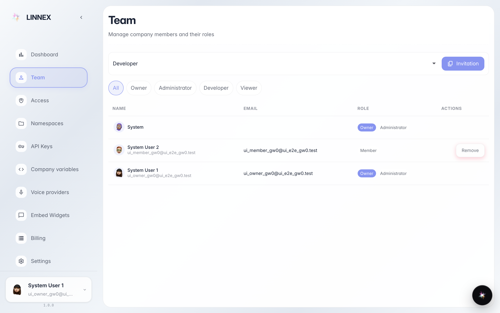
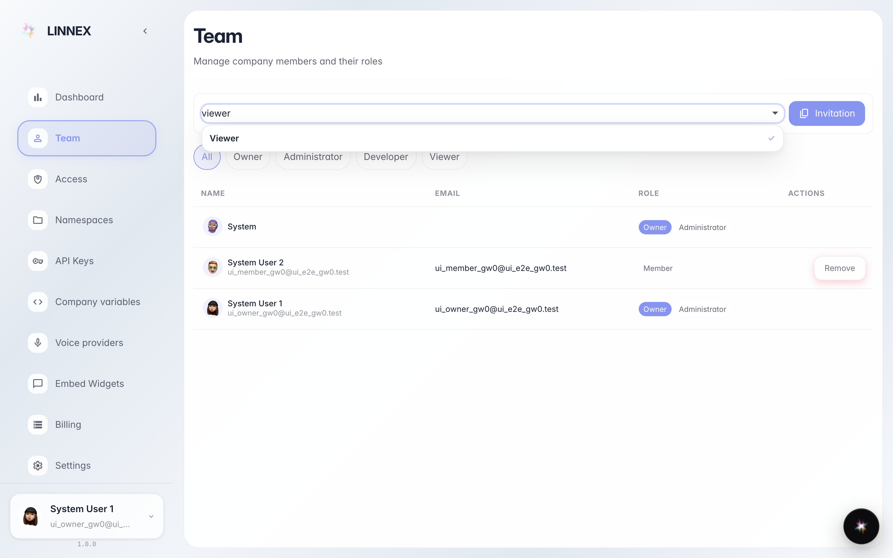
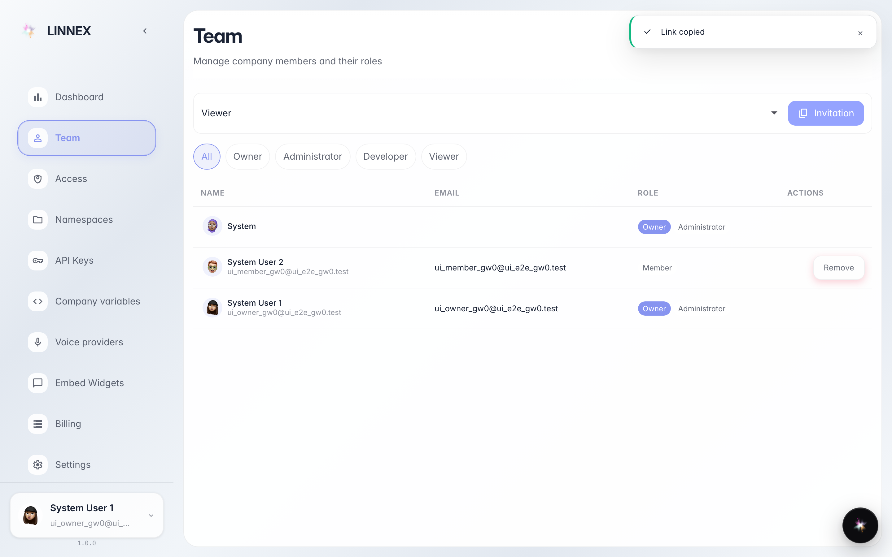

# Пригласить коллегу по ссылке

**Для чего:** добавить коллегу в компанию без технических настроек: создаётся ссылка-приглашение, которую можно отправить как угодно (почта, чат, SMS).

**Какие проблемы решает:** у нового сотрудника ещё нет аккаунта; по ссылке он регистрируется сам и входит с выбранной ролью.

**Результат:** ссылка-приглашение скопирована в буфер обмена и готова к отправке коллеге.

## Шаг 1. Откройте страницу «Команда»

В консоли откройте «Команда»: таблица показывает всех сотрудников компании и их роли (владелец, админ, разработчик, наблюдатель). Над списком — строка приглашения.

## Шаг 2. Выберите роль нового коллеги

Слева выберите, с какой ролью войдёт человек по ссылке: «наблюдатель» смотрит без изменений, «разработчик» работает, «админ» управляет. Здесь выбираем «наблюдатель» — самый осторожный вариант для новичка.

## Шаг 3. Нажмите «Копировать приглашение» и отправьте ссылку

**Демонстрация результата.** Кнопка создаёт ссылку (в первый раз) и копирует её в буфер обмена: сообщение подтверждает, что ссылка готова. Вставьте её в письмо или в чат: открывший её человек регистрируется и входит в компанию с выбранной ролью.

**Итог.** Приглашение готово: пароль сообщать не нужно, коллега делает всё сам по ссылке.

