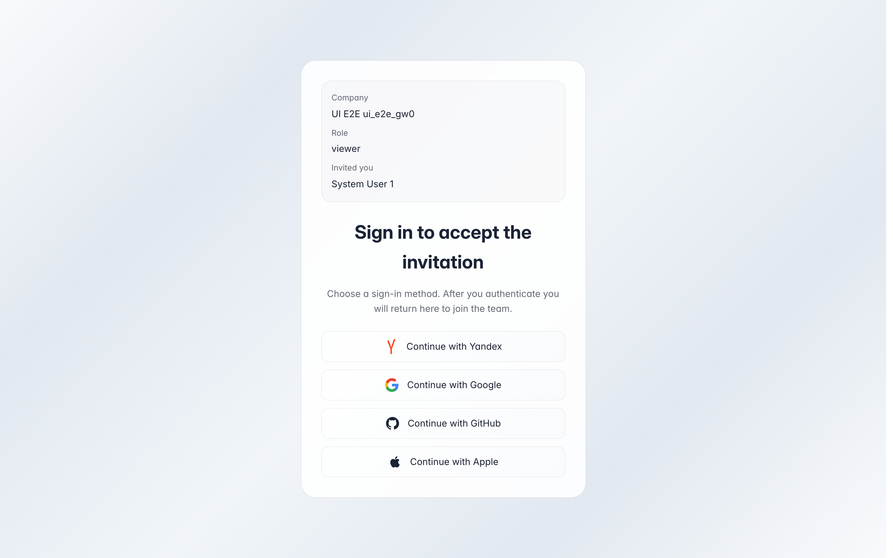
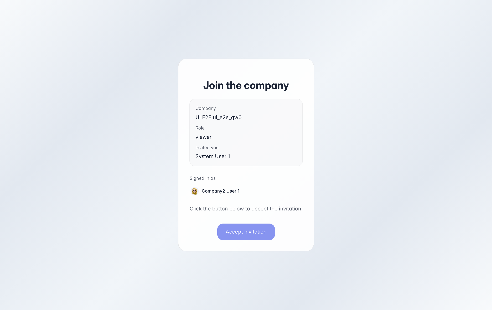
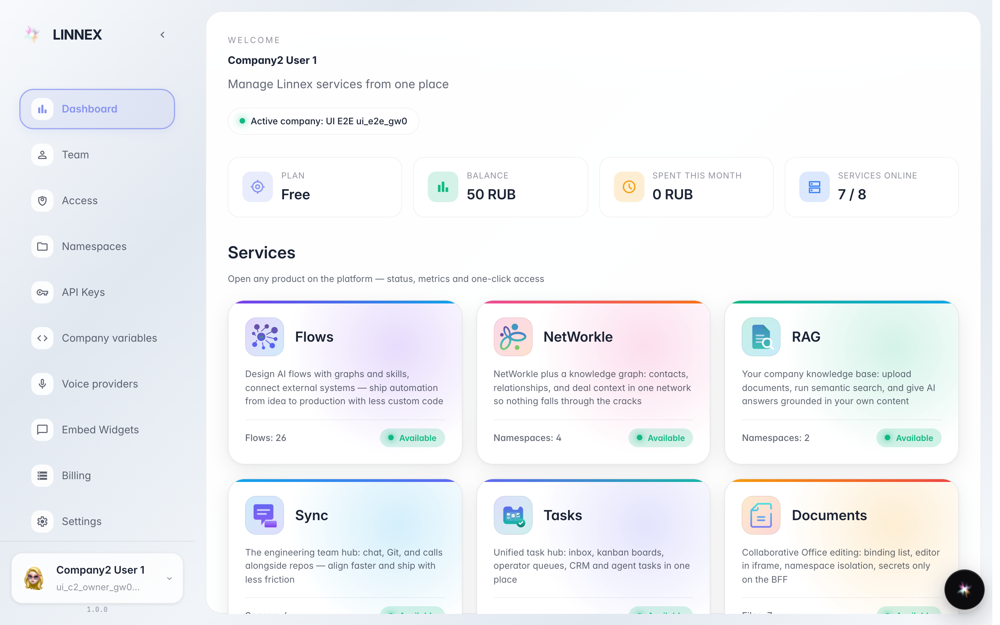

# Join a company via an invite link

**What for:** a colleague sent you an invite link — it takes you into their company with no manual search or signup.

**Problems solved:** no need to know the company address or ask an admin for access: the link itself shows where you are invited and in which role.

**Result:** you accept the invite and the company appears in your list — switch to it and start working.

## Step 1. Open the invite link

The link opens an invite card: the company name, your role and who invited you. Not signed in yet? Pick a familiar service below and confirm — the page brings you back to the invite by itself.

## Step 2. Review and accept the invite

Already signed in? The page shows which account you will join under and the accept button. Check the company and role in the card above — then press Join.

## Step 3. The company is now in your list

**Result demonstration.** The invite is accepted — the company is added to your list. Switch to it via the company picker or the account menu.

**Summary.** The whole path is: link, sign in, Join. No separate passwords or admin requests needed.

