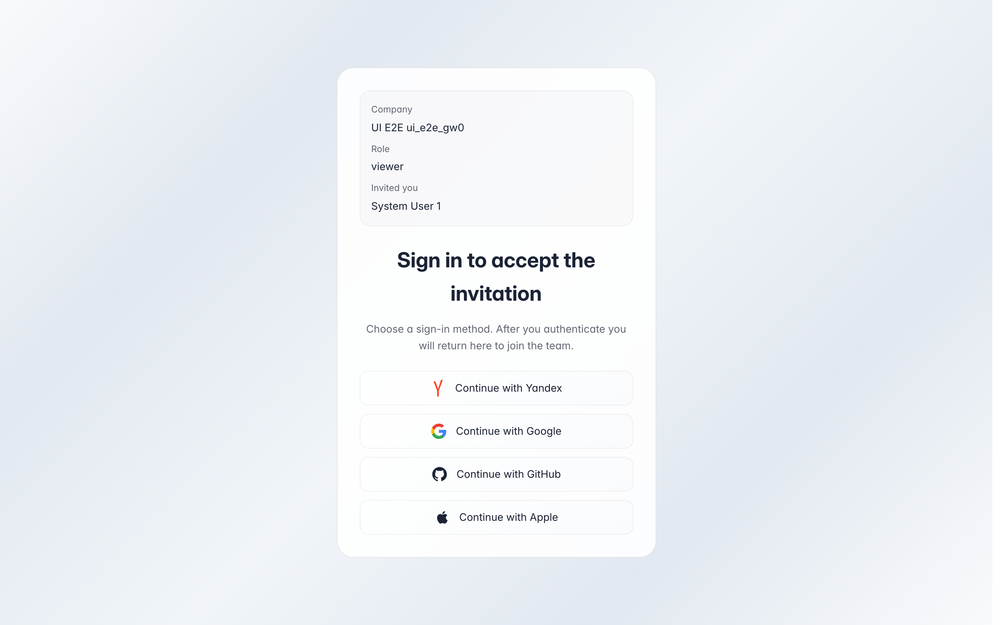
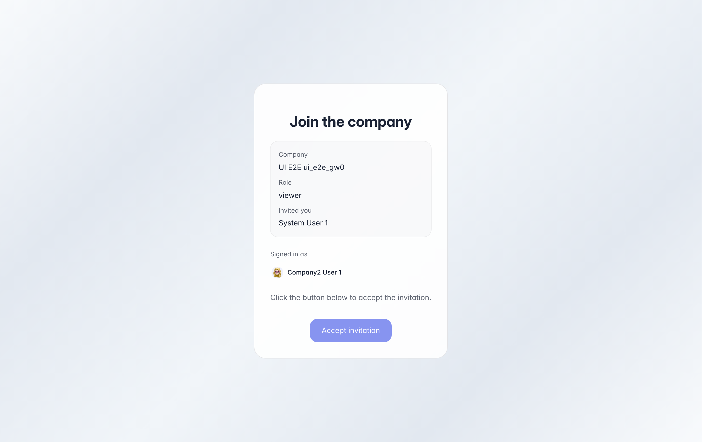
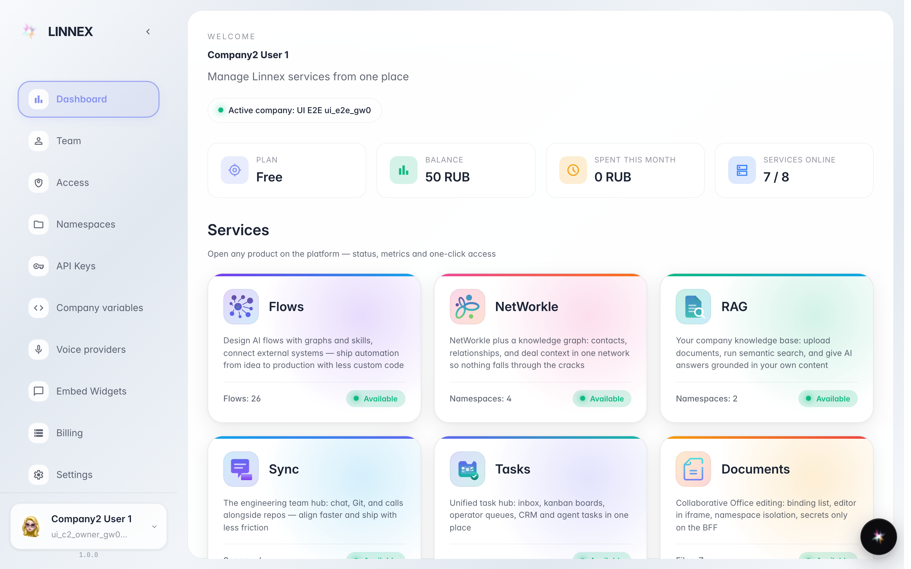

# Войти в компанию по приглашению

**Для чего:** коллега прислал вам ссылку-приглашение — по ней вы попадаете в его компанию без поиска и регистрации вручную.

**Какие проблемы решает:** не нужно знать адрес компании или просить доступ у администратора: ссылка сама показывает, куда вы приглашены и на какую роль.

**Результат:** вы принимаете приглашение и компания появляется в вашем списке — можно переключиться и работать.

## Шаг 1. Откройте ссылку-приглашение

Ссылка открывает карточку приглашения: видно название компании, вашу роль и кто пригласил. Если вы ещё не вошли на платформу — выберите привычный сервис ниже и подтвердите вход; страница сама вернёт вас к приглашению.

## Шаг 2. Проверьте и примите приглашение

Уже вошли? Страница показывает, под какой учётной записью вы присоединитесь, и кнопку принятия. Проверьте компанию и роль в карточке выше — и нажмите «Присоединиться».

## Шаг 3. Компания появилась в вашем списке

**Демонстрация результата.** Приглашение принято — компания добавлена в ваш список. Переключиться на неё можно через страницу выбора компании или меню аккаунта.

**Итог.** Весь путь — ссылка, вход, «Присоединиться». Отдельных паролей и заявок администратору не нужно.

