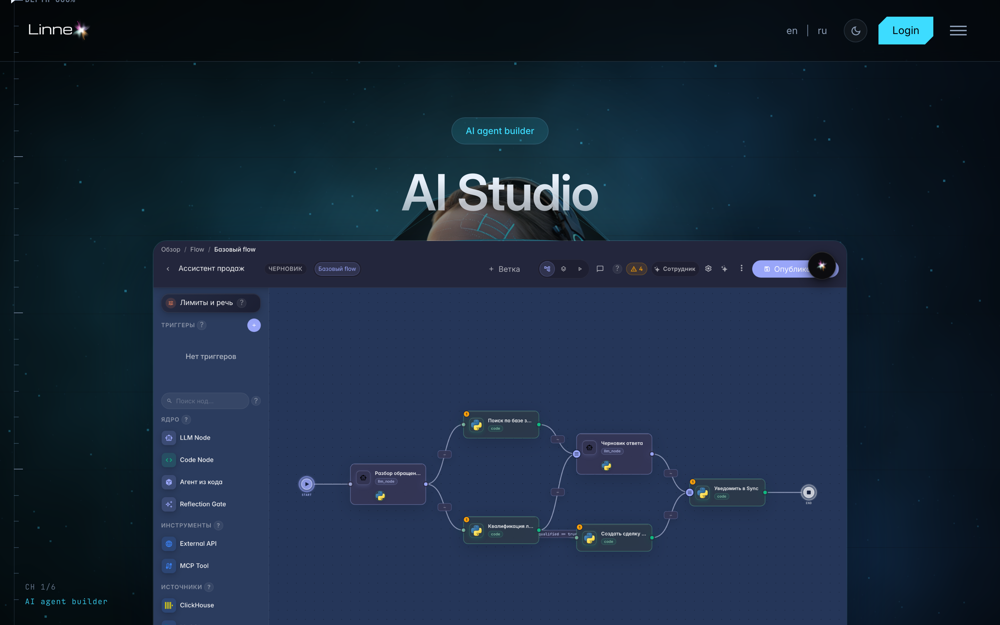
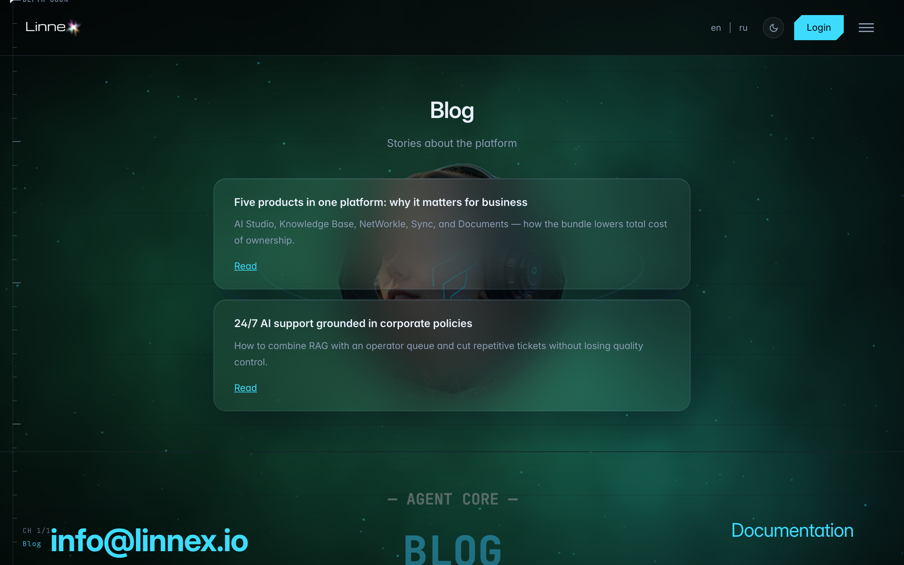
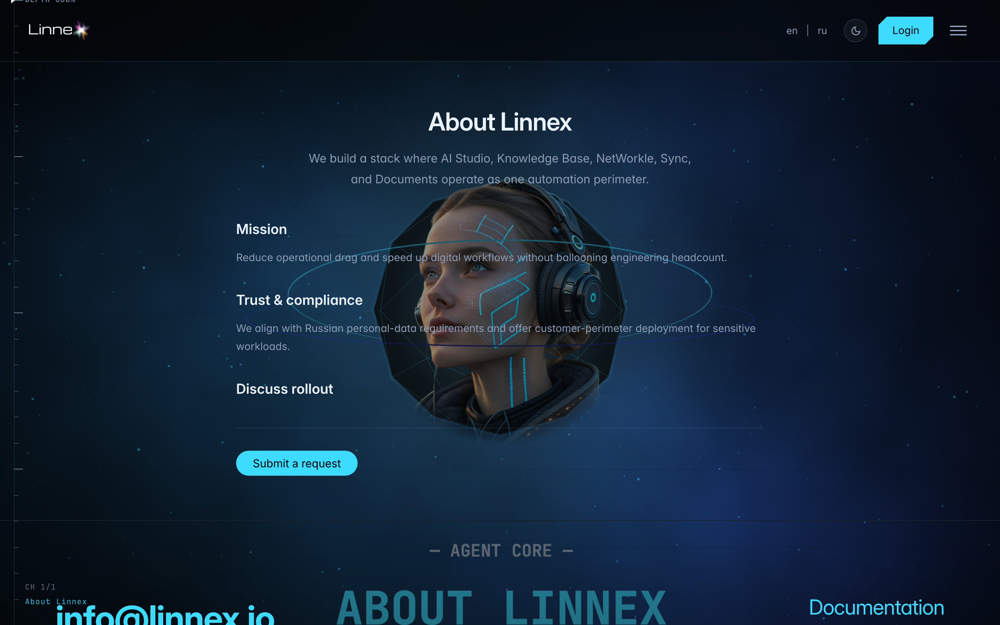

# Public pages: products, blog, about

**What for:** part of the site is open without signing in: product pages, the blog, about and the roadmap.

**Problems solved:** you can study the platform before registering and share a link with a colleague.

**Result:** you know what the public site offers and where the terms and policies live.

## Step 1. Open a product page

The Products section in the site header describes every platform product: agents, tasks, documents, CRM, shop and more — all without signing in.

## Step 2. Look into the blog

The blog posts platform news and usage walkthroughs — a handy way to track updates.

## Step 3. Open About and the legal pages

**Result demonstration.** About holds contacts and the platform description; the footer links terms, privacy policy and the roadmap.

**Summary.** Everything public works without signing in; after registering the same URLs stay available.

