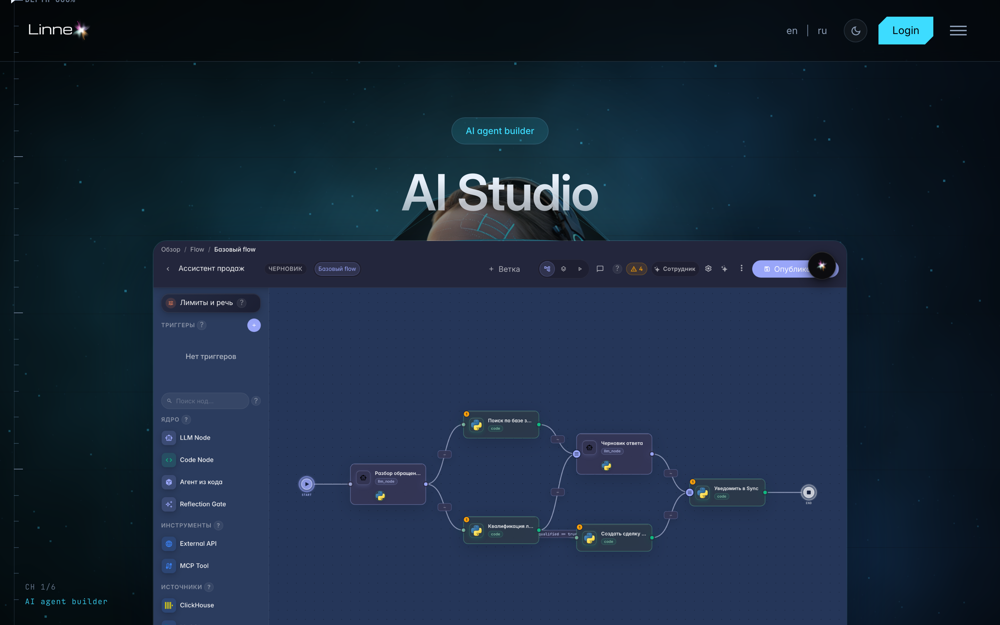
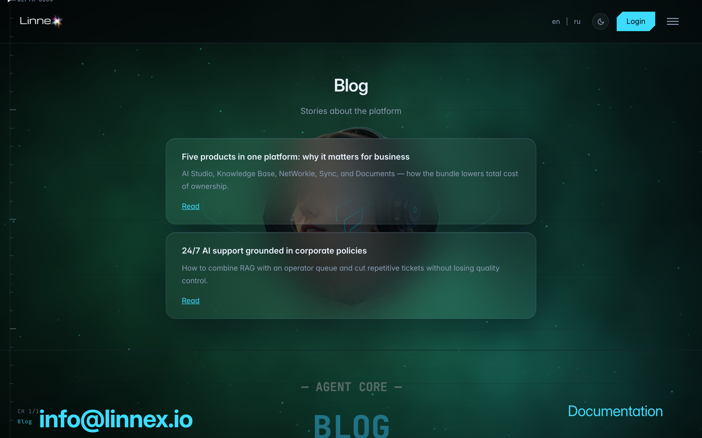
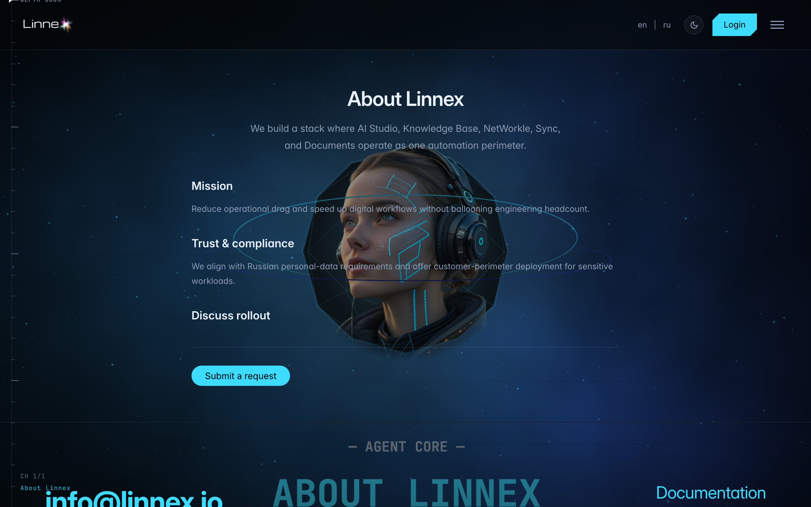

# Публичные страницы: продукты, блог, о компании

**Для чего:** часть сайта открыта без входа: страницы продуктов, блог, информация о компании и роадмап.

**Какие проблемы решает:** можно спокойно изучить платформу до регистрации и поделиться ссылкой с коллегой.

**Результат:** вы знаете, что смотреть на публичном сайте и где лежат условия и политики.

## Шаг 1. Откройте страницу продукта

Раздел «Продукты» в шапке сайта рассказывает о каждом продукте платформы: агенты, задачи, документы, CRM, магазин и другие — всё без входа.

## Шаг 2. Загляните в блог

Блог публикует новости платформы и разборы сценариев использования — удобно следить за обновлениями.

## Шаг 3. Откройте «О компании» и документы

**Демонстрация результата.** На «О компании» — контакты и описание платформы; в футере — условия использования, политика конфиденциальности и роадмап.

**Итог.** Всё публичное доступно без входа; после регистрации эти страницы остаются по тем же адресам.

