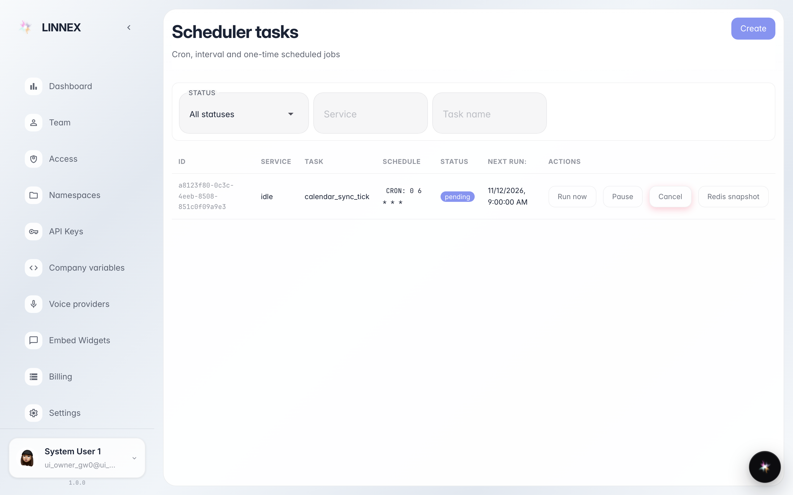
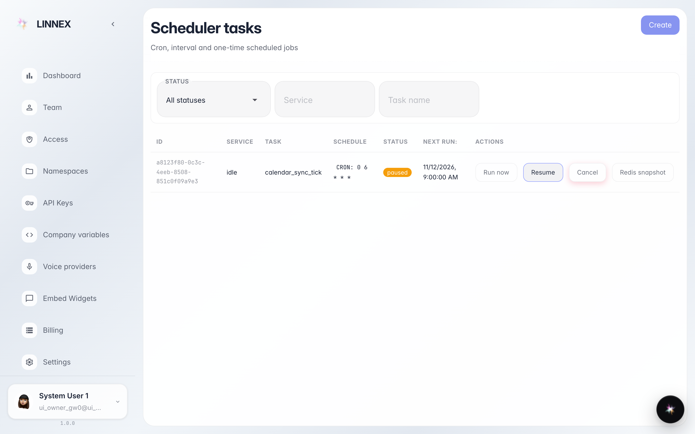

# Scheduled operations

**Purpose:** the «Schedules» page shows the jobs the platform runs by itself at fixed times (syncs, cleanups, checks).

**Problems solved:** know whether an automatic operation ran, is paused or was cancelled without calling support.

**Result:** the schedule list with status and actions (pause, run now, cancel) visible.

## Step 1. Open «Schedules»

The page lists scheduled operations: name, next run and status. The filters on top narrow by type or status when the list is long.

## Step 2. Status and actions on each row

**Result demonstration.** Pressing «Pause» flips the job status to «paused»: it will not fire until «Resume» brings it back. Next to it are «Run now» and «Cancel».

**Summary.** Automatic operations are under control: you see them, and you can stop or start them yourself.

