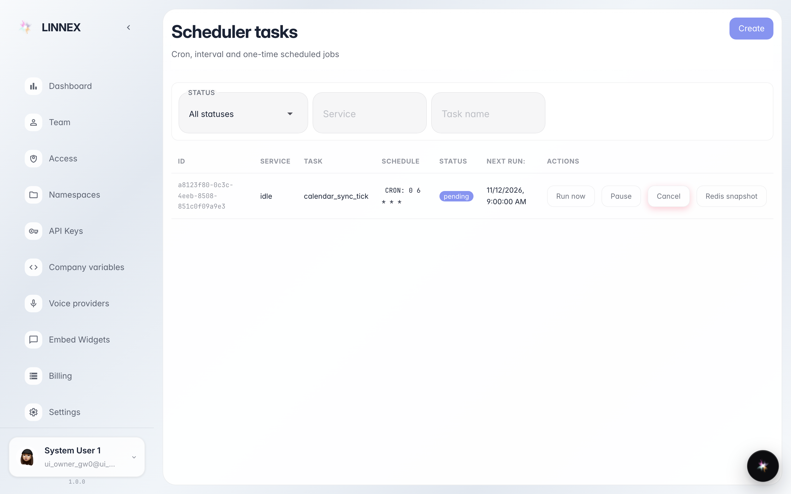
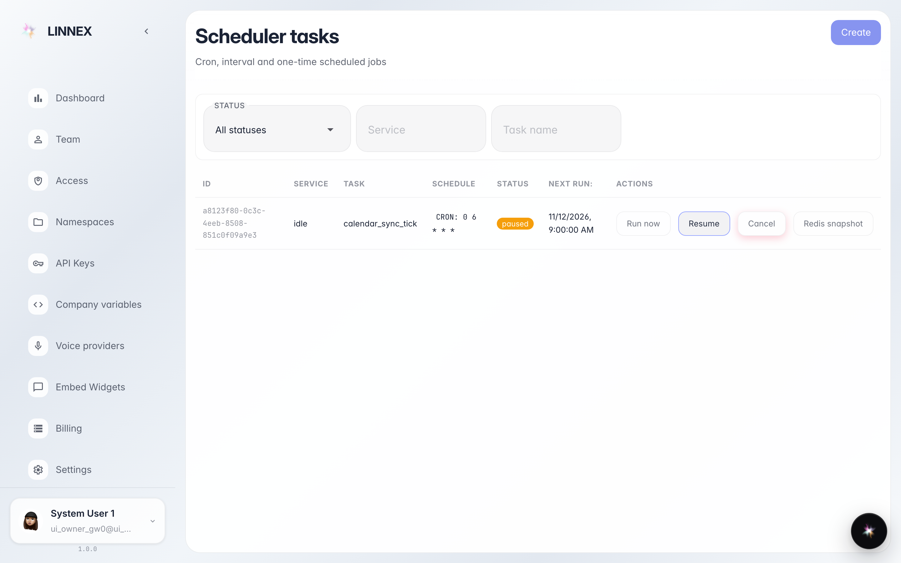

# Запланированные операции

**Для чего:** страница «Расписания» показывает работы, которые платформа выполняет сама в заданное время (синхронизации, очистки, проверки).

**Какие проблемы решает:** понять, запустилась ли автоматическая операция, стоит ли на паузе или отменена — без обращения в поддержку.

**Результат:** список расписаний со статусом и действиями (пауза, запустить сейчас, отменить) на виду.

## Шаг 1. Откройте «Расписания»

Страница перечисляет запланированные операции: имя, следующий запуск и статус. Фильтры вверху сужают список по типу или статусу, когда он длинный.

## Шаг 2. Статус и действия каждой строки

**Демонстрация результата.** Нажали «Пауза» — статус работы сменился на «paused»: она не запустится, пока её не вернуть кнопкой «Возобновить». Рядом — «Запустить сейчас» и «Отменить».

**Итог.** Автоматические операции под контролем: вы их видите и можете остановить или запустить сами.

