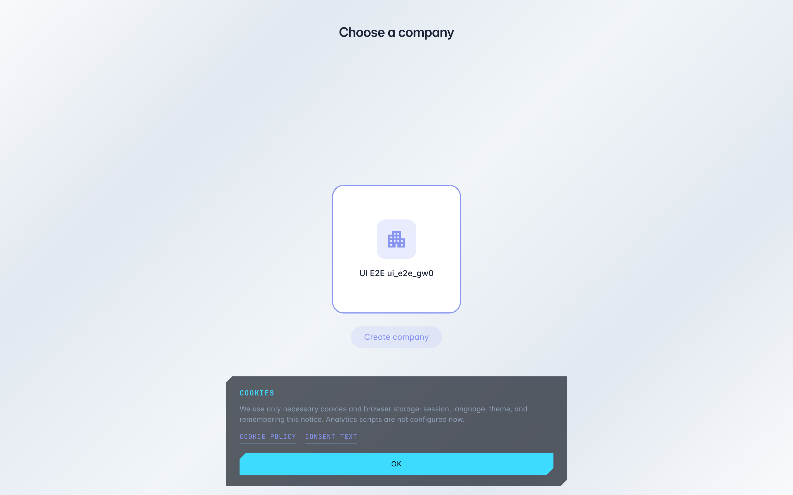

# Choose which company to work in

**Purpose:** one account can belong to several companies — e.g. your firm and a client's company. The «Choose company» page switches who you are working on behalf of.

**Problems solved:** you signed in but see someone else's data — the wrong company is active; switch it in one click here.

**Result:** the right company selected — the console shows its projects, team and settings.

## Step 1. Open the company picker

Each card is a company you belong to. The active one is highlighted: its data is what you currently see in the console. With several companies just click the card you need.

## Step 2. Click a card or create a company

**Result demonstration.** The active company is marked with a colored border — clicking another card switches the console to it. «Create company» registers a new organisation: for a separate business or a client.

**Summary.** Switching takes a second; switch back the same way — via this page or the user menu.

