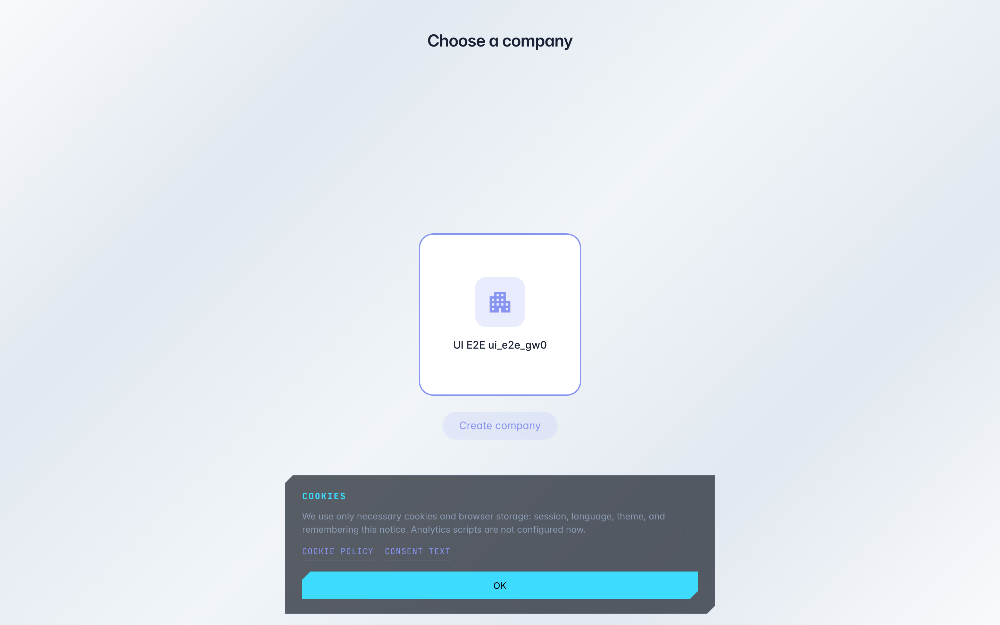

# Выбрать компанию для работы

**Для чего:** один аккаунт может состоять в нескольких компаниях — например, ваша фирма и компания клиента. Страница «Выберите компанию» переключает, от чьего имени вы работаете.

**Какие проблемы решает:** вы вошли, но видите чужие данные — значит активна не та компания; здесь она меняется одним нажатием.

**Результат:** выбрана нужная компания — консоль показывает именно её проекты, команду и настройки.

## Шаг 1. Откройте страницу выбора компании

Каждая карточка — компания, где вы состоите. Активная подсвечена рамкой: именно её данные вы сейчас видите в консоли. Если компаний несколько — просто нажмите на нужную карточку.

## Шаг 2. Нажмите карточку или создайте компанию

**Демонстрация результата.** Активная компания отмечена цветной рамкой — нажатие на другую карточку переключит консоль на неё. Кнопка «Создать компанию» заводит новую организацию: для отдельного бизнеса или клиента.

**Итог.** Переключение занимает секунду; вернуться можно так же — через эту страницу или меню пользователя.

