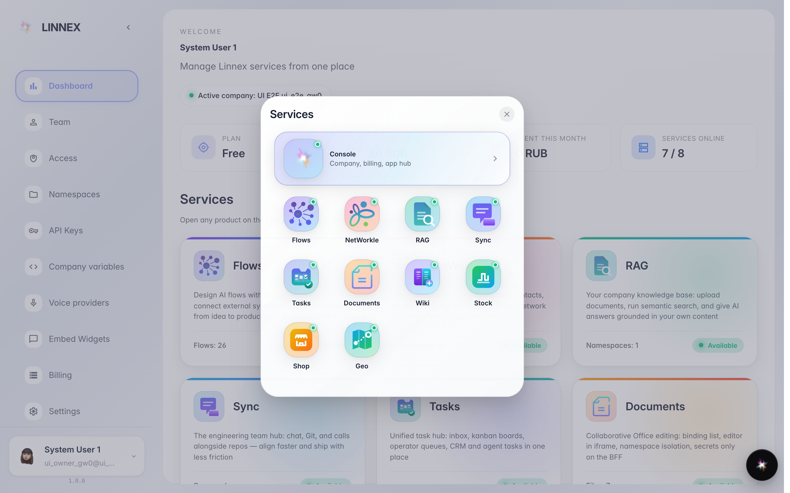
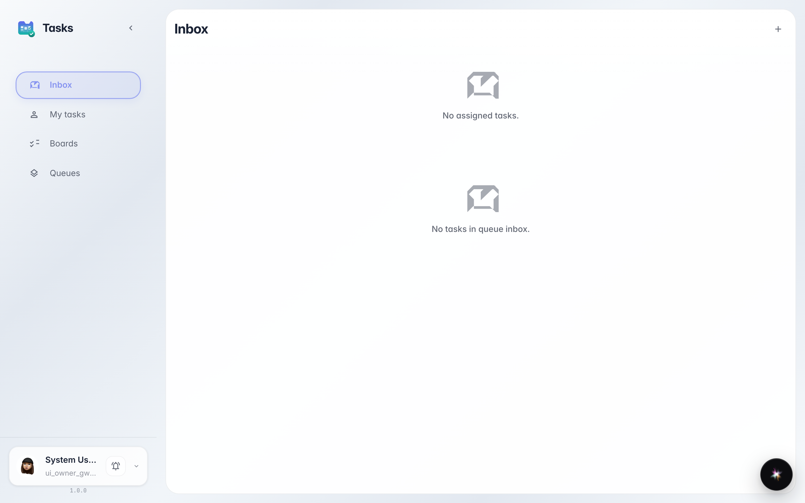

# Services hub: open another product

**What for:** the platform is several products (Tasks, Documents, Chat and more). The hub opens any of them in one click.

**Problems solved:** no addresses to remember — every product sits in one grid with its status.

**Result:** you are inside the right product and know how to get back.

## Step 1. Open the services hub

The logo button at the top of the sidebar (or the Apps item in the account menu) opens a grid of every platform product with its status.

## Step 2. Open a product from the hub

**Result demonstration.** The Tasks tile opened the tasks app — Flows, Documents, Chat and the rest launch the same way.

**Summary.** Every product opens from the services hub or the dashboard.

