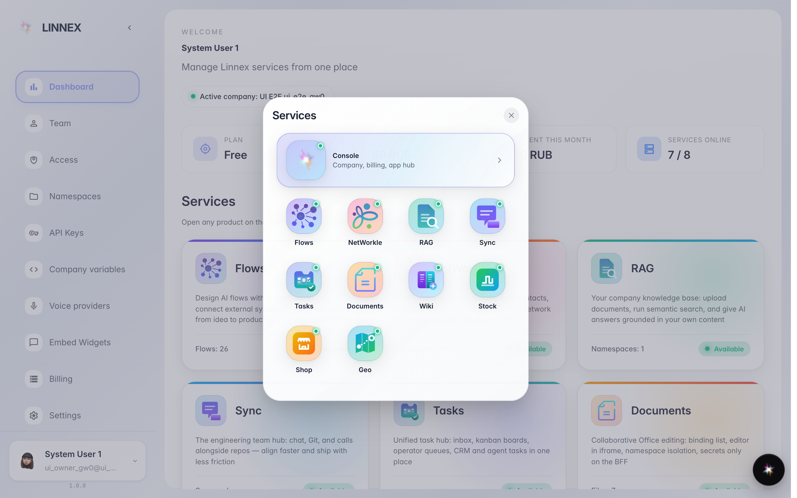
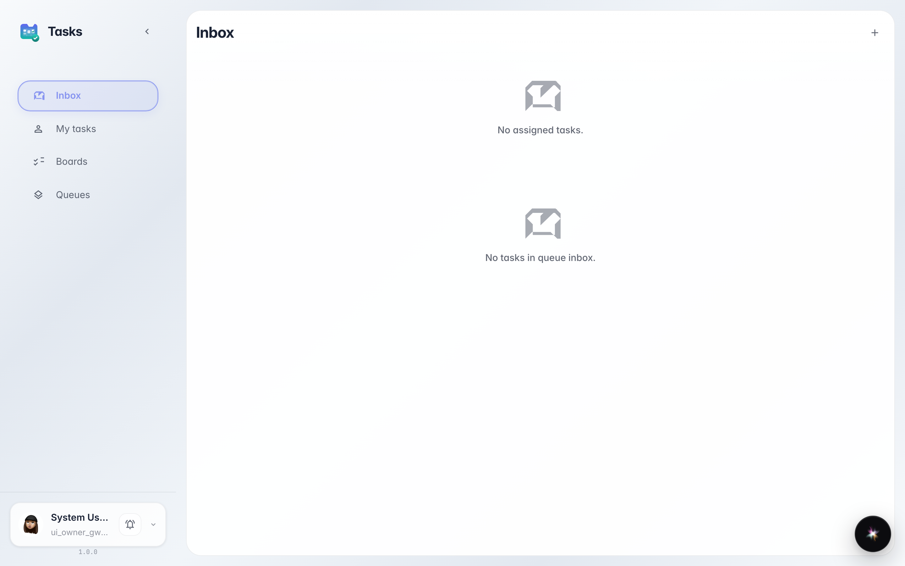

# Каталог сервисов: открыть другой продукт

**Для чего:** платформа — это несколько продуктов (Задачи, Документы, Чат и другие). Каталог открывает любой из них в один клик.

**Какие проблемы решает:** не нужно помнить адреса и выходить в меню браузера — все продукты собраны в одной сетке со статусами.

**Результат:** вы внутри нужного продукта и понимаете, как туда попадать снова.

## Шаг 1. Откройте каталог сервисов

Кнопка с логотипом вверху боковой панели (или пункт Apps в меню аккаунта) открывает сетку всех продуктов платформы с их статусами.

## Шаг 2. Откройте продукт из каталога

**Демонстрация результата.** Плитка «Tasks» открыла приложение задач — так же запускаются Flows, Документы, Чат и остальные продукты.

**Итог.** Вход в каждый продукт — из каталога сервисов или из дашборда.

