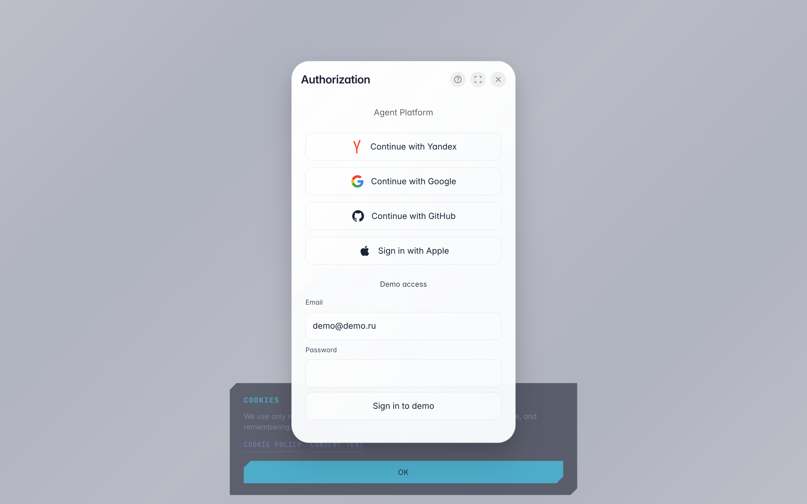

# Sign in to the platform

**Purpose:** signing in to the company console — the page offers a familiar service, no separate platform password needed.

**Problems solved:** no extra password to remember; signing in via Yandex, Google or GitHub takes a couple of clicks.

**Result:** you are inside the company console — projects, team and all sections are visible.

## Step 1. Open the sign-in page

The sign-in page offers authorization methods: pick the service you already use — Yandex, Google or GitHub — and confirm on its side. No separate platform password is needed.

## Step 2. Pick a sign-in method

**Result demonstration.** After confirming with the chosen service you land right in the company console. A colleague's invite leads to this same page — just sign in and the company appears by itself.

**Summary.** If sign-in fails, make sure you authorized with the right account in the chosen service, or contact support (the question icon at the top of the window).

